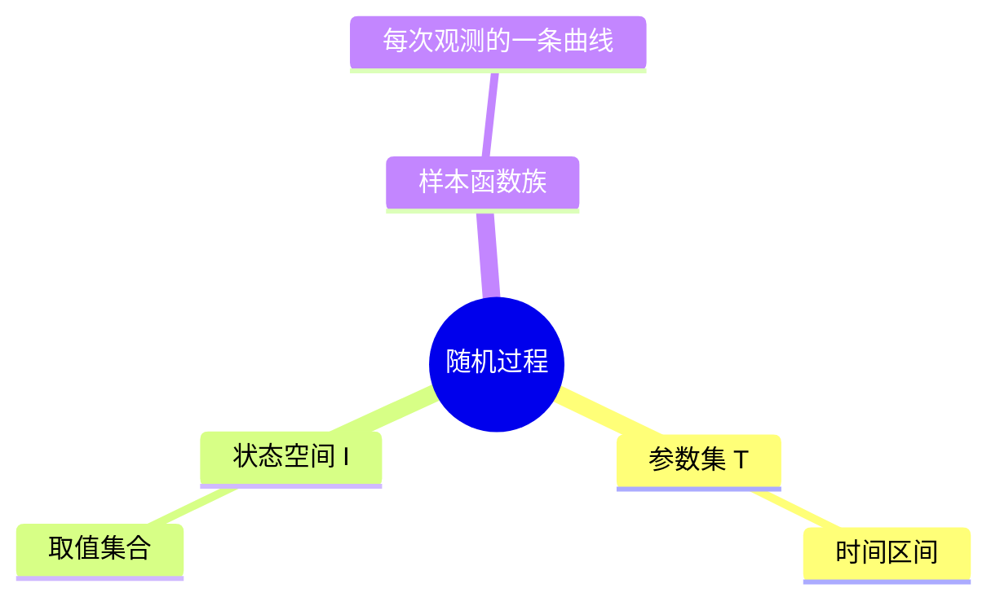

# 随机过程的定义与样本函数

## 随机过程的定义与样本函数

### 从随机变量到随机过程

我们已经熟悉随机变量 $X$：做一次试验，得到一个数。现在把“试验”扩展为“全程观测”——在不同时刻 $t$ 重复观测同一个随机现象，每次得到的不再是一个数，而是一条随时间变化的曲线。

> [!NOTE]
> 随机过程可理解为**一族随时间（或参数）变化的随机变量**，而不仅仅是一条“不确定的曲线”。

设 $T$ 是一无限实数集，把依赖于参数 $t \in T$ 的一族随机变量称为随机过程，记为

$$
\{X(t), \; t \in T\}
$$

其中对每一个固定的 $t \in T$，$X(t)$ 是一个随机变量。参数集 $T$ 常取为时间区间，如 $[0,+\infty)$ 或 $(-\infty,+\infty)$。

### 状态空间与样本函数

在时刻 $t$，$X(t)$ 的具体取值称为过程在该时刻的**状态**；对一切 $t \in T$，$X(t)$ 所有可能取值的全体称为**状态空间**。

> [!IMPORTANT]
> 状态空间是对**取值集合**的描述，参数集是对**时间范围**的描述，二者不要混淆。例如泊松过程的状态空间是 $\{0,1,2,\cdots\}$，参数集是 $[0,+\infty)$。

对随机过程进行一次全程观测，得到的结果是参数 $t$ 的一个函数，记为

$$
x(t), \quad t \in T
$$

称为随机过程的一个**样本函数**或**样本曲线**。所有可能的样本函数构成一个**样本函数族**，可以包含有限个或无限个结果。

### 一个算对了的例子

设随机过程

$$
X(t) = A \cos(\omega t), \quad -\infty < t < +\infty
$$

其中 $\omega$ 为常数，$A \sim N(0,1)$。对固定的 $t$，$X(t)$ 是随机变量；每给定一个 $A$ 的样本值 $a$，就得到一条样本函数

$$
x(t) = a \cos(\omega t)
$$

它是振幅随机的余弦曲线。其均值函数为

$$
m_X(t) = E[X(t)] = \cos(\omega t)\,E[A] = 0
$$

协方差函数为

$$
C_{XX}(t_1, t_2) = \cos(\omega t_1)\cos(\omega t_2)\,E[A^2] = \cos(\omega t_1)\cos(\omega t_2)
$$

> [!TIP]
> 计算数字特征时，把随机变量部分（如 $A$）与时间函数部分（如 $\cos \omega t$）分开处理，先对随机变量求期望，可显著简化运算。

### 常见的坑

> [!WARNING]
> 不要把“样本函数”与“某一时刻的随机变量”等同。样本函数 $x(t)$ 是**整条曲线**，而 $X(t_0)$ 是固定时刻的一个随机变量。两者观察维度不同：前者是试验结果，后者是随机变量。

> [!CAUTION]
> 状态空间可以是离散集合，也可以是连续区间；参数集同样如此。不能说“随机过程一定是时间连续、状态离散”之类的话，必须分别说明。

随机过程的定义本身不描述各时刻状态之间的**依赖关系**，这一点要等到后续引入有限维分布与数字特征后才逐步刻画。
