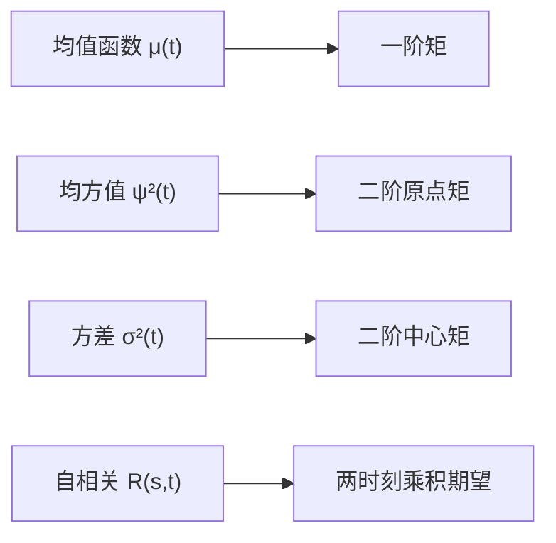

# 随机过程的数字特征（均值函数、方差函数、均方值函数）

## 为什么需要这些数字特征

随机过程 $\{X(t), t\in T\}$ 是**一族**随机变量，不是单个变量。要想像描述随机变量那样描述它，就得把“期望、方差”推广成**关于时间 $t$ 的函数**。若对每个 $t$，$E[X^2(t)]$ 都存在，则称为 ==二阶矩过程==，此时相关函数总存在。

## 它是什么

设 $\{X(t)\}$ 为随机过程，定义如下数字特征：

$$
\mu_X(t)=E[X(t)]
$$

$$
\psi_X^2(t)=E[X^2(t)]
$$

$$
\sigma_X^2(t)=D_X(t)=\operatorname{Var}[X(t)]=E\{[X(t)-\mu_X(t)]^2\}
$$

$$
R_X(t_1,t_2)=E[X(t_1)X(t_2)]
$$

- 均值函数：一阶矩，看**平均水平随时间怎么变**
- 均方值函数：二阶原点矩
- 方差函数：二阶中心矩，看**波动程度随时间怎么变**
- 自相关函数：二阶原点混合矩，刻画**两个时刻的线性相关性**

> [!NOTE]
> 方差函数与自协方差函数关系是核心：
> $$C_X(t_1,t_2)=R_X(t_1,t_2)-\mu_X(t_1)\mu_X(t_2)$$
> 且当 $t_1=t_2=t$ 时，$C_X(t,t)=\sigma_X^2(t)$。

## 和相近概念的区别

| 名称 | 记号 | 中心化？ | 作用 |
|---|---|---|---|
| 均值函数 | $\mu_X(t)$ | 否 | 平均水平 |
| 均方值函数 | $\psi_X^2(t)$ | 否 | 二阶原点矩 |
| 方差函数 | $\sigma_X^2(t)$ | 是 | 自身波动 |
| 自相关函数 | $R_X(t_1,t_2)$ | 否 | 两时刻相关性 |

> [!WARNING]
> 常见坑：把均方值函数当方差函数。只有 $\mu_X(t)=0$ 时才有 $\psi_X^2(t)=\sigma_X^2(t)$。

## 怎么做：一个算对了的例子

**例**：$X(t)=A\cos\omega t+B\sin\omega t$，$A,B$ 独立且 $A,B\sim N(0,\sigma^2)$，$\omega$ 常数。求证 $X(t)$ 是正态过程，并求均值函数和相关函数。

先想一步：固定任意 $t$，$X(t)$ 是 $A,B$ 的线性组合，所以服从正态分布；任意有限个时刻的线性组合仍正态，故是正态过程。

**均值函数**：

$$
\mu_X(t)=E[A]\cos\omega t+E[B]\sin\omega t=0
$$

**自相关函数**（因均值为 0，相关函数即协方差函数）：

$$
\begin{aligned}
R_X(s,t)&=E[(A\cos\omega s+B\sin\omega s)(A\cos\omega t+B\sin\omega t)]\\
&=E[A^2]\cos\omega s\cos\omega t+E[B^2]\sin\omega s\sin\omega t\\
&=\sigma^2(\cos\omega s\cos\omega t+\sin\omega s\sin\omega t)\\
&=\sigma^2\cos\omega(s-t)
\end{aligned}
$$

> [!TIP]
> 关键跳步：由独立性，$E[AB]=0$，交叉项全消失；再用和差化积 $\cos(a-b)=\cos a\cos b+\sin a\sin b$。

**方差函数**：令 $s=t$，

$$
\sigma_X^2(t)=R_X(t,t)=\sigma^2\cos 0=\sigma^2
$$

说明该过程方差不随时间变。

> [!IMPORTANT]
> 对正态过程而言，==全部统计特性完全由均值函数和协方差函数（相关函数）确定==；本题均值为 0、相关函数只依赖时间差 $s-t$，正是宽平稳的典型结构。
