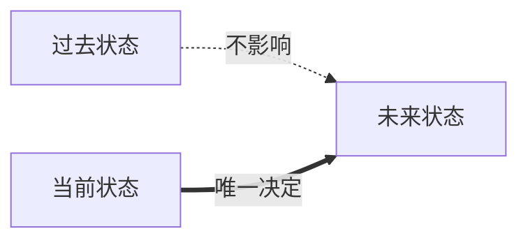

# 马尔可夫性（无后效性）

---
requires: [概率论与数理统计/条件概率, 概率论与数理统计/随机过程的基本概念]
---

想象你每天记录天气。如果已知“今天是晴天”，要预测“明天是否下雨”，你还需要去翻看前天、大前天的天气吗？直觉告诉我们：不需要。只要知道了“现在”的状态，“过去”的历史对预测“未来”就不再提供额外信息。这种特性，就是马尔可夫性。

## 它是什么

> [!IMPORTANT]
> 马尔可夫性（无后效性）是指：当随机过程在时刻 $t_0$ 所处的状态为已知的条件下，过程在时刻 $t > t_0$ 所处的状态，与过程在 $t_0$ 时刻以前所处的状态无关，而仅与过程在 $t_0$ 时刻的状态有关。

用分布函数严格表述：设随机过程 $\{X(t), t \in T\}$ 的状态空间为 $I$，对任意 $n$ 个时间值 $t_1 < t_2 < \dots < t_n$（$n \geq 3, t_i \in T$），若条件分布满足：

$$
P\{X(t_n) \leq x_n \mid X(t_1)=x_1, \dots, X(t_{n-1})=x_{n-1}\} = P\{X(t_n) \leq x_n \mid X(t_{n-1})=x_{n-1}\}
$$

则称该过程具有==马尔可夫性==，并称此过程为马尔可夫过程。公式的直观含义是：等式左边的一大串历史条件，可以被“压缩”成右边只保留最近一个时刻 $t_{n-1}$ 的条件。

## 为什么需要它

如果不具备马尔可夫性，计算未来的概率分布就需要把从初始时刻到当前的所有历史状态全部纳入条件中，随着时间推移，计算量会呈指数级爆炸。

引入无后效性后，==系统的未来演化只依赖于当前状态==。这使得我们只需关注相邻两个时刻之间的“转移概率”，从而引出后续的核心工具——转移矩阵 $P(n)$，并让绝对分布 $\overrightarrow{p(n)} = \overrightarrow{p(0)} \cdot P^n$ 的计算成为可能。

## 怎么做：验证与应用

判断一个过程是否具有马尔可夫性，核心步骤是写出条件概率，看能否消去更早的历史项。

**算例引导**：设离散状态马氏链 $\{X_n, n=0,1,2,\dots\}$，状态空间 $I=\{0, 1\}$。已知一步转移矩阵为 $P$。求 $P(X_2=1 \mid X_0=0, X_1=1)$。

根据马尔可夫性，既然已经知道了 $X_1=1$，那么 $X_0=0$ 这个历史信息就是多余的。因此直接化简：

$$
P(X_2=1 \mid X_0=0, X_1=1) = P(X_2=1 \mid X_1=1) = P_{11}(1)
$$

这就是无后效性的直接应用：==大胆划掉多余的历史条件==，只保留距离目标时刻最近的那个状态。

## 相近概念辨析

| 比较维度 | 马尔可夫过程 | 马尔可夫链（马氏链） |
| :--- | :--- | :--- |
| **时间参数 $T$** | 可以连续也可以离散 | ==必须离散==（如 $T_1=\{0,1,2,\dots\}$） |
| **状态空间 $I$** | 可以连续也可以离散 | ==必须离散== |
| **关系** | 广义概念 | 时间和状态都离散的马尔可夫过程 |

> [!NOTE]
> 马尔可夫性是“灵魂”，马尔可夫链是“肉体”。只有同时满足时间离散、状态离散，且具有马尔可夫性的过程，才能称为马尔可夫链。

## 常见的坑

> [!WARNING]
> 无后效性成立的前提是==“当前状态已知”==。如果题目给定的条件是 $P(X_2=1 \mid X_0=0)$，中间跳过了 $X_1$，此时不能直接套用马尔可夫性划掉 $X_0$！你需要利用全概率公式，通过一步转移概率 $P_{ij}$ 将 $X_1$ 的所有可能状态展开求和。

> [!CAUTION]
> 不要把“独立”和“无后效性”搞混。独立性意味着 $P(X_2 \mid X_1) = P(X_2)$，即未来连当前状态都不依赖；而无后效性是 $P(X_2 \mid X_1, X_0) = P(X_2 \mid X_1)$，未来依然依赖当前状态，只是不依赖更早的历史。

> [!TIP]
> 记忆口诀：**“已知现在，过去作废”**。在做题时看到长串条件概率，先找最靠近目标时刻的那个条件，把它单独拎出来，其余的全部砍掉。
