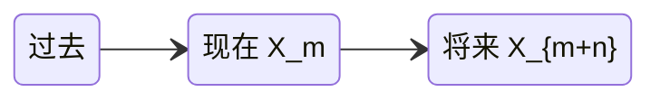

# 马尔可夫链的定义
先从一个问题开始：如果只告诉你“今天天气如何”，你能预测明天天气吗？更进一步，如果已经知道今天、昨天、前天……整整一周的天气，你对明天天气的把握会比只知道今天时更准吗？

如果一个过程满足——**==在已知“现在”的条件下，“将来”与“过去”条件独立==**——那么记住再多历史也没用。这就是马尔可夫性（无后效性）。

> [!IMPORTANT]
> **马尔可夫链**是指时间与状态都离散的马尔可夫过程，简记为 $\{X_n = X(n),\, n=0,1,2,\dots\}$。它满足对任意时刻 $m$ 与任意状态 $a_i,a_j$：下一时刻只由当前状态决定，与更早历史无关。

**为什么需要马尔可夫链？** 很多实际问题——通信信道状态、设备故障、排队系统、天气演变——只依赖当前状态，历史信息要么不可得，要么作用已被“当前状态”完全总结。马尔可夫链用最少的参数刻画这类系统，计算简洁且可解释。

“离散”体现在两点：时间取 $T=\{0,1,2,\dots\}$；状态空间 $I=\{a_1,a_2,\dots\}$ 可数。

### 转移概率

记

$$
P_{ij}(m,m+n) = P\{X_{m+n}=a_j \mid X_m=a_i\}
$$

称为从时刻 $m$ 的状态 $a_i$ 到时刻 $m+n$ 的状态 $a_j$ 的 **$n$ 步转移概率**。当 $P_{ij}(m,m+1)$ 不依赖 $m$ 时，记为 $p_{ij}$，矩阵 $P=(p_{ij})$ 称为**一步转移概率矩阵**，其中：

- $p_{ij}\ge 0$，
- 每行和为 $1$。

### 一个算对了的例子

设状态空间 $I=\{1,2,3\}$，一步转移矩阵

$$
P=
\begin{pmatrix}
0&0.5&0.5\\
0.5&0&0.5\\
0.5&0.5&0
\end{pmatrix},
\qquad \vec p(0)=\left(\frac13,\frac13,\frac13\right)
$$

求 $P\{X_2=2\}$。

先算两步转移矩阵：

$$
P^{(2)}=P^2=
\begin{pmatrix}
0.5&0.25&0.25\\
0.25&0.5&0.25\\
0.25&0.25&0.5
\end{pmatrix}
$$

再由全概率公式：

$$
\begin{aligned}
P\{X_2=2\}
&=\sum_{k=1}^{3}P\{X_0=k\}\,P\{X_2=2\mid X_0=k\}\\
&=\frac13(0.25+0.5+0.25)\\
&=\frac13
\end{aligned}
$$

> [!TIP]
> 求“某时刻落在某状态”时，直接用初始分布向量与转移矩阵相乘：$\vec p(n)=\vec p(0)P^{n}$，再取对应分量即可。

### 与马尔可夫过程的区别

| 对象 | 时间 | 状态 | 记号 |
|---|---|---|---|
| 马尔可夫过程 | 连续 | 离散 | $\{X(t),t\ge0\}$ |
| 马尔可夫链 | 离散 | 离散 | $\{X_n,n=0,1,2,\dots\}$ |

马尔可夫链是马尔可夫过程在“时间也离散化”后的特例。

> [!WARNING]
> **常见的坑**：验证马尔可夫性必须说明“给定现在，过去与将来独立”，而不是说“将来与过去无关”。“无记忆性”不是没有记忆，而是==记忆完全被当前状态概括==。

> [!CAUTION]
> 转移概率矩阵每行和必须为 $1$，但**每列和没有要求**。写错 $P$ 的位置会导致结果完全错误。
