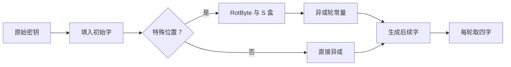

# AES子密钥生成算法（密钥扩展RotByte）、轮密钥选取及AES解密算法

## 它是什么、为什么需要

AES 每轮都要“轮密钥加”，但原始密钥只有一把，不能每轮重复使用同一段。子密钥生成算法（密钥扩展）把 $Nk$ 个初始字扩展成 $Nr+1$ 组轮密钥；每轮选取其中连续的 4 个字，与状态矩阵逐字节异或。这样各轮密钥不同，又都能由同一密钥确定地恢复。

==AES 的分组长度固定为 128 位，密钥长度决定轮数==：

| 密钥长度 | $Nk$（32 位字数） | 轮数 $Nr$ | 轮密钥组数 |
|---|---:|---:|---:|
| 128 位 | 4 | 10 | 11 |
| 192 位 | 6 | 12 | 13 |
| 256 位 | 8 | 14 | 15 |

## 密钥扩展与 RotByte

把 32 位（4 字节）称为一个字 $w_i$。先填入原始密钥，再依次生成后续字：

$$
w_i=
\begin{cases}
w_{i-Nk}\oplus \operatorname{SubWord}(\operatorname{RotWord}(w_{i-1}))\oplus Rcon_{i/Nk}, & i\bmod Nk=0,\\
w_{i-Nk}\oplus \operatorname{SubWord}(w_{i-1}), & Nk>6\ \text{且}\ i\bmod Nk=4,\\
w_{i-Nk}\oplus w_{i-1}, & \text{其他情况}.
\end{cases}
$$

其中 $\operatorname{RotWord}$ 将 $(a_0,a_1,a_2,a_3)$ 循环变为 $(a_1,a_2,a_3,a_0)$，课件所称 **RotByte** 即这一字节循环移位；$\operatorname{SubWord}$ 对 4 个字节分别作 S 盒代换，$Rcon$ 是轮常量。

轮密钥选取很直接：第 $r$ 轮取 $w_{4r},w_{4r+1},w_{4r+2},w_{4r+3}$，第 0 组用于加密前的初始轮密钥加。例如 AES-128 的第 1 轮使用 $w_4\sim w_7$，第 10 轮使用 $w_{40}\sim w_{43}$。

## AES 解密算法

AES 不是把加密轮函数原样运行，而是使用各变换的逆变换。解密从密文开始，先加最后一组轮密钥，再执行逆行位移、逆字节代换、轮密钥加、逆列混淆；最后一轮不做逆列混淆。也可采用等价解密结构，但轮密钥需相应作逆列混淆处理，不能混用两种写法。

> [!IMPORTANT]
> 加密最后一轮与解密最后一轮都==不做列混淆（或逆列混淆）==，但仍有轮密钥加。

> [!WARNING]
> 常见错误有三处：把 RotByte 当成普通 S 盒代换；忘记异或 $Rcon$；认为解密只需把轮密钥倒序，而不使用逆变换。

## 算对了的例子

已知 AES-128 扩展中 $w_3=(a_0,a_1,a_2,a_3)$，求 $w_4$。因 $4\bmod4=0$，先作

$$
\operatorname{RotWord}(w_3)=(a_1,a_2,a_3,a_0),
$$

再逐字节查 S 盒，随后异或 $Rcon_1$，最后得到

$$
w_4=w_0\oplus\operatorname{SubWord}(\operatorname{RotWord}(w_3))\oplus Rcon_1.
$$

这里不能写成 $w_3\oplus w_0$，也不能把 $Rcon_1$ 对 4 个字节全部异或；它按课程规定加到对应字的最高字节位置。
