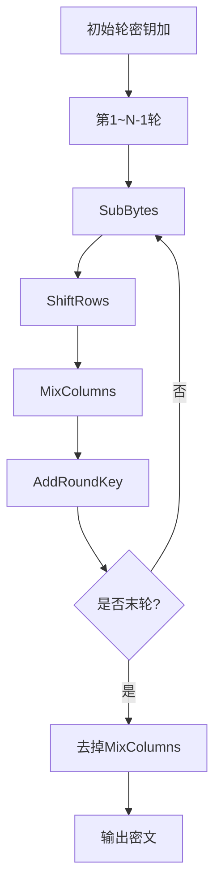

# Rijndael算法整体描述、State矩阵、字节代换SubBytes、字节移位ShiftRows、列混合MixColumns、轮密钥加AddRoundKey

Rijndael 算法是 AES（高级加密标准）的底层实现。与 DES 不同，它没有采用 Feistel 结构，而是基于==宽轨迹策略==设计，将算法分为轮密钥编排和加密过程两个独立部分。

> [!IMPORTANT]
> AES 分组长度固定为 ==128 比特（16 字节）==，不能是 192 或 256 比特。密钥长度才支持 128/192/256 比特。

## State 矩阵

明文如何进入算法？Rijndael 不直接按“串”处理，而是把 16 字节的输入块按**列优先**排成一个 $4 \times 4$ 的字节矩阵，称为 State 矩阵：

$$
\text{State} = \begin{bmatrix} s_{0,0} & s_{0,1} & s_{0,2} & s_{0,3} \\ s_{1,0} & s_{1,1} & s_{1,2} & s_{1,3} \\ s_{2,0} & s_{2,1} & s_{2,2} & s_{2,3} \\ s_{3,0} & s_{3,1} & s_{3,2} & s_{3,3} \end{bmatrix}
$$

所有后续变换都在这个矩阵上原地进行。

## 轮变换流程

每一轮对 State 执行四个操作。可以用伪代码表示单轮变换 `Round(State, RoundKey)`：

```text
SubBytes(State);
ShiftRows(State);
MixColumns(State);
AddRoundKey(State, RoundKey);
```

整体流程如下：



> [!WARNING]
> **最后一轮没有 MixColumns！** 这是考试高频易错点。

## 四大核心操作

| 操作 | 作用对象 | 功能 | 可逆性 |
|---|---|---|---|
| SubBytes | 每个字节 | S盒非线性代换 | 可逆 |
| ShiftRows | 每一行 | 行内循环左移 | 可逆 |
| MixColumns | 每一列 | 列内线性混合 | 可逆 |
| AddRoundKey | 整个State | 与轮密钥异或 | 自逆 |

- **SubBytes**：利用有限域 $GF(2^8)$ 上的 S 盒，对 State 中每个字节做非线性替换，提供混淆。
- **ShiftRows**：第 $i$ 行循环左移 $i$ 个字节（$i=0,1,2,3$），使单列的字节扩散到多列。
- **MixColumns**：将每列视为 $GF(2^8)$ 上的多项式，乘以一个固定多项式模 $x^4+1$，实现列内扩散。
- **AddRoundKey**：State 与当前轮密钥逐位异或（XOR）。

> [!TIP]
> 记忆口诀：“**替、移、混、加**”——代换、移位、混合、加钥。

## 与 Feistel 结构的区别

为什么 Rijndael 不用 DES 那样的 Feistel 结构？Feistel 每轮只处理一半数据，而宽轨迹策略每轮对全部 128 比特并行操作，扩散更快、软件实现更紧凑。

> [!NOTE]
> NESSIE 标准中，AES 属于普通型分组密码标准；过渡型为 MISTY1，高级型为 SHACAL2。

## 算例验证

以简答题为例：写出 AES 轮变换伪代码并指出末轮差异。

**解**：标准轮变换包含四步：`SubBytes → ShiftRows → MixColumns → AddRoundKey`。末轮去掉 `MixColumns`，仅三步。这保证了加密与解密结构对称，且末轮仍能通过 AddRoundKey 引入密钥依赖。
