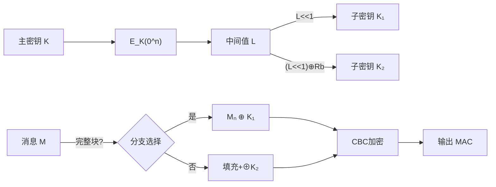

# CMAC的构造及其改进

## 为什么需要 CMAC？

CBC-MAC 虽然经典，但直接用于变长消息时存在致命缺陷：攻击者可通过拼接合法消息伪造新 MAC。如何解决这一安全漏洞？NIST 推荐的 CMAC（Cipher-based MAC）正是为此而生。它在 CBC-MAC 基础上引入==子密钥派生机制==，彻底修复了变长消息下的不可区分性安全问题，成为现代密码认证的标准方案。

## CMAC 的构造原理

CMAC 的核心思想是：根据消息长度是否对齐分组大小，动态选择两个不同的子密钥 $K_1$、$K_2$ 对最后一个分组进行处理。

> [!IMPORTANT]
> ==子密钥生成是考点核心==：$K_1 = L \ll 1$，若 $L$ 最高位为 1，则 $K_2 = (L \ll 1) \oplus R_b$；否则 $K_2 = L \ll 1$。其中 $R_b$ 是有限域 $\text{GF}(2^{128})$ 中的常数（AES 下为 `0x87`）。

## 与相近概念的区别

| 特性 | CBC-MAC | CMAC | Two-Track-MAC |
| :--- | :--- | :--- | :--- |
| 消息长度 | 仅定长安全 | ==变长安全== | 变长安全 |
| 子密钥 | 无 | $K_1, K_2$ | 基于 RIPEMD-160 |
| 标准地位 | 已弃用 | NIST SP 800-38B | 非主流标准 |
| 输出长度 | 等于分组长 | 可截断 | 固定 20B |

> [!NOTE]
> Two-Track-MAC 虽同属认证码章节，但基于哈希函数而非分组密码。其密钥与输出均为 ==20 字节==，对应 RIPEMD-160 的输出长度，勿与 CMAC 混淆。

## 常见坑与注意事项

> [!WARNING]
> 填空/选择题常考细节：CMAC 的子密钥 $K_1, K_2$ ==不是直接从主密钥截取==，而是通过加密全零块再移位派生。误认为“$K_1=K$”或“$K_2=K\oplus 1$”是高频错误。

> [!CAUTION]
> 当消息为空（0 比特）时，CMAC 仍定义良好：视为一个不完整块，填充后使用 $K_2$ 处理。不要认为空消息无 MAC 值。

## 算对了的例子

**题目**：Two-Track-MAC 算法基于带密钥的 RIPEMD-160，密钥和输出 MAC 值都是 ______ B。

**解析**：RIPEMD-160 的摘要长度为 160 比特，即 $160 \div 8 = 20$ 字节。Two-Track-MAC 直接采用该哈希结构，故密钥长度与输出长度均匹配其内部状态尺寸。

**答案**：==20==

> [!TIP]
> 记忆口诀：“CMAC 双子钥，零块移位来；Two-Track 一六零，二十字节记心间。” 考试中看到“RIPEMD-160 + MAC”直接联想 20B，看到“变长安全 CBC”立即反应 CMAC 子密钥派生流程。
