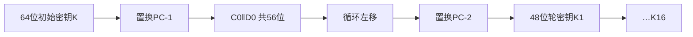

# DES的S盒运算、置换P以及子密钥的生成（置换PC-1、循环左移、PC-2）

## 这块在讲什么

DES 的加密流程里，**F 函数**是提供"混乱"的核心，而 F 函数内部由 **扩展置换 E、S 盒代换、置换 P** 三步组成；另一条独立线索是**子密钥生成**，它把使用者手里的 64 位初始密钥 K 加工成 16 个 48 位轮密钥 $K_i$。考试常考的就是 S 盒的性质、P 的作用，以及 PC-1 / 循环左移 / PC-2 这三步各干了什么。

> [!IMPORTANT]
> ==PC-1 是 64→55（去校验位）+ 重排，PC-2 是 56→48 的"压缩＋混乱"。== 两者方向别搞反。

## S 盒：唯一的非线性部件

S 盒输入 6 位、输出 4 位，共 8 个，记作 $S_1,\dots,S_8$。取 6 位中的**第 1 位和第 6 位**拼成行号 $r\in\{0,1,2,3\}$，**中间 4 位**拼成列号 $c\in\{0,\dots,15\}$，输出查表值 $S_i(r,c)$。

S 盒的关键性质（常考）：

| 性质 | 含义 |
|---|---|
| 非线性 | 不是仿射变换，无法用异或+移位表达 |
| 压缩 | 6 位进，4 位出 |
| ==输出均匀性== | 固定任一输入位、变化其余 5 位时，输出中 0/1 近乎各半 |
| 差分特性 | 输出对输入变化高度敏感，抗差分分析 |

> [!NOTE]
> 判断题"输出数字中 0 和 1 总数近于相等"√，这一条叫**输出均匀性**，是 S 盒抗统计分析的根本。

## 置换 P：只做重排，不做代换

S 盒输出的 32 位经过固定置换 P 重排，**不改变比特数量**，作用是把 S 盒的非线性扩散到下一轮的左右两半，属于"雪崩效应"的扩散环节。P 不是密钥相关的，是公开固定的。

## 子密钥生成

- **PC-1**：$64\to 56$。丢掉 8、16、24、…、64 位共 8 个**奇偶校验位**，再重排成 $C_0\,\|\,D_0$，各 28 位。
- **循环左移**：每轮对 $C_{i-1},D_{i-1}$ 各左移 $LS_i$ 位，$LS = [1,1,2,2,2,2,2,2,1,2,2,2,2,2,2,1]$。
- **PC-2**：$56\to 48$。==从 56 位中挑出 48 位并重排==，兼有"压缩"和"混乱"两种作用，输出即 $K_i$。

> [!WARNING]
> 易错：PC-1 输出 56 位、PC-2 输出 48 位；有人写成 PC-1 输出 55 位（那是另一种去校验位的说法），南邮课件口径是 ==64→56==，请按课件答。

## 一个对的例子

判断题：**"对 DES 的 S 盒，任一输入位保持不变、其他 5 位变化时（$2^5=32$ 种），输出中 0/1 总数近于相等。"**

答：√。因为 S 盒设计上满足**输出均匀性**，即在输入子空间里输出比特 0、1 出现次数近似对半（$16:16$ 量级），这是抵抗统计攻击的基础性质，也正是该题的考察点。
