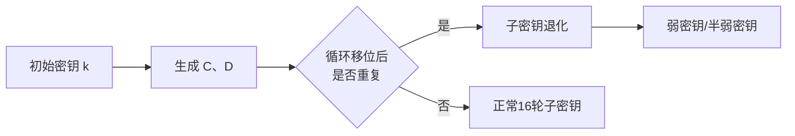

# DES的安全分析（弱密钥、半弱密钥、差分分析法和线性分析法）

在分组密码中，我们并不直接讨论“DES 一定安全”，而是分析它的密钥空间和结构有没有弱点。这里重点看两类问题：一类是由子密钥生成规律造成的**弱密钥、半弱密钥**；另一类是对 DES 进行密码分析时常提到的**差分分析法**和**线性分析法**。

> [!IMPORTANT]  
> DES 的安全分析核心是看：==密钥是否会退化、加密结构是否会被统计规律攻击==。

## 弱密钥

如果给定初始密钥 $k$，经过子密钥产生器后，16 轮子密钥全部相同，即

$$
k_1=k_2=\cdots=k_{16}
$$

则称 $k$ 为**弱密钥**。

DES 本来希望 16 轮迭代尽量“变化充分”，但如果每轮子密钥都一样，轮函数的差异就被削弱了，加密结构会出现很强的对称性。若 $k$ 为弱密钥，则对任意 64 bit 明文 $m$，有

$$
E_k(E_k(m))=m,\qquad D_k(D_k(m))=m
$$

这说明弱密钥会让 DES 出现“再加密一次就回去”的性质。

> [!NOTE]  
> 弱密钥本质上是**子密钥退化**：不是 DES 轮数不够，而是 16 轮子密钥没有真正区分开。

## 半弱密钥

若给定初始密钥 $k$，产生的 16 个子密钥只有两种，并且每种都出现 8 次，则称 $k$ 为**半弱密钥**。

半弱密钥常成对出现。若 $k_1$ 和 $k_2$ 是一对半弱密钥，$m$ 为明文组，则有

$$
E_{k_2}(E_{k_1}(m))=E_{k_1}(E_{k_2}(m))=m
$$

也就是说，这一对密钥在加密顺序上表现出很强的可交换、可抵消性质。

> [!TIP]  
> 记忆时可以抓关键词：  
> **弱密钥：16 个子密钥全相同；半弱密钥：只有两种且各 8 次。**

## 为什么会这样

弱密钥的出现，与子密钥产生器中寄存器 $C$、$D$ 的内容有关。若 $C$、$D$ 中存数在循环移位下出现重复图样，比如全 0 或全 1，就会导致各轮子密钥失去变化。

可以把它理解成：DES 的“轮”还在跑，但“钥匙”没有真正换。

## 差分分析法与线性分析法

除了密钥本身的退化，DES 还要面对两类经典分析方法：

| 方法 | 基本思想 | 关注点 |
|---|---|---|
| 差分分析法 | 比较两个明文输入的差与对应密文差 | 输入差分如何传播 |
| 线性分析法 | 寻找明文、密文、密钥之间的线性近似关系 | 某些比特异或后的统计偏差 |

简单说，差分分析看“**变化怎么传**”，线性分析看“**有没有近似线性规律**”。

> [!WARNING]  
> 不要把这两种方法理解成“直接秒破 DES”。它们更像是利用统计偏差进行密码分析，评估 DES 抵抗攻击的能力。

## 常见坑

- 把弱密钥理解成“密钥太短”，这是错的。弱密钥问题在于**子密钥重复退化**，不是位数本身。
- 把半弱密钥记成“只有两个子密钥”，要补上条件：**每种都出现 8 次**。
- 认为 S 盒对安全没影响，这也是错的。DES 的非线性主要来自 S 盒，若 S 盒设计不好，会更容易受到差分和线性分析。

## 一个典型考点

例如判断题：

> 在 DES 加密过程中，S 盒对加密的强度没有影响。（×）

正确理解是：==S 盒提供非线性，是 DES 抵抗分析的重要部件==。如果没有良好的 S 盒，DES 会更容易暴露差分特征和线性关系。

> [!CAUTION]  
> 虽然 DES 中弱密钥数量极少、也容易避开，但考试里仍常考定义式，尤其是  
> $E_k(E_k(m))=m$ 和 $E_{k_2}(E_{k_1}(m))=m$ 这两组性质。

这类内容的关键不是背很多结论，而是抓住一句话：**DES 的安全分析，一方面看密钥有没有退化，另一方面看结构有没有可利用的统计规律。**
