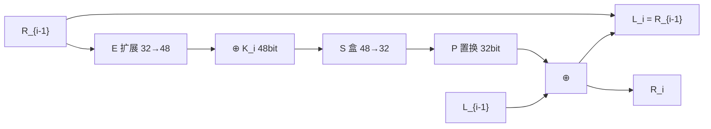

# 数据加密标准DES的参数、初始置换IP/逆置换IP-1、轮结构与E-扩展运算

## DES 是什么

数据加密标准（DES）是==典型的分组密码==：将 64 bit 明文分组加密为 64 bit 密文分组，密钥名义上 64 bit（实际有效 56 bit，其余 8 bit 为奇偶校验位）。它采用**Feistel 结构**——把分组分成左右两半 $L$、$R$，每轮只对一半做加密变换，另一半直接交换，因此加解密流程完全相同（只是子密钥使用顺序相反），硬件实现非常便宜。

## 为什么需要初始置换 IP

DES 的第一步和最后一步分别是初始置换 IP 与逆置换 $IP^{-1}$。它们只是按固定表**重排 64 个比特的位置**，不含任何密钥、不增加密钥空间，==对密码强度没有影响==（判断 38 即考此点）。那为什么要设计它？

> [!NOTE]
> 1970 年代 DES 主要面向硬件实现。IP 的位打乱可以让 64 bit 数据在芯片引脚上**并行加载**（高低位交错排列），与安全性无关。今天软件实现中 IP 常被视为历史遗留。

## 轮结构与 E-扩展

DES 的核心是 16 轮 Feistel 迭代（判断 63 的"64 轮"是错的，==轮数固定为 16==）。单轮结构远不足以抵抗差分、线性分析，但 16 轮叠加后混淆与扩散充分，安全性才有保障。每轮结构如下：

每轮密钥调度产生 48 bit 子密钥 $K_i$，而右半部分 $R_{i-1}$ 只有 32 bit，长度不匹配。于是引入 **E-扩展运算**：把 32 bit 的 $R_{i-1}$ 按规则扩展为 48 bit——每个 4 bit 输入块的**首尾各取一位**拼到相邻块外侧，形成 6 个 6 bit 分组。这样：

- 与子密钥 $K_i$ 等长，可以按位异或；
- 重复位让某些输入位影响两个 S 盒，==加快扩散==（一个明文 bit 更快波及整个分组）。

之后经 8 个 S 盒（6→4 bit 非线性压缩）和 P 置换，输出 32 bit 再与 $L_{i-1}$ 异或，得到 $R_i$；同时 $L_i=R_{i-1}$。

## 常见误区

| 误区 | 正解 |
|---|---|
| S 盒对强度无影响 | S 盒是 DES **唯一非线性部件**，是抗差分/线性攻击的核心，强度主要由它决定 |
| 初始置换 IP 提供安全性 | IP/$IP^{-1}$ 只是固定位重排，无密钥参与，==不影响强度== |
| DES 迭代 64 轮 | 分组长度 64 bit，但==轮数为 16== |
| E 扩展是加密变换 | E 只是**扩位**（32→48），本身不用密钥，目的是匹配子密钥长度并增强扩散 |

> [!TIP]
> 记一条流水线：**"E 扩、K 加、S 压、P 换、L 异或"**——扩展→与子密钥异或→S 盒压缩→P 置换→与左半异或。

## 算例：E-扩展如何工作

设某轮右半部分 $R_{i-1}$ 的前 8 bit 为 $r_1 r_2 \cdots r_8$。E-扩展表规定第一组 6 bit 取

$$r_{32},\, r_1, r_2, r_3, r_4,\, r_5$$

即把上一块的末位 $r_{32}$ 和本块的首位 $r_5$ 包到 4 bit 核心 $r_1r_2r_3r_4$ 两侧。若 $R_{i-1}$ 前 4 bit 为 `1010`，且 $r_{32}=1$，则第一组输出为 `110101`（6 bit），比输入多出 2 bit，正好凑成 48 bit 去和 $K_i$ 异或。这就是"扩展"的直观含义。

> [!IMPORTANT]
> DES 的设计逻辑：==Feistel 结构保证可逆，16 轮保证强度，S 盒提供非线性，E 扩展+P 置换负责扩散，IP/$IP^{-1}$ 仅为硬件友好==。分清各部件职责，是本章判断题与简答题的得分关键。
