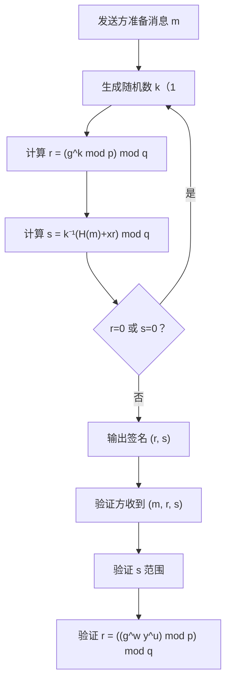

# 数字签名标准DSS的签名过程

## 为什么需要 DSS？

在数字世界中，仅仅有手写签名的扫描图片是不够的——它太容易被复制和篡改。==数字签名需要将消息内容与签名者身份绑定，同时保证消息完整性。== DSS（Digital Signature Standard）就是 NIST 发布的一套安全可靠的数字签名标准。

DSS 的核心算法是 **DSA**（Digital Signature Algorithm），它专门用于签名，不提供加密功能。这与 RSA 形成鲜明对比：RSA 既能加密又能签名，而 DSA 只专注签名一件事。

[!IMPORTANT]
> DSA 的安全性完全建立在求解离散对数问题的难度之上，而不是大整数分解。这一区别是考试中的高频考点。

## 签名过程分几步？

DSA 签名包含参数生成、密钥生成、签名产生和签名验证四个阶段。我们重点看最核心的签名产生过程。

先明确参与的角色和密钥：
- 发送方持有私钥 $x$，需要保密
- 所有人知道公钥 $y \equiv g^x \bmod p$，以及一组公开参数 $(p, q, g)$

整个签名流程可以用下图表示：

### 发送方产生签名

发送方对消息 $m$ 做以下计算：

第一步：生成一个**随机数 $k$**，要求 $1 < k < q$。==这个 $k$ 必须每次签名都不同，且必须保密==——一旦泄露或被重复使用，私钥 $x$ 就会被他人推导出来。

第二步：计算 $r$：
$$r = (g^k \bmod p) \bmod q$$

这一步先做模 $p$ 的幂运算，再对 $q$ 取模。$r$ 不直接暴露 $k$，但以 $k$ 为纽带。

第三步：用私钥 $x$ 和哈希值计算 $s$：
$$s = [k^{-1}(H(m) + xr)] \bmod q$$

其中 $H(m)$ 是消息的哈希值（DSS 规定使用 SHA-1 或更安全的 SHA-2），$k^{-1}$ 是 $k$ 模 $q$ 的乘法逆元。

最终输出签名对 $(r, s)$。如果抽到的 $k$ 导致 $r = 0$ 或 $s = 0$，就必须换一个 $k$ 重新算，否则签名无效。

### 接收方验证签名

验证方拿到 $m$、$r$、$s$ 后，用自己的方式确认签名有效，过程不再依赖私钥 $x$：

首先检查 $0 < r < q$ 和 $0 < s < q$，任一个超出范围直接拒绝。

然后计算中间量：
$$w \equiv s^{-1} \bmod q$$
$$u_1 \equiv H(m) \cdot w \bmod q$$
$$u_2 \equiv r \cdot w \bmod q$$

最后检验：
$$v = [(g^{u_1} y^{u_2}) \bmod p] \bmod q$$

若 $v = r$，==签名验证通过==，说明消息确实来自持有私钥 $x$ 的一方，且内容未被篡改。

## 常见误区与辨析

[!WARNING]
> **DSA 只能签名，不能加密！** 学生在初学时常把 RSA 和 DSA 的功能搞混。RSA 可直接用于加解密和签名，DSA 在设计上就只提供数字签名。

[!CAUTION]
> **随机数 $k$ 重复使用的灾难**：如果两次签名用了同一个 $k$，攻击者联立两个 $s$ 的方程就能算出私钥 $x$。这是真实世界中索尼 PS3 被破解的关键漏洞之一。

还有一个常考的辨析：

| 算法 | 安全基础 |
|------|----------|
| RSA | 大整数分解难题 |
| DSA | 离散对数难题 |
| ElGamal | 离散对数难题 |
| ECC | 椭圆曲线上的离散对数难题 |

当大素数分解难题被解决时，RSA 会失效，但 DSA 依然安全。反之，若离散对数被攻破，DSA 和 ElGamal 等算法都将不再可靠。

[!TIP]
> 记忆口诀：**"分解破 RSA，对数破 DSA"**。考卷上判断算法归属时，先想清楚它依赖的是哪种数学难题。
