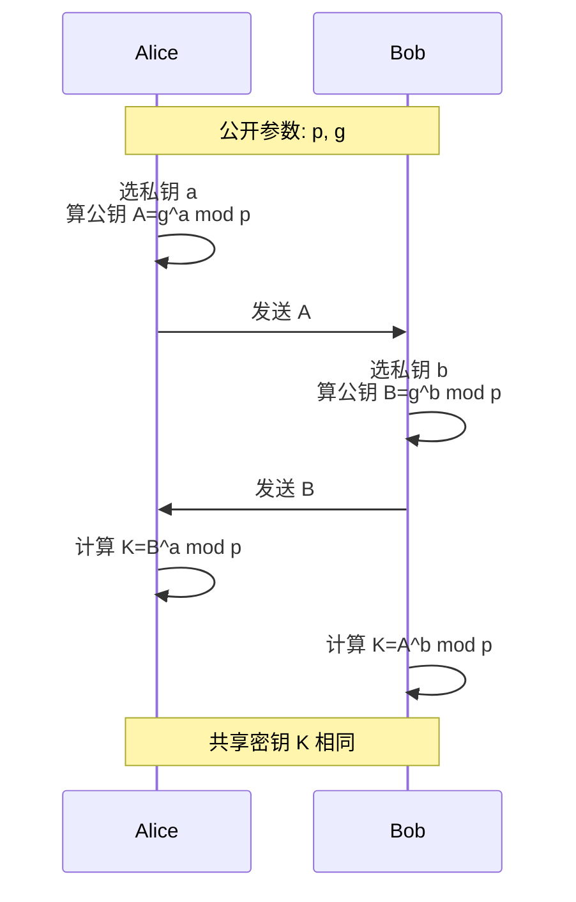

# Diffie-Hellman密钥协商/交换协议原理及中间人攻击

# Diffie-Hellman密钥协商协议原理及中间人攻击

## 协议背景与核心定义

1976年，Diffie和Hellman在《密码学的新方向》中提出了公钥密码思想。D-H协议是==第一个公钥密码算法==，其核心目标并非直接加密数据，而是允许通信双方在不安全的信道上，通过公开交换信息，协商出一个只有双方知道的**共享会话密钥**。

该协议的安全性基于==离散对数问题（DLP）==的困难性，而非大数分解。若有人能高效求解离散对数，D-H协议即被破译。

> [!IMPORTANT]
> 核心结论：D-H协议解决的是“密钥分发”难题，本身不提供身份认证，因此易受中间人攻击。

## 协议交互流程

假设Alice (A) 和 Bob (B) 想要建立共享密钥。首先双方约定一个大素数 $p$ 和一个生成元 $g$（$g < p$），这两个参数是公开的。

1. Alice 选择随机私钥 $a$，计算公钥 $A = g^a \mod p$ 并发送给 Bob。
2. Bob 选择随机私钥 $b$，计算公钥 $B = g^b \mod p$ 并发送给 Alice。
3. Alice 计算共享密钥 $K = B^a \mod p = (g^b)^a \mod p = g^{ab} \mod p$。
4. Bob 计算共享密钥 $K = A^b \mod p = (g^a)^b \mod p = g^{ab} \mod p$。

由于 $g^{ab} \equiv g^{ba} \pmod p$，双方得到相同的 $K$。攻击者即使截获 $p, g, A, B$，因无法从 $A$ 反推 $a$（离散对数难题），故无法计算 $K$。

## 常见考点辨析

| 算法/协议 | 安全基础 | 主要用途 |
| :--- | :--- | :--- |
| **RSA** | 大整数分解 | 加密、数字签名 |
| **DSA / ElGamal** | 离散对数 | 数字签名 / 加密 |
| **Diffie-Hellman** | 离散对数 | ==密钥协商== |

> [!TIP]
> 记忆技巧：RSA看“分解”，DH/DSA/ECC看“对数”。D-H是“协商”而非“加密传输”。

## 中间人攻击（MitM）

D-H协议最大的弱点是==缺乏身份认证==。攻击者 Mallory (M) 可以拦截 A 和 B 的通信，分别与他们建立独立的密钥。

1. M 拦截 A 发给 B 的 $A$，伪造自己的公钥 $M_1 = g^m \mod p$ 发给 B。
2. M 拦截 B 发给 A 的 $B$，伪造自己的公钥 $M_2 = g^m \mod p$ 发给 A。
3. A 与 M 协商出密钥 $K_{AM}$，B 与 M 协商出密钥 $K_{BM}$。
4. A 用 $K_{AM}$ 加密消息，M 解密后读取，再用 $K_{BM}$ 加密转发给 B。

此时，A 和 B 以为他们在安全通信，实则所有流量均被 M 窃听甚至篡改。

> [!CAUTION]
> 高危误区：认为 D-H 协议本身能防止窃听。实际上，若无数字签名或证书辅助验证公钥归属，D-H 无法抵御主动攻击。

## 计算示例

设 $p=23, g=5$。
1. Alice 选 $a=6$，计算 $A = 5^6 \mod 23 = 15625 \mod 23 = 8$。发送 $A=8$。
2. Bob 选 $b=15$，计算 $B = 5^{15} \mod 23$。
   - $5^1=5, 5^2=2, 5^4=4, 5^8=16$
   - $5^{15} = 5^8 \cdot 5^4 \cdot 5^2 \cdot 5^1 = 16 \cdot 4 \cdot 2 \cdot 5 = 640 \mod 23 = 19$。发送 $B=19$。
3. Alice 计算 $K = 19^6 \mod 23$。
   - $19 \equiv -4 \pmod{23}$
   - $(-4)^6 = 4096$
   - $4096 \div 23 = 178 \dots 2$。即 $K=2$。
4. Bob 计算 $K = 8^{15} \mod 23$。
   - $8 = 2^3 \Rightarrow 8^{15} = 2^{45}$
   - 由费马小定理 $2^{22} \equiv 1 \pmod{23}$
   - $2^{45} = 2^{22 \cdot 2 + 1} = (2^{22})^2 \cdot 2^1 \equiv 1 \cdot 2 = 2$。
   
双方最终共享密钥均为 $K=2$。
