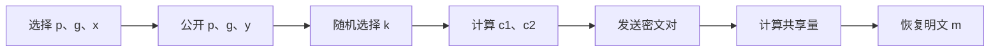

# ElGamal公钥密码体制的算法描述与安全性（基于离散对数困难问题）

ElGamal 公钥密码体制由 T. ElGamal 于 1985 年提出，是最有名的公钥密码体制之一。它的安全性==基于有限域上离散对数问题的难解性==，而不是大整数分解或椭圆曲线离散对数问题。

## 算法描述

设 $p$ 为大素数，$g$ 是有限域 $\mathbb{Z}_p^*$ 的本原元。接收方随机选择私钥 $x$，满足 $1<x<p-1$，计算

$$y=g^x\bmod p.$$

公开密钥为 $(p,g,y)$，私钥为 $x$。算法公开，安全性依赖私钥保密。

发送方加密消息 $m$（$0<m<p$）时，每次随机选择 $k$，满足 $1<k<p-1$，计算

$$c_1=g^k\bmod p,\qquad c_2=m\,y^k\bmod p,$$

密文为 $(c_1,c_2)$。接收方利用私钥计算共享量

$$c_1^x=(g^k)^x=g^{xk}=y^k\pmod p,$$

再恢复明文：

$$m=c_2(c_1^x)^{-1}\bmod p.$$

这里 $y^k$ 相当于一次性掩码：发送方用 $y,g,k$ 得到它，接收方用 $c_1,x$ 得到同一个值。由于每次加密都重新选择 $k$，==同一明文在同一公钥下通常产生不同密文==，因此 ElGamal 加密具有随机性。

## 一个算对了的例子

取 $p=11$，$g=2$，私钥 $x=3$，则

$$y=2^3\bmod 11=8.$$

公钥为 $(11,2,8)$。加密 $m=5$，随机取 $k=4$：

$$c_1=2^4\bmod 11=5,$$

$$c_2=5\cdot 8^4\bmod 11=5\cdot 4096\bmod 11=4.$$

密文为 $(5,4)$。解密时，$c_1^x=5^3\bmod 11=4$，其模 $11$ 逆元为 $3$，因为 $4\cdot3=12\equiv1\pmod{11}$。于是

$$m=4\cdot3\bmod 11=1,$$

这个结果不对，说明前面的 $c_2$ 算错了。重新计算：$8^2\bmod11=9$，$8^4\bmod11=9^2\bmod11=4$，故

$$c_2=5\cdot4\bmod11=9.$$

正确密文是 $(5,9)$，解密为 $m=9\cdot3\bmod11=5$，与原文一致。这个例子也提醒：模幂运算应逐步化简，不能凭大数取模心算。

## 安全性与相近概念

攻击者知道 $p,g,y$，若要求出私钥 $x$，就要解 $y=g^x\bmod p$，即求有限域上的离散对数；仅知道 $c_1=g^k\bmod p$ 时，求随机数 $k$ 同样是离散对数问题。在参数足够大、实现正确的前提下，这些问题被认为难以求解。

| 体制 | 主要困难问题 | 典型用途或特点 |
|---|---|---|
| RSA | 大整数因子分解 | 公钥加密、数字签名 |
| ElGamal | 有限域上的离散对数 | 随机化公钥加密，也有签名变体 |
| Diffie–Hellman | 离散对数及相关困难问题 | 密钥交换，基本形式易受中间人攻击 |
| ECC | 椭圆曲线离散对数 | 较短密钥获得较高安全强度 |
| DSA | 离散对数 | 数字签名，不是通用加密算法 |

> [!IMPORTANT]
> 判断题核心表述：**ElGamal 公钥密码体制的安全性基于有限域上离散对数问题的难解性。**DSA 的安全性也依赖于求解离散对数问题的难度。

> [!WARNING]
> “ElGamal 基于椭圆曲线离散对数”作为本课程原始表述应判错，订正为“有限域”。椭圆曲线版本可以另行构造，但不能与 ECC 的安全性表述混为一谈。

> [!CAUTION]
> 随机数 $k$ 必须保密、随机且每次重新选择。重复或泄露 $k$ 会破坏掩码的安全性；密文由两个数组成，也不能只发送 $c_2$。此外，基本 Diffie–Hellman 与 ElGamal 用途不同，前者主要交换密钥，后者直接加密消息。
