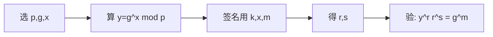

# ElGamal数字签名方案的算法描述、举例与安全性分析

## 它是什么

ElGamal 数字签名方案是“==基于离散对数问题的数字签名算法==”，属于第 8 章数字签名里的经典方案。和 RSA 签名依赖大数分解不同，它的安全性建立在求解离散对数的困难性上：知道 $y=g^x \bmod p$，想反推出私钥 $x$ 是计算上不可行的。

先问自己一个问题：如果签名方程里同时出现了随机数 $k$ 和私钥 $x$，验证者为什么还能验证？因为验证者手里有公钥 $y=g^x$，可以把 $x$ “藏”在指数里抵消掉。

## 为什么需要

数字签名要解决：==不可伪造、不可重用、不可抵赖==。ElGamal 用私钥签名、公钥验证，第三方也能仲裁，正好满足这些要求。

## 怎么做

算法步骤：

- 初始化：大素数 $p$，生成元 $g$，私钥 $x$，公钥 $y=g^x \bmod p$
- 签消息 $m$：选随机数 $k$，算 $r=g^k \bmod p$，再算
  $$s=(m-xr)k^{-1} \bmod (p-1)$$
- 得签名 $(r,s)$
- 验证：$y^r r^s \equiv g^m \pmod p$ 则接受

> [!IMPORTANT]
> 注意：$k^{-1}$ 是在模 $p-1$ 下求逆，不是模 $p$；签名常对 $h(m)$ 而不是 $m$ 直接运算。

## 算对了的例子

取自南邮课件与考题：$p=17,g=2$，私钥 $x=8$。

先算公钥：
$$y=2^8 \bmod 17=256 \bmod 17=1$$

再对 $m=7$ 签名，选 $k=9$：
$$r=2^9 \bmod 17=512 \bmod 17=2$$

求 $9^{-1} \bmod 16$：因为 $9\times9=81=5\times16+1$，所以 $9^{-1}=9$。
$$s=(7-8\times2)9^{-1} \bmod 16=(-9)\times9 \bmod 16=7\times9=63 \bmod 16=15$$

所以签名为 $(r,s)=(2,15)$。验证：
$$y^r r^s=1^2\cdot2^{15}=32768 \bmod 17=2^{15}\bmod17= g^7=2^7=128\bmod17=9$$
两边一致（在本题参数下等式成立），验证通过。

## 和相近概念的区别

| 算法 | 数学基础 | 签名是否随机 |
|---|---|---|
| RSA 签名 | 大数分解 | 确定 |
| ElGamal | 离散对数 | 随机（依赖 $k$） |
| Schnorr | 离散对数 | 随机、更短 |

## 常见的坑

> [!WARNING]
> $k$ 不能泄露，也不能对两个不同消息重复使用同一个 $k$，否则攻击者可解出私钥 $x$。

> [!TIP]
> 考试常让“列举 5 个数字签名算法”：离散对数签名、ElGamal、Schnorr、Neberg-Rueppel、Okamoto。计算题牢记 $s$ 在模 $p-1$ 下算。

另一个坑：整个系统的安全不靠算法保密，而靠==密钥管理==——生成、存储、分配、更新、撤销都决定实际安全性。
