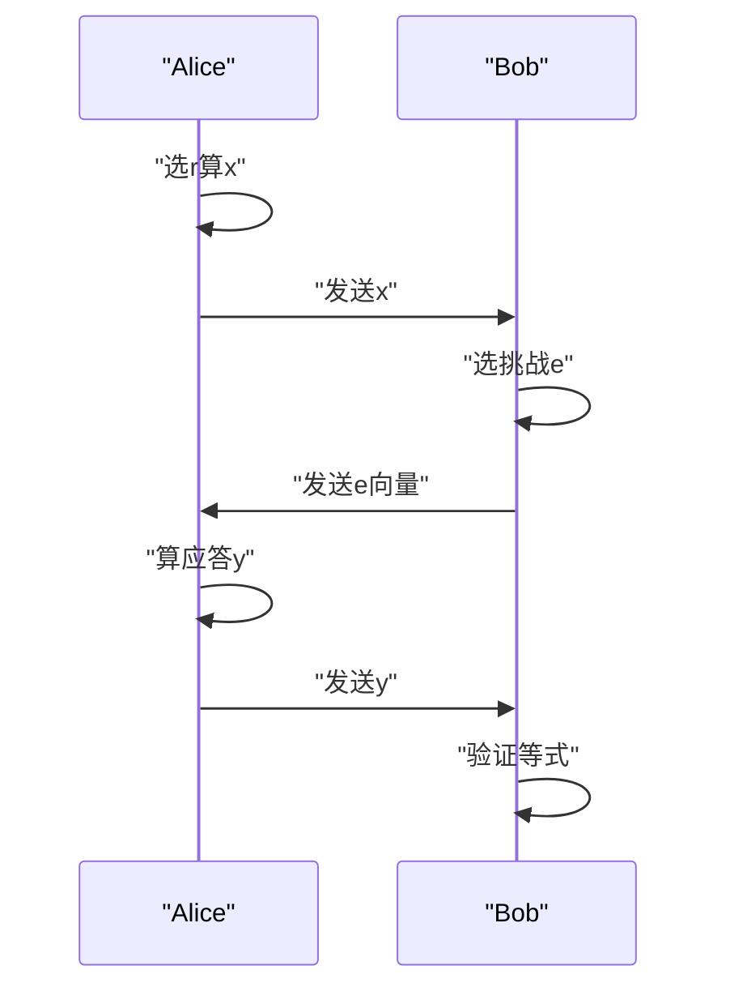

# Fiege-Fiat-Shamir(FFS)的身份识别方案及协议交互过程

如果 Alice 想向 Bob 证明“我是 Alice”，却不想把密码直接发过去，该怎么办？FFS 方案给出的思路是：==用“零知识”的方式，通过挑战-应答来证明身份==。

## 它是什么与为什么需要

Feige-Fiat-Shamir（FFS）身份识别方案是一种基于大整数分解难题的零知识身份证明协议。

传统的口令认证一旦传输就会被窃听者截获；而 FFS 允许证明者（Alice）向验证者（Bob）证明自己拥有某个秘密，却==不泄露任何关于该秘密的信息==。其安全性依赖于模合数 $n$ 的二次剩余问题。

## 怎么做：参数生成与协议交互

### 密钥生成

1. 选取两个大素数 $p, q$，计算 $n = p \times q$。
2. 选取 $k$ 个与 $n$ 互素的随机数 $s_1, s_2, \dots, s_k$ 作为**私钥**。
3. 计算 $v_i \equiv s_i^2 \pmod n\ (i=1,\dots,k)$ 作为**公钥**。
4. 公开 $n$ 和 $(v_1, \dots, v_k)$，保密 $(s_1, \dots, s_k)$。

> [!IMPORTANT]
> 私钥 $s_i$ 是公钥 $v_i$ 模 $n$ 的平方根，不知道 $p,q$ 就无法求平方根。

### 协议交互过程

协议需重复执行 $t$ 轮以降低欺骗概率。单轮流程如下：

1. **承诺**：Alice 选随机数 $r \in \mathbb{Z}_n^*$，计算 $x \equiv r^2 \pmod n$，将 $x$ 发给 Bob。
2. **挑战**：Bob 随机选择挑战向量 $\mathbf{e} = (e_1, \dots, e_k),\ e_i \in \{0,1\}$，发给 Alice。
3. **应答**：Alice 计算 $y \equiv r \cdot \prod_{i=1}^{k} s_i^{e_i} \pmod n$，将 $y$ 发给 Bob。
4. **验证**：Bob 检验是否满足 ==$y^2 \equiv x \cdot \prod_{i=1}^{k} v_i^{e_i} \pmod n$==。

> [!TIP]
> 记忆口诀：**承诺发平方，挑战挑下标，应答乘私钥，验证对等式。**

## 一个算对了的例子

设 $p=3, q=11, n=33$，取 $k=1$。

- **密钥**：Alice 选 $s_1 = 5$，则 $v_1 \equiv 5^2 = 25 \pmod{33}$。公钥 $v_1=25$，私钥 $s_1=5$。
- **承诺**：Alice 选 $r = 7$，计算 $x \equiv 7^2 = 49 \equiv 16 \pmod{33}$，发送 $x=16$。
- **挑战**：Bob 选 $e_1 = 1$，发送 $e_1=1$。
- **应答**：Alice 计算 $y \equiv 7 \times 5^1 = 35 \equiv 2 \pmod{33}$，发送 $y=2$。
- **验证**：Bob 算左边 $y^2 = 4$；右边 $x \cdot v_1^{e_1} = 16 \times 25 = 400 \equiv 4 \pmod{33}$。$4=4$，验证通过！

## 与相近概念的区别

| 对比项 | FFS 方案 | Fiat-Shamir 方案 |
| :--- | :--- | :--- |
| 挑战空间 | $e_i \in \{0,1\}$，每轮 $k$ 比特 | 单一大范围挑战 |
| 欺骗概率 | 单轮 $2^{-k}$，$t$ 轮 $2^{-kt}$ | 依赖挑战域大小 |
| 核心操作 | 多次模乘 | 单次模幂 |

> [!NOTE]
> FFS 本质上是 Fiat-Shamir 方案的并行化改进，通过引入 $k$ 个并行的二次剩余关系，将单轮欺骗概率从 $1/2$ 降至 $2^{-k}$，从而减少交互轮数。

## 常见的坑

> [!WARNING]
> 随机数 $r$ 绝对不能复用！若两次使用相同的 $r$ 且挑战不同，攻击者可通过联立方程直接解出私钥 $s_i$。

> [!CAUTION]
> 验证时别忘了取模。计算 $y^2$ 和 $x \cdot \prod v_i^{e_i}$ 都必须在 $\pmod n$ 意义下进行，否则数值溢出且结果错误。
