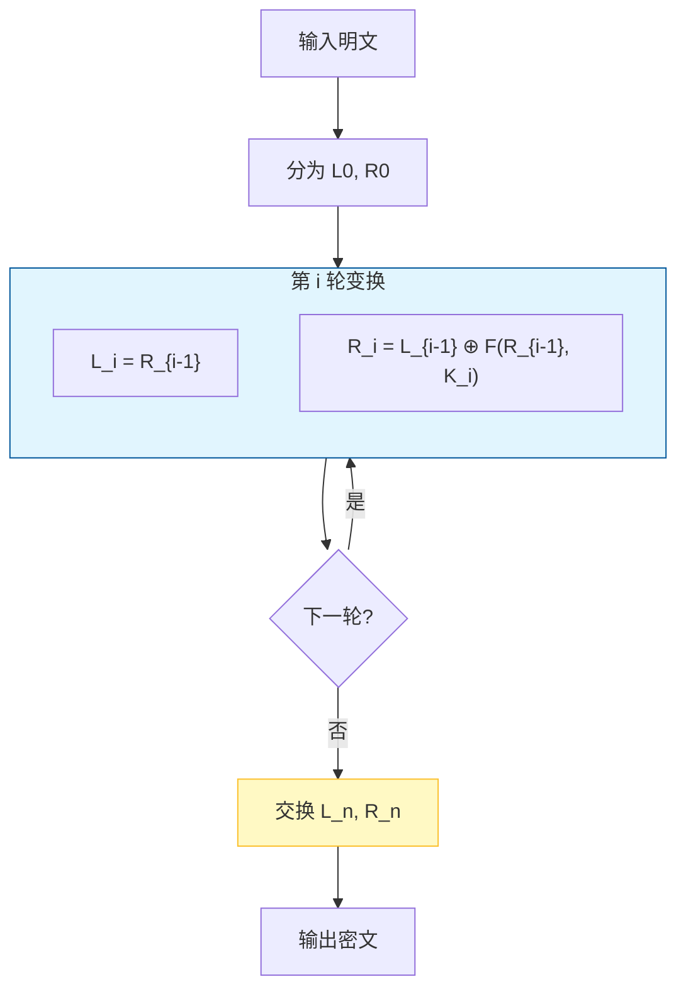

# Feistel加密结构、网络参数及单轮的加解密过程

# Feistel 加密结构、网络参数及单轮的加解密过程

## 什么是 Feistel 结构？

Feistel 结构（Feistel Network）是分组密码设计的经典架构，由 Horst Feistel 提出。其核心思想是将输入明文分为左右两半，通过多轮迭代变换实现香农提出的==混淆（Confusion）==与==扩散（Diffusion）==。

> [!IMPORTANT]
> **核心优势**：无论轮函数 $F$ 是否可逆，Feistel 结构的**加密与解密过程完全相同**，仅需将子密钥的使用顺序反转。这极大简化了硬件实现复杂度。

## 单轮加解密过程详解

设第 $i$ 轮的左半部分为 $L_{i-1}$，右半部分为 $R_{i-1}$，子密钥为 $K_i$，轮函数为 $F$。

### 加密过程
$$
\begin{cases}
L_i = R_{i-1} \\
R_i = L_{i-1} \oplus F(R_{i-1}, K_i)
\end{cases}
$$

### 解密过程
解密是加密的逆过程。由于异或运算 $\oplus$ 的性质（$A \oplus B \oplus B = A$），我们可以从 $(L_i, R_i)$ 恢复 $(L_{i-1}, R_{i-1})$：

1. 恢复 $R_{i-1}$：由加密公式知 $L_i = R_{i-1}$，故直接得到。
2. 恢复 $L_{i-1}$：
   $$
   L_{i-1} = R_i \oplus F(R_{i-1}, K_i) = R_i \oplus F(L_i, K_i)
   $$

> [!TIP]
> **记忆技巧**：解密时，只需将加密时的子密钥序列 $K_1, K_2, ..., K_n$ **逆序**使用为 $K_n, ..., K_2, K_1$，算法结构无需任何改变。

## 常见误区与考点辨析

| 维度 | Feistel 结构特点 | 常见误区/考点 |
| :--- | :--- | :--- |
| **复杂度** | 加密与解密算法结构一致 | ==判断题陷阱==：认为解密比加密复杂得多是错误的（×）。两者计算量相当。 |
| **轮函数 F** | 不需要可逆 | $F$ 可以是任意复杂函数，甚至不可逆，只要保证混淆和扩散即可。 |
| **SP 思想** | S盒实现混淆，P置换实现扩散 | 填空常考：S 盒对应==混乱==，P 盒对应==扩散==。 |
| **完备性** | 输出位依赖所有输入位 | 若每一位输出依赖于每一位输入，称具有==完备性==（√）。 |

> [!WARNING]
> **易错点**：RC-5 等现代算法可能不采用固定 S 盒，而是使用数据相依旋转等技术。但 Feistel 结构本身是一种通用框架，DES 是其典型代表。不要混淆具体算法特性与结构特性。

## 实例演示

假设一个简化的 Feistel 轮函数，输入 $L_0=1010, R_0=1100$，密钥 $K=1111$，定义 $F(R, K) = R \oplus K$。

**加密第一轮：**
1. $L_1 = R_0 = 1100$
2. $F(R_0, K) = 1100 \oplus 1111 = 0011$
3. $R_1 = L_0 \oplus F(R_0, K) = 1010 \oplus 0011 = 1001$
4. 输出：$(L_1, R_1) = (1100, 1001)$

**解密第一轮（逆向恢复）：**
已知 $(L_1, R_1) = (1100, 1001)$，密钥 $K=1111$。
1. 恢复 $R_0$：$R_0 = L_1 = 1100$
2. 计算 $F(L_1, K) = 1100 \oplus 1111 = 0011$
3. 恢复 $L_0$：$L_0 = R_1 \oplus F(L_1, K) = 1001 \oplus 0011 = 1010$
4. 结果：$(L_0, R_0) = (1010, 1100)$，与原始输入一致。

> [!NOTE]
> 此例验证了 Feistel 结构的核心性质：即使 $F$ 仅为简单的异或，只要解密时正确逆用密钥，即可完美还原明文。
