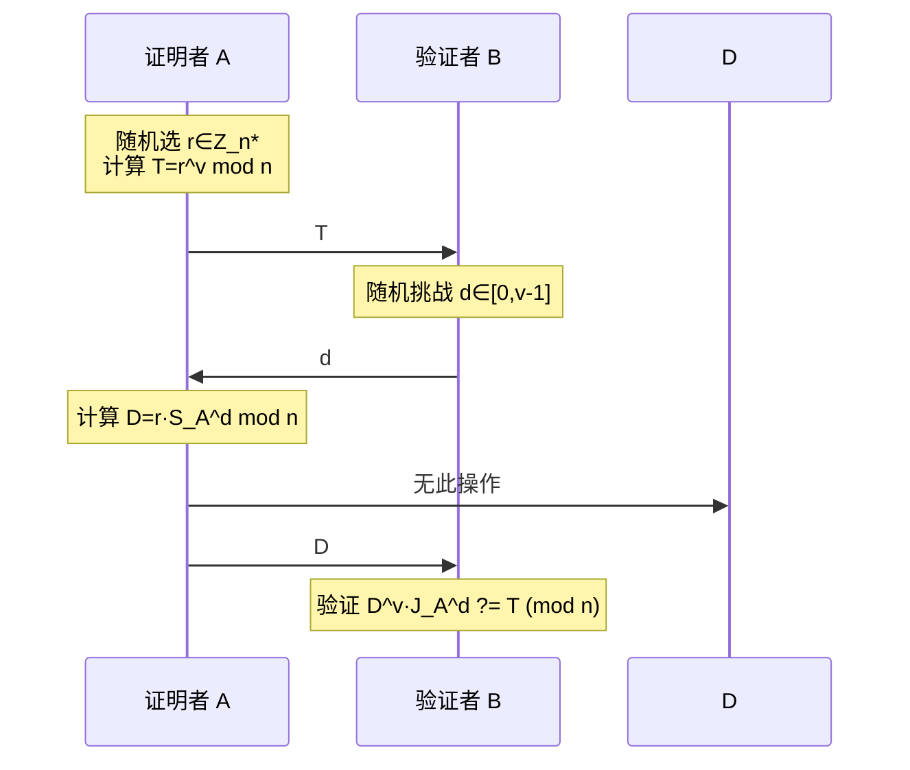

# Guillou-Quisquater(G-Q)身份方案及交互示意图

## Guillou-Quisquater（G-Q）身份方案

G-Q 方案是 1988 年由 Guillou 和 Quisquater 提出的、基于 RSA 密码体制的身份鉴别协议。在需要频繁进行身份验证并能并行鉴别的场景中，它每次证明只需要一次鉴别信息交换，但计算量比 F-F-S 方案大。

> [!IMPORTANT]
> G-Q 方案的安全性建立在 RSA 体制的安全性之上。==完全性（诚实的证明者总能通过验证）和健全性（假冒者无法通过验证）成立，但该协议尚未被证明是零知识安全的。==

### 为什么需要 G-Q 方案

F-F-S 方案为了提高安全性需要多轮交互，通信与计算开销较大。G-Q 方案希望：

- 把每次证明的消息交换轮数降到**最少**
- 支持**并行鉴别**，提高系统吞吐量
- 借助 RSA 的成熟安全性，获得较高的安全强度

### 方案参数与交互流程

**系统参数（由可信中心 TA 生成）：**

选择两个大素数 $p, q$，计算 $n = pq$。选取整数 $v \geq 2$（通常为素数），使得 $\gcd(v, \varphi(n)) = 1$。计算 $s = v^{-1} \bmod \varphi(n)$，作为 TA 的私钥。$n$ 和 $v$ 公开。

**用户注册：**

用户 A 向 TA 注册时，TA 为其分配身份串 $ID_A$，选择一个随机整数 $J_A$（公共），并计算：

$$
S_A = J_A^{-s} \bmod n
$$

$S_A$ 作为 A 的私钥安全地交给 A。验证者只需知道公开信息 $(n, v, J_A, ID_A)$。

**鉴别协议（一次交互）：**

> [!NOTE]
> 交互只有**三步**：证明者发送承诺 $T$，验证者发送挑战 $d$，证明者发送响应 $D$。验证等式为 $D^v \cdot J_A^d \equiv T \pmod{n}$。

**验证等式为什么成立？**

$$
D^v \cdot J_A^{\,d} = (r S_A^{\,d})^v \cdot J_A^{\,d} = r^v \cdot S_A^{\,dv} \cdot J_A^{\,d}
$$

由 $S_A = J_A^{-s} \bmod n$，即 $S_A^v = J_A^{-sv} = J_A^{-1} \bmod n$，所以

$$
S_A^{dv} \cdot J_A^d = (J_A^{-1})^d \cdot J_A^d = 1 \pmod{n}
$$

故 $D^v J_A^d \equiv r^v \equiv T \pmod n$。

---

### 一个算对了的例子

设 TA 公开参数 $n = 55$，$v = 3$。用户 A 的公共参数 $J_A = 7$。TA 私钥 $s$ 满足 $3s \equiv 1 \pmod{\varphi(55)}$，$\varphi(55)=40$，所以 $s = 27$。

A 的私钥：

$$
S_A = J_A^{-s} \bmod 55 = 7^{-27} \bmod 55
$$

计算 $7^2 \equiv 49$，$7^4 \equiv 49^2 \equiv 2401 \equiv 36$，$7^8 \equiv 36^2 \equiv 1296 \equiv 31$，$7^{16} \equiv 31^2 \equiv 961 \equiv 26$，$7^{27} = 7^{16} \cdot 7^8 \cdot 7^2 \cdot 7 \equiv 26 \cdot 31 \cdot 49 \cdot 7 \pmod{55}$。先算 $26 \times 31 = 806 \equiv 36$，$36 \times 49 = 1764 \equiv 4$，$4 \times 7 = 28$。所以 $7^{27} \equiv 28$，故 $S_A = 28^{-1} \bmod 55$。因为 $28 \times 2 = 56 \equiv 1$，所以 $S_A = 2$。

**鉴别过程：**

1. A 随机选 $r = 13$，计算 $T = 13^3 \bmod 55 = 2197 \bmod 55$。$55 \times 39 = 2145$，余 $52$，即 $T = 52$。
2. B 随机选挑战 $d = 2$。
3. A 计算 $D = r \cdot S_A^d = 13 \times 2^2 = 52 \bmod 55$。
4. B 验证：$D^v \cdot J_A^d = 52^3 \times 7^2 \bmod 55$。$52 \equiv -3$，所以 $52^3 \equiv -27 \equiv 28 \pmod{55}$；$7^2 = 49$。$28 \times 49 = 1372$，$55 \times 24 = 1320$，余 $52$。验证结果 $= T = 52$，通过。

---

### 与 F-F-S 方案的对比

| 特性 | F-F-S 方案 | G-Q 方案 |
|---|---|---|
| 安全基础 | 大整数分解困难性 | RSA 体制安全性 |
| 交互轮数 | 多轮（通常 $t$ 轮） | 仅一轮 |
| 每轮计算量 | 较小 | 较大（需模指数） |
| 并行鉴别 | 支持 | 更高效 |
| 身份隐私（零知识性） | 已证明 | ==尚未证明== |

> [!CAUTION]
> 常见误区：认为 G-Q 方案“与 RSA 一样可证明安全”。实际上，加密体制的安全归约不能直接套用到身份鉴别协议上。G-Q 协议虽然具有完全性和健全性，但其零知识性目前仍是一个未解决的问题。

> [!TIP]
> 记忆要点：G-Q 是“RSA 味”的身份方案——验证式 $D^v J_A^d \equiv T \pmod n$ 中，$v$ 对应 RSA 的公开指数，$S_A$ 对应私钥的“逆元”结构。先记验证式，再反推注册参数，整条逻辑就顺了。
