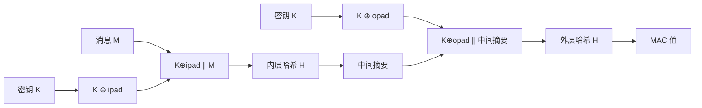

# HMAC的构造原理及其安全性分析

## HMAC 的构造原理

先想一个问题：如果直接把密钥拼在消息前面做哈希，即 $H(K \parallel M)$，会有什么问题？

对 MD5、SHA-1 这类 Merkle–Damgård 结构的哈希函数来说，存在**长度扩展攻击**——攻击者知道 $H(K \parallel M)$ 的值后，可以在不知道 $K$ 的情况下构造出合法的 $H(K \parallel M \parallel M')$。也就是说，直接拼接哈希根本挡不住伪造。

HMAC 就是为解决这个问题设计的。它的构造公式：

$$HMAC(K, M) = H\Big(K \oplus opad \;\Big\|\; H(K \oplus ipad \parallel M)\Big)$$

其中：

| 记号 | 含义 |
|------|------|
| $H$ | 底层哈希函数（如 MD5、SHA-1、SHA-256） |
| $K$ | 密钥，若长度大于分组长度 $B$，则先哈希；若小于 $B$，右补零到 $B$ 字节 |
| $ipad$ | $B$ 字节的 `0x36` 重复串 |
| $opad$ | $B$ 字节的 `0x5C` 重复串 |
| $\parallel$ | 拼接 |

核心思路是**两轮哈希**：内层把密钥混入消息摘要，外层再对结果做一次带密钥的哈希，使最终输出同时绑定密钥 $K$ 和消息 $M$，且无法被长度扩展攻击利用。



> [!IMPORTANT]
> HMAC 的安全性不直接依赖哈希函数的抗碰撞性要求，而主要依赖其**伪随机性**与**压缩函数的单向性**。即便底层哈希函数在抗碰撞上有所削弱（如 MD5），HMAC-MD5 在实际中仍保持了相当长的安全性。

## 伪代码表示

```
function HMAC(K, M):
    if len(K) > B:            # B 为哈希函数的输入分组长度（字节）
        K = H(K)
    if len(K) < B:
        K = K ∥ 0x00^(B - len(K))

    inner = H( (K ⊕ ipad) ∥ M )
    outer = H( (K ⊕ opad) ∥ inner )
    return outer
```

考试手写时写清 $ipad$、$opad$ 的定义和两次哈希的拼接顺序即可。

## 和普通 MAC 的区别

| 方案 | 构造方式 | 问题 |
|------|----------|------|
| CBC-MAC | 用分组密码 CBC 模式加密后取末块 | 只适合定长消息，变长需额外处理 |
| 直接哈希 MAC | $H(K \parallel M)$ | 长度扩展攻击 |
| HMAC | 两轮密钥化哈希 | 无需分组密码，安全可靠，广泛使用 |

> [!TIP]
> 记忆 HMAC 结构只需一句话：**“内层 ipad 把消息和密钥搅在一起哈希，外层 opad 把中间结果再锁一遍”**。$ipad$ 是 `0x36`（“内”的拼音首字母 i 对应直觉），$opad$ 是 `0x5C`（外）。

## 输出长度与常见考点

HMAC 的输出长度等于底层哈希函数的输出长度：

| 算法 | 底层哈希 | 输出长度 |
|------|----------|----------|
| HMAC-MD5 | MD5 | ==16 字节（128 比特）== |
| HMAC-SHA-1 | SHA-1 | 20 字节（160 比特） |
| HMAC-SHA-256 | SHA-256 | 32 字节（256 比特） |

> [!WARNING]
> 填空题常考输出字节数：HMAC-MD5 是 **16B**，不要和 20B 的 SHA-1 系搞混。Two-Track-MAC 基于 RIPEMD-160，所以密钥和输出 MAC 都是 **20B**。

## 一个算对了的例子

设 $K$ 为 16 字节密钥，$H$ 为 MD5，$B = 64$ 字节。给定 $K$ 和消息 $M$：

1. $K$ 长度 $16 < 64$，右补 $48$ 个 `0x00` 得到 $K_0$；
2. 计算 $K_0 \oplus ipad$（64 字节全 `0x36` 异或）；
3. 拼接 $M$，算 MD5，得到 16 字节中间值 $t$；
4. 计算 $K_0 \oplus opad$（64 字节全 `0x5C` 异或），拼接 $t$，再算 MD5；
5. 输出 16 字节的 HMAC-MD5 值。

> [!NOTE]
> 实际应用中 $K$ 长了才哈希、短了才补零，目的是把密钥规整到恰好一个分组长度，便于与 $ipad$、$opad$ 对齐异或。

## 身份验证中的应用

HMAC 常被用来做“挑战—应答”认证：服务器发随机数作为挑战，客户端用密码当密钥对随机数做 HMAC，服务器比对结果。攻击者即便截获随机数和 HMAC 值，也无法反推出密码，且随机数保证每次会话的 MAC 都不同，防重放。

> [!CAUTION]
> 不要把 HMAC 说成“对消息加密”。HMAC 只保证**完整性与认证性**，不提供机密性。消息本身若需要保密，应另外加密。
