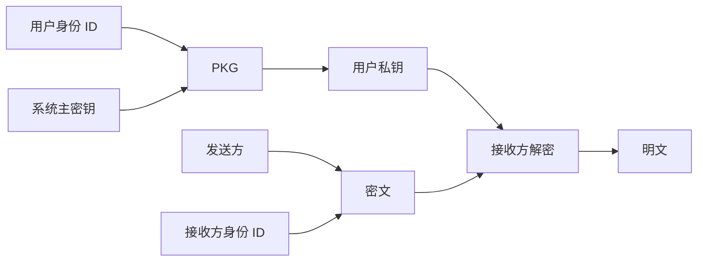

# Identity-Based Encryption (IBE) 基于身份加密的概念

## 什么是 IBE

基于身份的加密（Identity-Based Encryption，IBE）是一种公钥密码体制。它不再使用传统 PKI 中随机生成、并存放在证书目录里的公钥，而是直接把能够唯一标识用户的身份信息作为公钥，例如姓名、电话号码、身份证号码、IP 地址或电子邮件地址。

设用户身份为 $ID_U$，IBE 的基本过程是：

1. 私钥生成器 PKG 根据系统主密钥和 $ID_U$ 生成用户私钥；
2. 发送方使用 $ID_U$ 和系统公开参数执行加密；
3. 接收方用自己的私钥解密。

> [!IMPORTANT]
> IBE 的核心是：**公钥就是身份，身份就是公钥**。

## 为什么需要 IBE

传统公钥密码要求接收方拥有公钥证书，并通过证书目录查找证书，还必须验证证书链和签名是否合法。当用户数量很大时，证书的签发、分发、撤销和真实性验证都会产生较高成本。

IBE 把“公钥与身份的绑定”交给可信第三方 PKG 完成。发送方知道接收者的身份后便可直接加密，==不需要查询和验证接收方的公钥证书==，从而简化公钥管理。

## 怎么实现

IBE 通常由三类算法组成：

- $\operatorname{Setup}(\lambda)$：生成系统主密钥和公开参数；
- $\operatorname{KeyGen}(ID)$：由 PKG 根据身份 $ID$ 生成私钥；
- $\operatorname{Encrypt}(ID,m)$：使用公开参数、接收者身份和明文生成密文；
- $\operatorname{Decrypt}(sk_ID,c)$：使用对应私钥恢复明文。

其中，$ID$、系统公开参数和加密算法可公开；系统主密钥只能由 PKG 保管，否则任何人都能计算任意用户私钥。

## 与传统公钥密码的区别

| 对比项 | IBE | 传统公钥密码 |
|---|---|---|
| 公钥形式 | 身份信息 $ID$ | 随机公钥 |
| 身份与公钥的绑定 | 由 PKG 完成 | 由数字证书完成 |
| 发送方准备 | 通常只需知道 $ID$ | 通常需查目录并验证证书 |
| 密钥生成方 | 可信第三方 PKG | 用户自行生成 |
| 主要依赖 | 对 PKG 的信任 | 对 CA 和证书体系的信任 |

IBE 并没有消除身份管理，只是==把公钥真实性问题转化为身份唯一性与 PKG 信任问题==。

## 常见问题与易错点

> [!WARNING]
> IBE 并不自动保证“这个身份一定属于现实中的某个人”。发送方必须确认 $ID$ 与接收者真实对应，否则可能把消息加密给错误身份。

其主要不足包括：

1. **身份确认困难**：姓名、电话号码等未必天然唯一，用户规模大时管理更复杂，因此更适合用户群较小、身份体系清晰的场合。
2. **私钥交付风险**：PKG 必须把私钥安全地交给用户，还要防止传输途中泄露或被冒领。
3. **不可否认性存在争议**：私钥由 PKG 生成并掌握，PKG 原则上也能计算相同私钥，因此难以证明某次签名或解密一定由用户独立实施。

> [!CAUTION]
> “IBE 不需要公钥目录”不等于“IBE 不需要可信第三方”；恰恰相反，其安全通常依赖于可信的 PKG。

## 一个完整例子

假设系统已经为用户 `alice@njupt.edu.cn` 生成了私钥 $sk_A$。

发送方选择会话密钥 $K$，用该会话密钥加密文件：

$$c \leftarrow \operatorname{AES\text{-}Encrypt}(K,M)$$

再使用 `alice@njupt.edu.cn` 作为接收者身份，对 $K$ 执行 IBE 加密：

$$
c' \leftarrow \operatorname{Encrypt}\bigl(ID_A,K\bigr)
$$

最终发送 $(c,c')$。接收方收到后，先用私钥 $sk_A$ 解出 $K$，再用 $K$ 解密文件：

$$
K \leftarrow \operatorname{Decrypt}(sk_A,c'),\qquad
M \leftarrow \operatorname{AES\text{-}Decrypt}(K,c)
$$

这里必须分清两类密钥：$K$ 是加密文件内容的会话密钥；$ID_A$ 对应的私钥 $sk_A$ 用于解开并保护 $K$，并不是直接用于解密整个文件。
