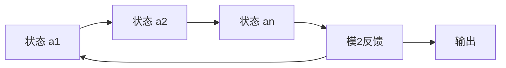

# 线性反馈移位寄存器(LFSR)的结构与工作原理

## 什么是 LFSR

LFSR（Linear Feedback Shift Register，==线性反馈移位寄存器==）是一种由若干触发器和一个反馈函数组成的时序逻辑电路。若反馈函数

$$
f(a_1,a_2,\ldots,a_n)
$$

是状态变量 $a_1,a_2,\ldots,a_n$ 的线性函数，即系数 $c_i\in\{0,1\}$、加法为模 2 加，那么该移位寄存器就称为 LFSR。

它产生的二进制序列周期稳定、便于硬件实现，而且可以用代数方法分析，因此是==序列密码中产生密钥流的主要工具==。

> [!IMPORTANT]
> LFSR 的核心特征是“线性反馈”，不是“指令寄存器”，也不是任意逻辑反馈。

## 结构与工作原理

一个 $n$ 级 LFSR 保存 $n$ 个状态位。每次时钟到来，寄存器整体移位，同时把若干状态位的线性组合送回反馈端：

$$
s_{t+n}=c_1s_t+c_2s_{t+1}+\cdots+c_ns_{t+n-1}\pmod 2
$$

其中 $c_i$ 表示对应抽头是否参与反馈。常见形式是

$$
s_{t+n}=s_t\oplus s_{t+k}
$$

或写成 $s_{t+n}=s_{t+n-k}\oplus s_t$，具体下标关系取决于抽头位置和移位方向。

若抽头选择使状态转移矩阵在有限域 $GF(2)$ 上是==本原多项式==，则所有非零初态都位于同一个循环中，输出序列的周期达到最大：

$$
P_{\max}=2^n-1
$$

> [!TIP]
> 记忆口诀：$n$ 个状态位共有 $2^n$ 种状态，但全零状态通常只能产生全零序列，因此非零状态的最大循环长度是 $2^n-1$。

## 为什么需要它

LFSR 适合密码电路，主要因为：

1. ==易于硬件实现==，只需触发器、异或门和少量连线；
2. ==周期长且结构规律明确==，方便分析和测试；
3. 能与旋转器、非线性组合器等配合，构成密钥流发生器。

不过，单个 LFSR 的输出通常具有较强线性结构，不能直接作为理想密钥流。因此实际系统常将多个 LFSR 进行非线性组合，提高输出的复杂度和不可预测性。

## 与相近概念的区别

| 概念 | 主要作用 | 与 LFSR 的区别 |
|---|---|---|
| 普通移位寄存器 | 存储和移位数据 | 反馈不一定线性 |
| 指令寄存器 | 存放并执行指令 | 不是密钥序列产生器 |
| PRNG | 广义伪随机数生成器 | 可以包含 LFSR，也可能采用其他方法 |
| LFSR | 产生周期伪随机序列 | 反馈函数必须是线性的 |

## 常见误区

> [!WARNING]
> “$n$ 级 LFSR 的最大周期是 $2^n$”是错误的，正确答案是 $2^n-1$。

还要注意：

- $2^n-1$ 是最大可能周期，并非任意抽头组合都能达到；
- 全零初态通常会停留在全零状态，不能形成最大周期；
- 周期长不等于密码安全性强，多个 LFSR 直接异或仍可能保留明显线性关系。

## 算对的例子

已知一个 3 级 LFSR 的反馈关系为

$$
s_{t+3}=s_t\oplus s_{t+1}
$$

初态取 $(s_0,s_1,s_2)=(1,0,0)$，则：

$$
\begin{aligned}
s_3&=1\oplus0=1,\\
s_4&=0\oplus1=1,\\
s_5&=1\oplus1=0.
\end{aligned}
$$

因此输出序列为

$$
110110\cdots
$$

继续计算可发现它按 $110$ 循环，周期为 $7=2^3-1$。这也说明：只有抽头和初始状态选择合适，才能取得理论最大周期。
