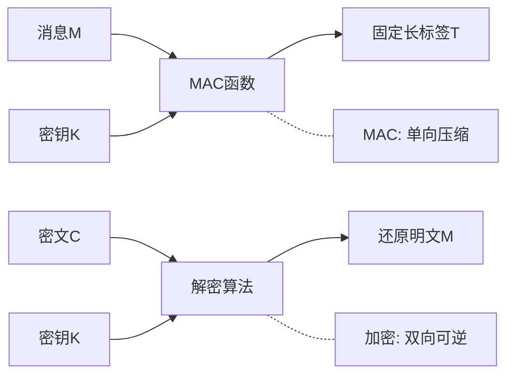
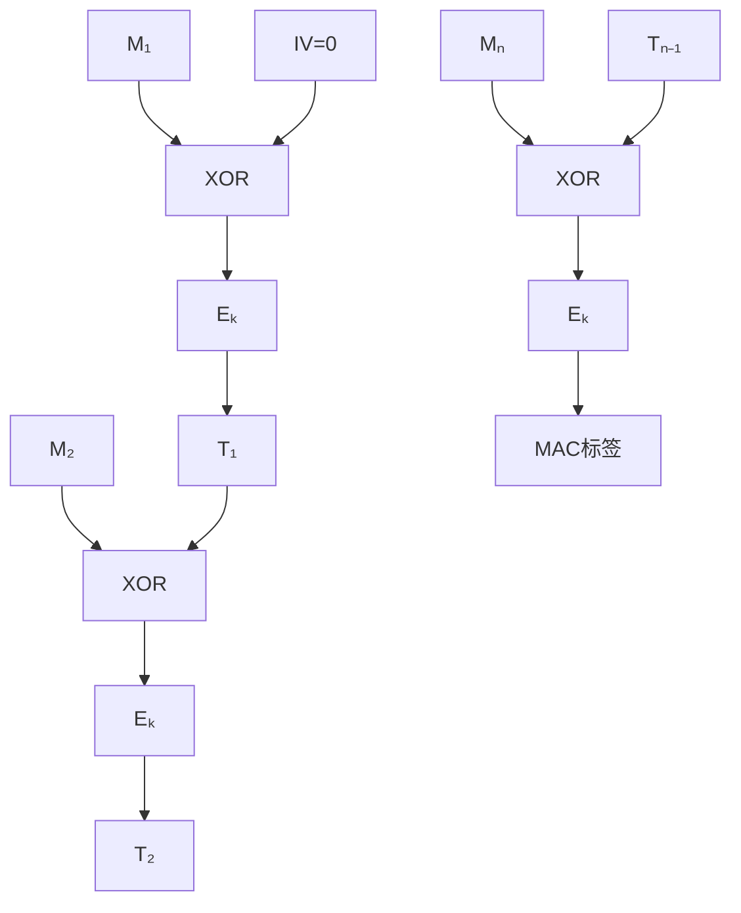

# MAC函数与加密算法的比较

## 为什么认证不必可逆？

加密是为了让窃听者“看不懂”，而MAC是为了让接收方确认消息“没被改”。既然目的不同，是否还需要像加密那样保证函数可逆？答案是否定的。==MAC函数不必是可逆的==，这正是它与加密算法最本质的区别。因为不需要还原原文，MAC可以使用单向压缩特性，这使得攻击者无法从标签反推密钥或消息，因此相比同等强度的加密算法更不易被攻破。

> [!IMPORTANT]
> MAC的核心价值是完整性与源认证，而非保密性。其不可逆性（单向性）是安全优势，而非功能缺陷。

## MAC与加密算法的核心差异

| 比较维度 | 加密算法 | MAC函数 |
| :--- | :--- | :--- |
| 核心目标 | 保密性 | 完整性、数据源认证 |
| 可逆性 | 必须可逆（解密） | ==不必可逆==（单向） |
| 输出长度 | 通常≥明文长度 | 固定短标签（如128bit） |
| 密钥作用 | 加解密均依赖 | 仅生成/验证标签 |
| 抗攻击性 | 需抵抗密文分析 | 抗伪造、抗碰撞 |



## 常见MAC算法与CBC-MAC流程

南邮课程中常考的5种MAC算法包括：MD4、MD5、SHA-0、SHA-1、HMAC。需注意这些是哈希基础，实际MAC多基于它们构造（如HMAC）。

> [!WARNING]
> 判断题“数据认证算法检测密文是否被篡改”答案为√，但严格来说MAC验证的是==消息完整性==，无论消息以明文还是密文形式传输均可应用。

CBC-MAC是分组密码构造MAC的经典模式，其伪代码如下：

```python
# CBC-MAC 认证过程
T = IV  # 通常IV=0
for i in range(n):
    T = E_K(T XOR M_i)
return T  # 最终密文块即为MAC标签
```



> [!TIP]
> CBC-MAC只取==最后一个密文分组==作为标签，这与CBC加密输出所有密文组完全不同。若消息长度可变，直接使用CBC-MAC存在伪造风险，应改用CMAC或HMAC。

## 避坑指南与正确示例

**常见误区**：认为MAC能替代加密提供保密性；混淆哈希函数与MAC（无密钥的哈希不是MAC）。

**算对示例**：使用DES-CBC-MAC处理2组消息 $M_1, M_2$，密钥 $K$，$IV=0$。计算 $T_1 = E_K(M_1 \oplus 0)$，再算 $T_2 = E_K(M_2 \oplus T_1)$，最终MAC值为 $T_2$。验证时接收方用相同密钥和消息重新计算，比对 $T_2$ 即可判定完整性，全程无需任何逆运算。
