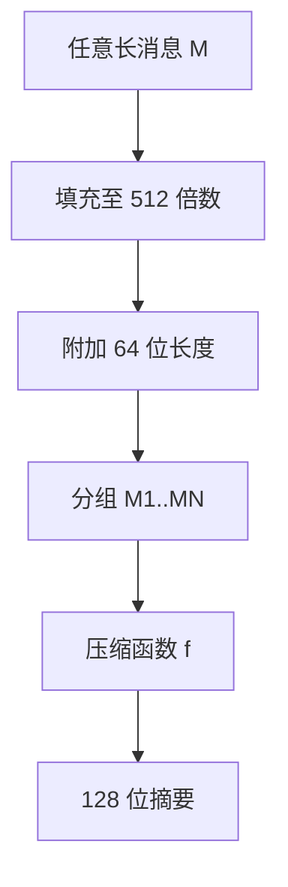

# MD5算法的整体流程、压缩函数及四轮循环操作实例

## MD5 是什么

MD5（Message Digest 5）是 Rivest 于 1991 年提出的==单向 Hash 函数==，输入任意有限长消息，输出固定 **128 比特（16 字节）** 的消息摘要。它与 SHA-1、RIPEMD-160 同属第一代 Hash 标准，但摘要更短（SHA-1 为 160 比特）。

## 为什么需要它

Hash 函数要满足三条安全性质：

| 性质 | 含义 | 攻击目标 |
|---|---|---|
| 单向性 | 给 $h$ 找 $M$ 使 $H(M)=h$ 不可行 | 原像攻击 |
| 抗弱碰撞 | 给 $M_1$ 找 $M_2\neq M_1$ 使 $H(M_1)=H(M_2)$ 不可行 | 第二原像 |
| 抗强碰撞 | 找任意一对 $M_1,M_2$ 使 $H(M_1)=H(M_2)$ 不可行 | 生日攻击 |

> [!IMPORTANT]
> MD5 的强碰撞性已被王小云团队攻破（2004），因此**不能再用于数字签名**；但因其速度快，仍可用于完整性校验、HMAC 等场景。

## 整体流程

**填充规则**：先补一个 1，再补若干 0，使长度 $\equiv 448 \pmod{512}$，最后附加 64 位原始长度（小端序）。

> [!WARNING]
> 常见错误：忘记先补"1"再补"0"，或长度用比特却按字节编码。

## 压缩函数与四轮循环

MD5 每轮处理 512 比特分组，使用 4 个 32 比特寄存器 $A,B,C,D$（初值固定），经 **4 轮×16 步** 更新：

$$A \leftarrow B + ((A + F(B,C,D) + M[k] + T[i]) \lll s)$$

- **$F$ 按轮次轮换**：
  - 轮 1：$F(X,Y,Z)=(X\land Y)\lor(\lnot X\land Z)$
  - 轮 2：$G(X,Y,Z)=(X\land Z)\lor(Y\land\lnot Z)$
  - 轮 3：$H(X,Y,Z)=X\oplus Y\oplus Z$
  - 轮 4：$I(X,Y,Z)=Y\oplus(X\lor\lnot Z)$
- **$T[i]$**：$T[i]=\lfloor 2^{32}|\sin(i)|\rfloor$，共 64 个常量
- **$\lll s$**：循环左移，每步移位数不同

## 一个算对了的例子

对空字符串 "" 做 MD5：

1. 填充：消息长度 0，补 1 个 1 和 447 个 0，再附加 64 位 0
2. 压缩：初值 $A=0x67452301,\ B=0xefcdab89,\ C=0x98badcfe,\ D=0x10325476$
3. 经 64 步迭代后输出：

$$H(\text{""})=\texttt{d41d8cd98f00b204e9800998ecf8427e}$$

> [!TIP]
> 记忆：MD5 输出 32 个十六进制字符 = 128 比特 = **16 字节**。HMAC-MD5 输出长度即为 16 字节，这是常考判断点。

## 与相近概念的区别

| 特性 | MD5 | SHA-1 | SHA-256 |
|---|---|---|---|
| 输出长度 | 128 比特 | 160 比特 | 256 比特 |
| 安全性 | 已破 | 已弱 | 安全 |
| 分组长度 | 512 比特 | 512 比特 | 512 比特 |

> [!CAUTION]
> 考试易混：MD5 分组长度是 512 比特，但**输出是 128 比特**；不要写成"MD5 输出 512 位"。
