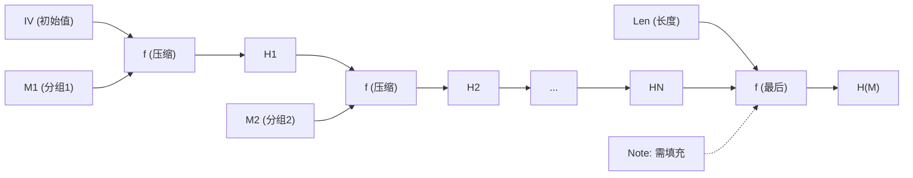

# 杂凑函数的Merkle-Damgard迭代构造方法与直接设计散列函数

## 什么是杂凑函数的构造？

面对任意长度的消息 $M$，如何将其压缩为固定长度 $n$ 比特的摘要 $H(M)$？主要有两条路径：**迭代构造**（如 Merkle-Damgard）与**直接设计**。理解两者的区别是掌握 Hash 函数安全性的关键。

## Merkle-Damgard (MD) 迭代构造

这是 MD5、SHA-1、SHA-2 等经典算法的基础架构。其核心思想是将长消息分块，通过压缩函数 $f$ 迭代处理。

**怎么做？**
1. **填充与分块**：对消息 $M$ 进行填充，使其长度满足 $L \equiv 448 \pmod{512}$（以 SHA-1/MD5 为例），并附加 64 位长度信息，最终分为 $t$ 个 512 比特分组 $M_1, \dots, M_t$。
2. **迭代计算**：设定初始向量 $H_0 = IV$。对于 $i=1$ 到 $t$，计算 $H_i = f(H_{i-1}, M_i)$。
3. **输出**：最终输出 $H_t$ 作为哈希值。

> [!IMPORTANT]
> ==MD 结构的安全性依赖==：若压缩函数 $f$ 是抗碰撞的，则整个 MD 构造也是抗碰撞的。但需注意，MD 结构天然存在==长度扩展攻击==风险。

## 直接设计散列函数

不依赖迭代结构，而是直接基于数学难题或专用变换设计。典型代表是基于模运算的 hash 或某些轻量级算法。

**特点对比：**

| 特性 | Merkle-Damgard 迭代 | 直接设计 |
| :--- | :--- | :--- |
| **基础** | 压缩函数 $f$ 的迭代 | 整体数学变换/代数结构 |
| **灵活性** | 高，易扩展消息长度 | 低，通常限制输入长度或结构 |
| **安全性证明** | 可归约至 $f$ 的安全性 | 往往依赖特定假设，难通用证明 |
| **典型应用** | SHA-2, MD5, SM3 | 早期理论模型, 特定场景 |

> [!WARNING]
> 直接设计往往难以像 MD 结构那样提供通用的安全性归约证明。在现代标准中，纯粹的直接设计较少见，多结合宽管道（Wide Pipe）等改进技术。

## 常见坑与解题技巧

**坑 1：忽略填充中的长度域**
很多题目会问“为什么 MD 结构要附加消息长度？”
**答**：为了防止不同长度的消息在经过填充后产生相同的分组序列，从而避免简单的碰撞。更重要的是，它是防御部分长度扩展攻击的基础（虽不能完全防御）。

**坑 2：混淆 IV 的作用**
IV 是公开固定的常数，不是密钥。如果将 IV 当作密钥使用，无法提供 MAC 的安全性。

> [!TIP]
> **记忆口诀**：MD 迭代像接力，分组压缩传到底；长度填充不能少，防止扩展搞偷袭。

## 算例演示

假设压缩函数 $f(H, M) = (H \oplus M) \lll 1$（左循环移位 1 位），IV = `0000`，消息 $M$ 分为两组 $M_1=`1010`$, $M_2=`1100`$。

1. $H_0 = 0000$
2. $H_1 = f(0000, 1010) = (0000 \oplus 1010) \lll 1 = 1010 \lll 1 = 0101$
3. $H_2 = f(0101, 1100) = (0101 \oplus 1100) \lll 1 = 1001 \lll 1 = 0011$

最终 Hash 值为 `0011`。注意每一步的异或和移位操作必须精确。
