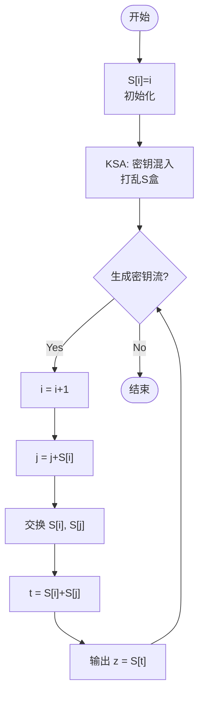

# RC4序列密码算法的流程与特点

# RC4序列密码算法的流程与特点

RC4（Rivest Cipher 4）是由RSA数据安全公司开发的一种==可变密钥长度==的序列密码。作为世界上使用最广泛的流密码之一，它曾广泛应用于IEEE 802.11 WLAN（WEP协议）及SSL/TLS早期版本中。

## 为什么需要RC4？

在对称加密中，分组密码（如AES）需等待完整数据块才能处理，而序列密码则是==逐比特或逐字节==进行异或运算。
- **优势**：软件实现极简、加解密速度极快、无错误传播（一个密文位出错仅影响对应明文位）。
- **场景**：适用于实时通信或对延迟敏感的场景。

> [!IMPORTANT]
> 核心结论：RC4属于**同步序列密码**，其安全性完全依赖于密钥流生成器的伪随机性。目前建议密钥长度至少为==128位==以保障安全强度。

## 算法流程：KSA与PRGA

RC4的核心在于内部状态数组 $S$（长度为256）和两个索引指针 $i, j$。算法分为两个阶段：

### 1. 密钥调度算法 (KSA)
目的是利用种子密钥 $K$ 对初始排列 $S$ 进行打乱。
1. 初始化：$S[i] = i, \quad i=0,\dots,255$。
2. 混合：利用密钥 $K$ 对 $S$ 进行置换，确保 $S$ 的状态与密钥强相关。

### 2. 伪随机生成算法 (PRGA)
从打乱后的 $S$ 中生成密钥流 $z$。
1. 更新索引：$i = (i + 1) \mod 256$。
2. 交换元素：$j = (j + S[i]) \mod 256$，交换 $S[i]$ 与 $S[j]$。
3. 输出密钥流：$t = (S[i] + S[j]) \mod 256$，输出 $z = S[t]$。

## 常见误区与辨析

| 特性 | RC4 (序列密码) | AES (分组密码) |
| :--- | :--- | :--- |
| **处理单位** | 字节/比特流 | 固定长度分组 (128位) |
| **错误传播** | ==无== (独立解密) | 有 (CBC模式下扩散) |
| **实现复杂度** | 低 (仅需置换和加法) | 高 (多轮代换-置换网络) |

> [!WARNING]
> 高危误区：RC4存在已知弱点（如初始字节偏差），**严禁**在现代新系统中单独使用。WEP协议因RC4密钥重用问题已被彻底破解。

## 典型例题解析

**题目**：列举5个流密码算法。
**解析**：根据南邮课件及国际标准，常见的流密码包括：
1. **RC4**：应用最广，变长密钥。
2. **A5**：GSM移动通信标准。
3. **SNOW2**：面向软件的流密码。
4. **OFB模式**：输出反馈模式，将分组密码转化为流密码。
5. **CTR模式**：计数器模式，同样实现流式加密。

> [!TIP]
> 记忆技巧：流密码口诀“**R**C4 **A**5 **S**NOW”，加上两种分组转流的模式（OFB/CTR）。注意区分：RC4是原生流密码，而OFB/CTR是工作模式。
