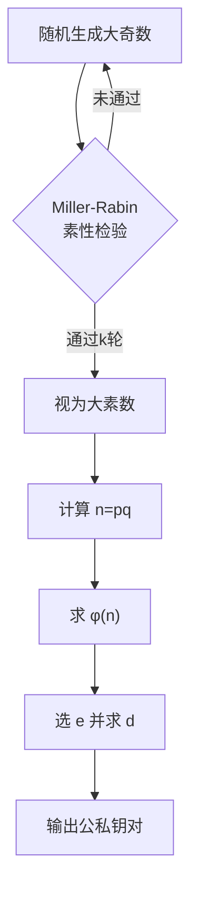

# RSA的安全性问题（|q-p|要大、密钥泄露）、素数的产生与RSA的实现

RSA 的理论基础是数论中的欧拉定理，其安全性依赖于==大整数的素因子分解的困难性==。但在实际工程中，仅仅“理论上安全”远远不够，参数的选取与实现细节直接决定了系统能否抵御真实攻击。

> [!IMPORTANT]
> **欧拉函数**：设 $n$ 是一正整数，小于 $n$ 且与 $n$ 互素的正整数的个数称为 $n$ 的欧拉函数，记为 $\varphi(n)$。若 $n=pq$（$p,q$ 为素数），则 $\varphi(n)=(p-1)(q-1)$。

## RSA 的安全性问题

### 为什么要求 $|q-p|$ 要大？

如果两个素数 $p$ 和 $q$ 靠得太近，会发生什么？假设 $p \approx q$，那么 $n = pq \approx p^2$，即 $p \approx \sqrt{n}$。攻击者只需从 $\lfloor\sqrt{n}\rfloor$ 开始逐个向下试探，就能迅速完成因式分解（费马分解法）。因此，必须保证 $|q-p|$ 足够大，使两者不在同一数量级附近。

### 密钥泄露

私钥 $d$ 一旦泄露，不仅意味着当前通信被破解。已知 $d$ 和 $e$，攻击者可以通过概率算法高效地分解 $n$，从而彻底摧毁该密钥对的基础。此外，若多个用户共享同一个模数 $n$（即使 $e, d$ 不同），也会导致共模攻击，使得密文被轻易恢复。

> [!WARNING]
> 绝不能为了省事让多个用户共用同一个模数 $n$；私钥 $d$ 也不能过小，否则易受 Wiener 小指数攻击。

## 素数的产生与 RSA 的实现

要构造 RSA 密钥，首先得有“大素数”。但如何判断一个几百位的数是素数？逐一试除显然不现实。工程上通常采用**概率性素性检验**（如 Miller-Rabin 算法）：随机生成一个大奇数，经过多轮检验后，若均未被判定为合数，则以极高概率认为它是素数。

> [!NOTE]
> 确定性检验（如 AKS）虽然理论上存在，但速度太慢，实际密码系统中几乎只用概率检验。

## 正确算例

回顾欧拉函数的定义，我们来看一个完整的 RSA 参数生成过程。

取小素数 $p=5, q=11$（此处仅为演示，实际中 $n$ 至少需 1024 位）：

1. **计算模数**：$n = p \times q = 55$。
2. **计算欧拉函数**：$\varphi(n) = (5-1)(11-1) = 40$。
3. **选取公钥指数 $e$**：要求 $1 < e < \varphi(n)$ 且 $\gcd(e, \varphi(n)) = 1$。取 $e = 3$（因为 $\gcd(3, 40)=1$）。
4. **计算私钥 $d$**：满足 $ed \equiv 1 \pmod{\varphi(n)}$，即 $3d \equiv 1 \pmod{40}$。解得 $d = 27$（因为 $3 \times 27 = 81 = 2 \times 40 + 1$）。
5. **验证欧拉定理**：若明文 $m=2$（与 $n$ 互素），加密 $c = m^e \bmod n = 2^3 \bmod 55 = 8$；解密 $m' = c^d \bmod n = 8^{27} \bmod 55$。由欧拉定理 $a^{\varphi(n)} \equiv 1 \pmod n$，可推得 $m'=2$，解密成功。

> [!TIP]
> 考试求 $d$ 时，用扩展欧几里得算法最稳；数字小时可直接凑 $ed = k\varphi(n) + 1$ 中的整数 $k$。

## 相近概念对比

| 比较项 | 理论要求 | 工程实现 |
| :--- | :--- | :--- |
| **素数判定** | 绝对确定（试除法） | 高概率正确（Miller-Rabin） |
| **$p, q$ 关系** | 任意不相等素数 | $\|q-p\|$ 必须大，且位数相近 |
| **密钥长度** | 无明确下界 | $\ge 1024$ 位（推荐 2048 位） |
