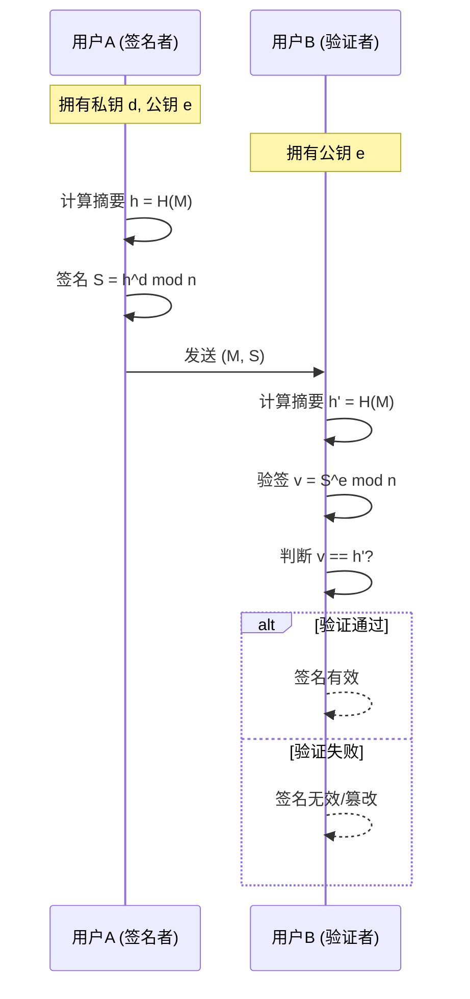

# 基于RSA的数字签名算法（初始化、签名过程、验证过程）及注意问题

## 基于 RSA 的数字签名算法

数字签名的核心目的是实现==身份认证==、==数据完整性==和==不可否认性==。与加密不同，签名不为了保密，而是为了“证明是你发的”。在 RSA 体制中，利用公钥和私钥的数学对称性，通过**私钥签名、公钥验证**来实现这一目标。

> [!IMPORTANT]
> **核心原则**：签名必须使用**签名者自己的私钥**，验证使用**签名者的公钥**。切勿混淆为接收方的密钥。

### 算法流程

RSA 数字签名通常结合哈希函数 $H(\cdot)$ 使用，以解决长消息处理效率低及安全性问题。

1.  **系统初始化**：
    *   选取大素数 $p, q$，计算 $n=pq$，$\phi(n)=(p-1)(q-1)$。
    *   选取公钥 $e$，计算私钥 $d \equiv e^{-1} \pmod{\phi(n)}$。
    *   公开参数：$(n, e)$；保密参数：$(d, p, q)$。

2.  **签名过程**：
    用户 A 对消息 $M$ 进行签名：
    *   计算消息摘要：$h = H(M)$
    *   生成签名：$$S = h^d \bmod n$$
    *   将 $(M, S)$ 发送给接收方。

3.  **验证过程**：
    用户 B 收到 $(M, S)$ 后：
    *   计算消息摘要：$h' = H(M)$
    *   恢复摘要：$$v = S^e \bmod n$$
    *   判定：若 $v = h'$，则签名有效；否则无效。

### 常见误区与注意问题

| 概念 | 正确做法 | 常见错误 (坑) |
| :--- | :--- | :--- |
| **密钥选择** | 用**自己**的私钥签名 | 误用对方的公钥或私钥 |
| **处理对象** | 对**消息摘要** $H(M)$ 签名 | 直接对长消息 $M$ 签名（慢且不安全） |
| **安全性** | 需填充方案 (如 PSS) | 直接使用教科书式 RSA (易受攻击) |

> [!WARNING]
> **效率与安全**：RSA 运算速度慢，直接对长消息签名效率极低。此外，未加哈希的直接签名可能面临存在性伪造攻击。因此，实际应用中**必须**先 Hash 再签名。

> [!TIP]
> **记忆口诀**：签名是“私钥盖章”，验证是“公钥验章”。谁想证明身份，就用谁的私钥。

### 典型例题解析

**题目**：设用户 A 选取 $p=5, q=11$（注：原题 $p=15$ 非素数，此处修正为合法素数以演示逻辑），$n=55$，$\phi(n)=40$。选取公钥 $e=7$。求私钥 $d$，并验证 $3$ 是否是对报文摘要 $m=5$ 的有效签名。

**解答步骤**：
1.  **求私钥 $d$**：
    需满足 $e \cdot d \equiv 1 \pmod{40}$，即 $7d \equiv 1 \pmod{40}$。
    通过扩展欧几里得算法或试算：$7 \times 23 = 161 = 4 \times 40 + 1$。
    故私钥 $d = 23$。

2.  **验证签名**：
    *   已知：签名 $S=3$，摘要 $m=5$，公钥 $e=7, n=55$。
    *   计算验证值 $v$：
        $$v = S^e \bmod n = 3^7 \bmod 55$$
        $$3^1=3, 3^2=9, 3^3=27, 3^4=81 \equiv 26, 3^7 = 3^4 \cdot 3^3 = 26 \cdot 27 = 702$$
        $$702 \div 55 = 12 \dots 42 \implies v = 42$$
    *   比对：$v = 42 \neq m (5)$。
    *   **结论**：$3$ **不是**对摘要 $5$ 的有效签名。

*(注：若题目意图是让你计算正确的签名，则 $S = 5^{23} \bmod 55$。)*
