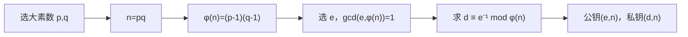

# RSA算法的数论基础（欧拉定理）、密钥产生、加解密描述、证明及举例

## RSA 算法的数论基础与加解密

先从一个问题入手：普通对称加密要求双方事先共享同一把密钥，但在开放网络中，两个从未见过面的人怎样才能安全通信？RSA 的回答是：找一种“加密容易、逆推困难”的数学函数——大整数分解。

### 欧拉定理：RSA 的数学引擎

设 $\varphi(n)$ 为欧拉函数，表示小于 $n$ 且与 $n$ 互素的正整数个数。

> [!IMPORTANT]
> **欧拉定理**：若 $\gcd(a,n)=1$，则
> $$a^{\varphi(n)} \equiv 1 \pmod n$$

这是 RSA 解密能“还原”出明文的根本依据。直观理解：在模 $n$ 的缩系（与 $n$ 互素的剩余类集合）中，任意元素 $a$ 的 $\varphi(n)$ 次幂会回到单位元 $1$。

> [!NOTE]
> **欧拉函数计算**：$\varphi(400)=\varphi(2^4 \times 5^2)=(16-8)\times(25-5)=160$。一般地，若 $n=\prod p_i^{e_i}$，则 $\varphi(n)=\prod p_i^{e_i-1}(p_i-1)$。

### RSA 密钥产生

具体步骤：

1. **选取两个大素数** $p$ 和 $q$（如各 512 位以上）。
2. **计算** $n = pq$，$\varphi(n) = (p-1)(q-1)$。
3. **选取加密指数** $e$，满足 $1 < e < \varphi(n)$ 且 $\gcd(e,\varphi(n))=1$。常用 $e = 65537$。
4. **计算解密指数** $d$，满足 $ed \equiv 1 \pmod{\varphi(n)}$，即 $d$ 是 $e$ 模 $\varphi(n)$ 的乘法逆元。
5. **公开** $(e,n)$ 作为公钥，**保密** $(d,n)$ 作为私钥，并销毁 $p,q$。

> [!WARNING]
> $p$ 和 $q$ 必须严格保密并销毁。一旦泄露，攻击者就能算出 $\varphi(n)$，从而由公钥 $e$ 求出私钥 $d$。

### 加解密描述

设明文分组为 $m$（满足 $0 \le m < n$），密文为 $c$：

**加密**：
$$c \equiv m^e \pmod n$$

**解密**：
$$m \equiv c^d \pmod n$$

RSA 既能用于加密，也能用于数字签名——签名时用**自己的私钥** $d$ 运算，验证时用**对方公钥** $e$ 运算。

> [!WARNING]
> 若 A 想给 B 发送加密邮件，A 必须用 **B 的公钥**加密。用自己的私钥加密，任何人都能用 A 的公钥解出内容，这实际上是签名而非保密。

### 正确性证明

解密的本质是计算 $(m^e)^d = m^{ed} \pmod n$。因为 $ed \equiv 1 \pmod{\varphi(n)}$，可设 $ed = k\varphi(n) + 1$（$k$ 为整数）。于是：

$$m^{ed} \equiv m^{k\varphi(n)+1} \equiv (m^{\varphi(n)})^k \cdot m \pmod n$$

**若 $\gcd(m,n)=1$**，由欧拉定理 $m^{\varphi(n)} \equiv 1 \pmod n$，故 $m^{ed} \equiv m \pmod n$。

**若 $\gcd(m,n) \neq 1$，** 即 $m$ 是 $p$ 或 $q$ 的倍数。不妨设 $m \equiv 0 \pmod p$，则 $m^{ed} \equiv 0 \equiv m \pmod p$ 成立；模 $q$ 时 $\gcd(m,q)=1$ 仍适用欧拉定理，得 $m^{ed} \equiv m \pmod q$。由 CRT，$m^{ed} \equiv m \pmod{pq = n}$ 恒成立。

> [!IMPORTANT]
> ==RSA 解密能还原明文，核心就是 $ed = k\varphi(n)+1$ 配合欧拉定理==。即使 $m$ 与 $n$ 不互素，结论依然成立。

### 一个算对了的例子

取 $p = 3$，$q = 7$（实际中远不够安全，仅作演示）：

| 步骤 | 计算 | 结果 |
|:---|:---|:---|
| $n$ | $3 \times 7$ | $21$ |
| $\varphi(n)$ | $(3-1)(7-1)$ | $12$ |
| 选 $e$ | $\gcd(e,12)=1$ | $e=5$ |
| 求 $d$ | $5d \equiv 1 \pmod{12}$ | $d=17$（因为 $5 \times 17 = 85 = 7 \times 12 + 1$） |

设明文 $m = 2$：

**加密**：$c = 2^5 \bmod 21 = 32 \bmod 21 = 11$

**解密**：$m = 11^{17} \bmod 21 = 2$

验证：$11^2 \equiv 16 \pmod{21}$，$11^4 \equiv 16^2 \equiv 4 \pmod{21}$，$11^8 \equiv 4^2 \equiv 16 \pmod{21}$，$11^{16} \equiv 4 \pmod{21}$，故 $11^{17} \equiv 11 \times 4 \equiv 44 \equiv 2 \pmod{21}$。✓

### 与其他公钥算法的区别

| 算法 | 数学基础 | 典型用途 |
|:---|:---|:---|
| RSA | 大整数分解困难 | 加密、签名、密钥交换 |
| ECC | 椭圆曲线离散对数 | 加密、签名，密钥更短 |
| ElGamal | 离散对数 | 加密、签名 |
| McEliece | 纠错码（Goppa 码） | 加密，抗量子攻击 |

> [!CAUTION]
> 并非所有公钥算法都能同时用于加密和签名。例如 McEliece 体制基于纠错码，适合加密但不适合签名。判断题“所有公钥密码算法都可以用于签名和保密”是错误的。

> [!TIP]
> **记忆口诀**：加密用“对方公钥”，签名用“自己私钥”。公钥加密如“投信到对方信箱”，私钥签名如“盖自己的章”。
