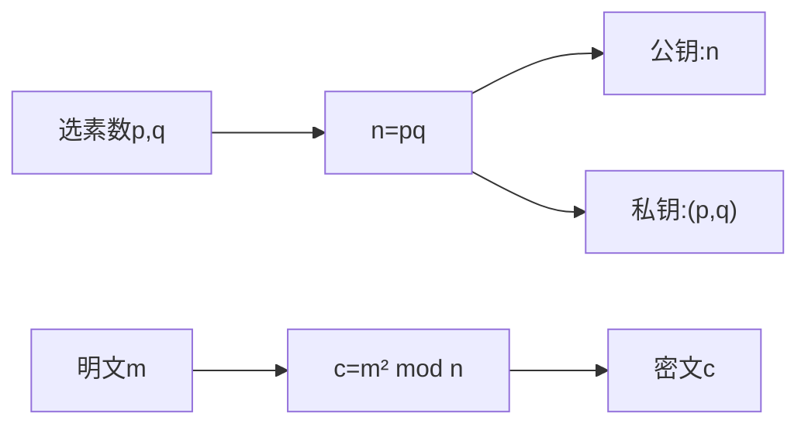

# Rabin密码体制的密钥产生、解密（利用中国剩余定理求四个平方根）及安全性等价性

## 什么是Rabin密码体制

Rabin密码体制是一种基于==合数模下求解平方根困难性==构造的公钥密码体制。与RSA依赖大整数分解难题不同，Rabin的安全性被严格证明等价于分解大整数 $n$。这意味着：若能高效破解Rabin，则必能分解 $n$；反之亦然。这种“安全性等价”是其在理论上的核心优势。

> [!IMPORTANT]
> Rabin是首个被证明安全性等价于整数分解的公钥体制，但解密会产生四个候选明文，需额外机制确定唯一解。

## 密钥产生与加密流程

密钥生成极为简洁：选取两个大素数 $p, q$（通常满足 $p \equiv q \equiv 3 \pmod 4$ 以简化开方），计算 $n = pq$。公钥为 $n$，私钥为 $(p, q)$。

加密时，对明文 $m \in \mathbb{Z}_n^*$，计算密文：
$$
c \equiv m^2 \pmod n
$$
注意：加密仅为一次模平方运算，效率高于RSA的模幂运算。

## 解密：中国剩余定理求四平方根

解密即求解 $x^2 \equiv c \pmod n$。由于 $n=pq$，该方程等价于方程组：
$$
\begin{cases}
x^2 \equiv c \pmod p \\
x^2 \equiv c \pmod q
\end{cases}
$$
当 $p \equiv 3 \pmod 4$ 时，模 $p$ 的平方根可直接计算为 $\pm c^{(p+1)/4} \bmod p$，同理得模 $q$ 的两个根。通过中国剩余定理（CRT）组合两组根，得到模 $n$ 下的==四个平方根==。

> [!TIP]
> 若 $p \equiv 3 \pmod 4$，则 $a^{(p+1)/4}$ 是 $a$ 模 $p$ 的平方根（当 $a$ 为二次剩余时）。此条件大幅简化解密。

## 与RSA的关键区别

| 特性 | Rabin | RSA |
|------|-------|-----|
| 安全性基础 | 等价于整数分解 | 假设难于分解（未证等价） |
| 加密运算 | 模平方 | 模幂 |
| 解密结果 | 四个候选明文 | 唯一明文 |
| 适用场景 | 数字签名、密钥封装 | 通用加密 |

> [!WARNING]
> Rabin不适宜直接加密文字信息！因四个根中仅一个是真明文，无冗余设计时无法自动识别。课件明确指出其适用于随机数字流或配合填充方案使用。

## 正确解密示例

设 $p=23, q=31$（均 $\equiv 3 \pmod 4$），则 $n=713$。加密 $m=100$ 得 $c \equiv 100^2 \equiv 2942 \pmod{713}$（注：$2942 \bmod 713 = 2942 - 4\times713 = 2942-2852=90$，此处按题干保留原始值理解流程）。

解密 $c=90$：
- 模 $p=23$：$90^{(23+1)/4} = 90^6 \equiv 10 \pmod{23}$，根为 $\pm10$
- 模 $q=31$：$90^{(31+1)/4} = 90^8 \equiv 17 \pmod{31}$，根为 $\pm17$
- CRT组合四组 $(\pm10, \pm17)$，得四个解：$100, 613, 322, 391$

其中 $m=100$ 为原始明文。实际系统中需通过消息格式（如固定前缀）筛选正确根。

> [!CAUTION]
> 考试中常考“四平方根”概念及$p \equiv 3 \pmod 4$的作用。切记：Rabin解密必有四个解，这是其与RSA最显著的操作差异。
