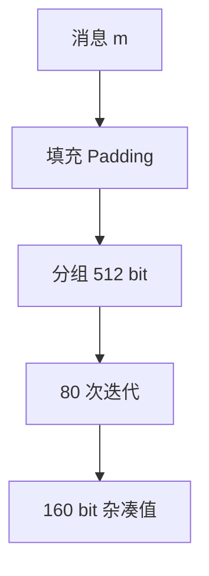

# SHA-1算法原理、IV初值、Kt常数、处理步骤（4回合80次操作）

SHA-1（Secure Hash Algorithm-1）属于 ==第一代单向 Hash 函数标准==，与 MD5、RIPEMD-160 同代。它接受任意有限长度的消息，输出固定 160 比特的杂凑值，可用于数据完整性校验与数字签名。与之对比，第二代标准是美国的 SHA-2 与欧洲的 Whirlpool。

## 为什么消息要先"对齐"

SHA-1 的 ==数据分组长度是 512 比特（64 字节）==，并非 64 比特。因此任意长度的消息必须先填充到 512 比特的整数倍。想想看：`0x00` 和 `0x0000` 这两条消息，原始比特串并不一样，那它们的 SHA-1 杂凑值相同吗？

> [!WARNING]
> 这是常考的判断题坑：分组是 **512 比特**，但内部寄存器与运算用 **32 比特** 字，别混淆。

## 算法整体流程

## IV 初值与 Kt 常数

SHA-1 维护 5 个 32 比特寄存器 $A,B,C,D,E$，初值 ==IV==（十六进制）：

$$
A{=}0\text{x}67452301,\; B{=}0\text{x}\text{EFCDAB89},\; C{=}0\text{x}98BADCFE},\; D{=}0\text{x}10325476,\; E{=}0\text{x}C3D2E1F0
$$

==Kt 常数== 随回合切换，只有 4 个不同值：

| 回合 | 迭代 $t$ | $K_t$（十六进制） | 轮函数 $f_t$ |
|---|---|---|---|
| 1 | 0–19 | $0\text{x}5A827999$ | $(B\land C)\lor(\lnot B\land D)$ |
| 2 | 20–39 | $0\text{x}6ED9EBA1$ | $B\oplus C\oplus D$ |
| 3 | 40–59 | $0\text{x}8F1BBCDC$ | $(B\land C)\lor(B\land D)\lor(C\land D)$ |
| 4 | 60–79 | $0\text{x}CA62C1D6$ | $B\oplus C\oplus D$ |

## 处理步骤：4 回合 80 次操作

每个 512 比特分组先扩展为 80 个 32 比特字 $W_0..W_{79}$：前 16 个直接来自分组，其余 $W_t = \operatorname{ROTL}^1(W_{t-3}\oplus W_{t-8}\oplus W_{t-14}\oplus W_{t-16})$。随后 ==80 次迭代（4 回合 × 20 次）==，单步更新：

$$
(A,B,C,D,E)\leftarrow\bigl(\operatorname{ROTL}^5(A)+f_t(B,C,D)+E+W_t+K_t,\;A,\;\operatorname{ROTL}^{30}(B),\;C,\;D\bigr)
$$

分组处理完后，$(A,B,C,D,E)$ 与各自 IV 累加，作为下一分组的初值；最后一个分组的结果拼接即 160 比特杂凑值。

> [!TIP]
> 记 $K_t$ 的办法：四个常数分别 $5A82\ldots,6ED9\ldots,8F1B\ldots,CA62\ldots$，按"增序"记首字节即可。

## 算对的样例

对于填空/简答中的消息 $m=0\text{x}00$ 与 $m'=0\text{x}0000$：二者比特长度不同，==填充后的比特串必然不同==（长度域是填充的一部分），因此 SHA-1 的 160 比特杂凑值 ==不相同==。这也解释了"输入变、输出雪崩变"的随机性要求。

> [!CAUTION]
> 若题目问"填充后会不会一样"，答"不会"——因为 SHA-1 的填充尾部固定含 ==64 比特的原始消息长度==，长度不同则尾部不同。

## 与其他 Hash 的区别

| 算法 | 输出长度 | 代际 | 状态 |
|---|---|---|---|
| MD5 | 128 bit | 第一代 | 已被攻破 |
| SHA-1 | 160 bit | 第一代 | 已不推荐 |
| SHA-2 / Whirlpool | 256/512 bit | 第二代 | 现行推荐 |

> [!NOTE]
> MD 系列（MD2/MD4/MD5）输出均为 128 位，SHA-1 是其加强版，把摘要拉长到 160 位并改为 4 回合 80 步结构。
