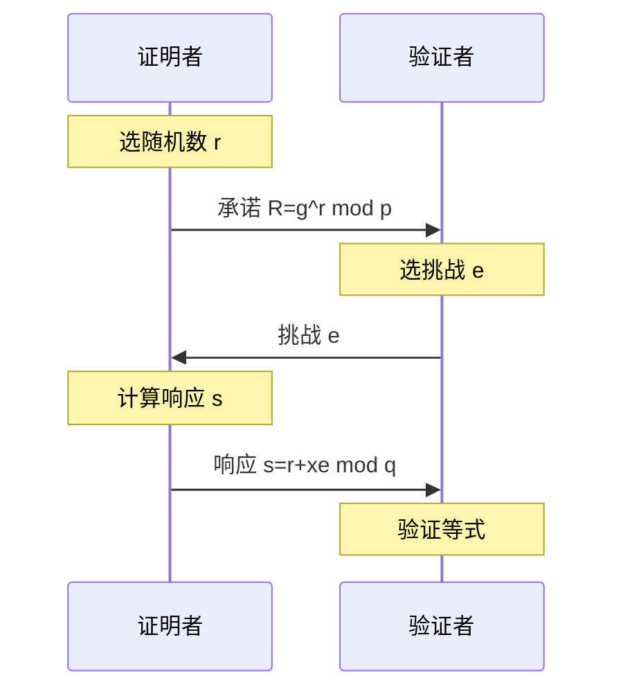

# Schnorr身份鉴别方案的流程与安全性分析

Schnorr 身份鉴别方案是一种基于==离散对数问题==的零知识证明协议，用于让证明者（Prover）向验证者（Verifier）证明自己拥有某个私钥，而无需泄露该私钥。

> [!IMPORTANT]
> Schnorr 算法的安全性依赖于求解离散对数问题的难度。这是考试判断题的核心考点（判断 82：√）。

## 为什么需要它

如果直接向对方发送密码或私钥来“自证身份”，一旦信道被窃听，身份就会被冒充。我们能不能设计一种方法，既能让对方确信“我知道私钥”，又完全不暴露私钥的任何信息？这就是 Schnorr 方案要解决的问题。

## 怎么做：参数与流程

**系统公开参数**：大素数 $p$、$q$（$q$ 为 $p-1$ 的大素因子）、生成元 $g$（阶为 $q$，即 $g^q \equiv 1 \pmod p$）。
**密钥对**：私钥 $x \in \mathbb{Z}_q$，公钥 $y \equiv g^x \pmod p$。

**交互三步曲**：
1. **承诺**：证明者选随机数 $r \in \mathbb{Z}_q$，计算 $R = g^r \bmod p$，发给验证者。
2. **挑战**：验证者选随机数 $e$，发给证明者。
3. **响应**：证明者计算 $s = (r + x \cdot e) \bmod q$，发给验证者。

**验证等式**：验证者检查是否满足 ==$g^s \equiv R \cdot y^e \pmod p$==。
推导过程：$g^s = g^{r+xe} = g^r \cdot (g^x)^e = R \cdot y^e \pmod p$。若等式成立，则通过鉴别。

## 算对了的例子

设 $p=23, q=11, g=4$（满足 $4^{11} \equiv 1 \pmod{23}$）。
- **密钥**：私钥 $x=3$，公钥 $y = 4^3 \bmod 23 = 64 \bmod 23 = 18$。
- **承诺**：证明者选 $r=5$，计算 $R = 4^5 \bmod 23 = 1024 \bmod 23 = 13$。
- **挑战**：验证者发 $e=7$。
- **响应**：证明者算 $s = (5 + 3 \times 7) \bmod 11 = 26 \bmod 11 = 4$。
- **验证**：验证者算左边 $g^s = 4^4 \bmod 23 = 256 \bmod 23 = 3$；右边 $R \cdot y^e = 13 \times 18^7 \bmod 23$。因 $18^7 \bmod 23 = 9$，故 $13 \times 9 \bmod 23 = 117 \bmod 23 = 3$。左右相等，鉴别成功！

> [!TIP]
> 记忆口诀：“承诺用 $r$，响应加 $xe$，模 $q$ 运算，底数是 $g$”。注意 $s$ 的计算是在模 $q$ 下进行的，而 $R$ 和验证等式是在模 $p$ 下进行的。

## 相近概念的区别

| 特性 | Schnorr 身份鉴别 | ElGamal 签名 |
| :--- | :--- | :--- |
| **目的** | 交互式身份证明 | 非交互式数字签名 |
| **通信** | 需多轮交互（挑战-响应） | 单向发送签名 |
| **随机数** | 每次必须更换 $r$ | 每次必须更换 $k$ |

> [!NOTE]
> 简答题 18 常考列举数字签名算法，标准答案包括：离散对数签名算法、ElGamal、==Schnorr==、Neberg-Rueppel、Okamoto。此外，GPS 算法是 Schnorr 的改进方案（判断 85：√），主要优化了计算效率。

> [!WARNING]
> 常见坑：随机数 $r$ 绝不能重复使用！若两次鉴别用了相同的 $r$ 但不同的挑战 $e_1, e_2$，攻击者可通过 $s_1 - s_2 = x(e_1 - e_2) \bmod q$ 直接解出私钥 $x$。
