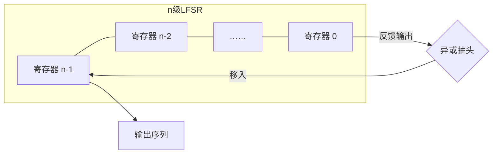

# m序列的特性与本原多项式的概念

## m 序列与本原多项式

线性反馈移位寄存器（LFSR）能生成什么样的序列，取决于它的反馈函数。对 n 级 LFSR，状态向量最多有 $2^n$ 种组合，但全零状态一旦出现就会永远困在全零里，所以真正可用的非零状态最多 $2^n-1$ 个。

> [!IMPORTANT]
> n 级 LFSR 输出的最大周期是 ==$2^n-1$==，不是 $2n$、$2^n$ 或 $n-1$。达到这个最大周期的序列称为 **m 序列**（最长线性反馈移位寄存器序列）。

### LFSR 的多项式表示

把反馈函数写成特征多项式，n 级 LFSR 的一般形式为：

$$C(x) = c_0 + c_1x + c_2x^2 + \cdots + c_{n-1}x^{n-1} + c_nx^n$$

其中 $c_0 = c_n = 1$。课件里常见写法是：

$$x^n + c_{n-1}x^{n-1} + \cdots + c_1x + 1 = 0$$

反馈抽头就对应系数 $c_j = 1$ 的那些位置。判断 m 序列时，多数用**本原多项式**（primitive polynomial）来刻画。

### 本原多项式的判定

> [!TIP]
> 判断一个 n 次多项式 $p(x)$ 是否为本原多项式，三步走：
> 1. 它是**不可约**的；
> 2. 它能整除 $1 + x^{2^n - 1}$；
> 3. 对所有 $L < 2^n - 1$，它**不能整除** $1 + x^L$。

第二步保证序列周期能整除 $2^n-1$；第三步排除周期更小的“假长序列”。因此课件里参考答案写：*一个 n 次不可约多项式，能整除 $1+x^{2^n-1}$ 而不能整除其他 $1+x^L\ (L<2^n-1)$。*

### 举例：n=4 的 LFSR 状态转移

题干：n=4，反馈关系 $k_{i-3} + k_{i-1} + k_i = 0$，初始状态 1011。先整理反馈式：

$$k_i = k_{i-3} \oplus k_{i-1}$$

即每次新位由**前面第 3 位与第 1 位异或**得到。状态按“时刻从高到低”排列：

| 时刻 | 状态$(3)$ | 状态$(2)$ | 状态$(1)$ | 状态$(0)$ | 输出 |
|:---:|:---:|:---:|:---:|:---:|:---:|
| 0 | 1 | 0 | 1 | 1 | 1 |
| 1 | 1 | 1 | 0 | 1 | 1 |
| 2 | 0 | 1 | 1 | 0 | 0 |
| 3 | 1 | 0 | 1 | 1 | 1 |
| 4 | 0 | 1 | 0 | 1 | 1 |
| 5 | 0 | 0 | 1 | 0 | 0 |
| … | … | … | … | … | … |

> [!WARNING]
> 状态转移表中“状态(i)”含义要看清：它可能指**当前时刻的第 i 个寄存器单元**。做题时先根据反馈式确定哪个寄存器参与异或，再逐拍移位，否则表容易整列错位。

该 LFSR 的周期是否是 $15$（$2^4-1$），取决于对应特征多项式是否为本原多项式。若遍历全部非零状态，则输出序列就是 m 序列。
