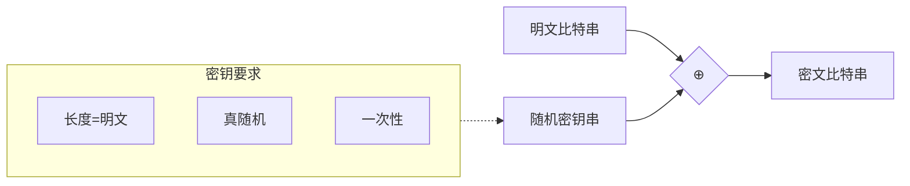

# 一次一密密码体制及其无条件安全性

## 什么是一次一密

一次一密（One-Time Pad, OTP），又称 Vernam 密码，是古典密码学中唯一被证明具有==无条件安全性==（Unconditional Security）的体制。其核心思想极其简单：使用与明文等长、完全随机且仅使用一次的密钥流对明文进行加密。

在二进制实现中，Vernam 密码将明文和密钥均编码为 $(0,1)$ 字符串，通过模 2 加法（即异或运算 $\oplus$）生成密文。

> [!IMPORTANT]
> Shannon 证明了：**仅有一次一密体制是不可破译的**（即绝对安全）。公钥或普通单钥体制均不具备此性质。

## 为什么需要它

传统密码（如 Caesar、Vigenère）依赖算法的复杂性或密钥空间的有限性，攻击者可通过统计分析或暴力破解获取信息。而一次一密从信息论角度切断了密文与明文的统计关联。

若密钥满足“真随机”且“不重用”，则对于任意给定的密文 $C$，任何可能的明文 $M$ 都有对应的密钥 $K$ 使其成立。因此，截获密文无法提供关于明文的任何额外信息。

## 怎么做：加密与解密

设明文序列 $M = m_1 m_2 \dots m_n$，密钥序列 $K = k_1 k_2 \dots k_n$，其中 $m_i, k_i \in \{0, 1\}$。

1.  **加密**：$c_i = m_i \oplus k_i$
2.  **解密**：$m_i = c_i \oplus k_i$

由于异或运算的自逆性（$A \oplus B \oplus B = A$），加解密过程完全相同。

> [!TIP]
> 记忆口诀：**等长、随机、一次性**。缺一不可，否则安全性崩塌。

## 常见误区与辨析

许多同学容易混淆“计算安全性”与“无条件安全性”。

| 特性 | 一次一密 (OTP) | DES/AES/RSA |
| :--- | :--- | :--- |
| **安全性基础** | 信息论（无条件安全） | 计算复杂度（计算安全） |
| **密钥长度** | $\ge$ 明文长度 | 固定长度（如 128/256 bit） |
| **密钥重用** | ==严禁重用== | 可重复使用 |
| **Shannon 证明** | ✅ 已证明不可破译 | ❌ 未证明绝对安全 |

> [!WARNING]
> **高危误区**：认为“密钥越长越安全”就可以随意生成短密钥循环使用。若密钥重复使用（Key Reuse），OTP 退化为多表代换密码，极易通过重合指数法或已知明文攻击破译。

## 典型例题解析

**题目**：判断“Shannon 证明了公钥密码体制是绝对安全的”。

**分析**：
Shannon 的信息论安全性证明仅针对**一次一密**。公钥密码体制（如 RSA）的安全性基于大数分解等数学难题，属于计算安全性，理论上存在被破解的可能（只要算力足够或算法出现漏洞）。

**结论**：该说法错误（×）。订正：Shannon 证明了一次一密是不可破解的。

> [!CAUTION]
> 考试中若出现“绝对安全”、“不可破译”字样，务必检查是否限定为**一次一密**。其他任何现代密码体制均不能称为绝对安全。
