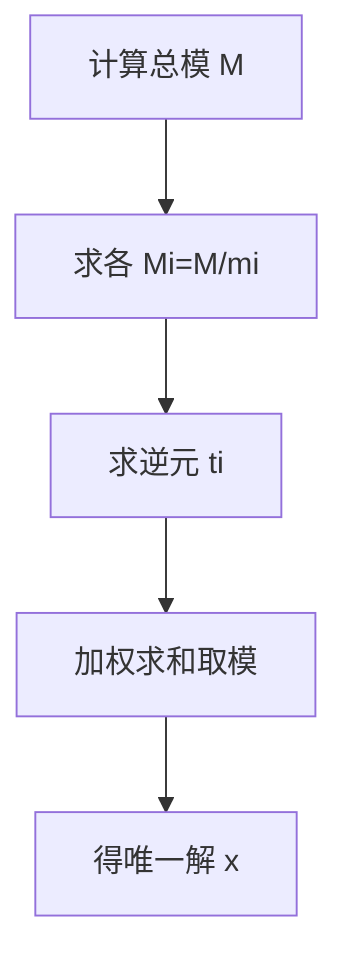

# 中国剩余定理及其应用

## 什么是中国剩余定理

如果已知一个整数 $x$ 除以一组==两两互素==的模数 $m_1, m_2, \dots, m_k$ 所得的余数，能否唯一确定 $x$？中国剩余定理（CRT）给出了肯定回答：在模 $M = m_1 m_2 \cdots m_k$ 的意义下，$x$ 存在且唯一。

> [!IMPORTANT]
> ==核心前提==：所有模数必须**两两互素**。若 $\gcd(m_i, m_j) \neq 1$，则不能直接套用标准 CRT 公式，需先合并同余方程或判定无解。

在密码学中，CRT 不仅是求解同余方程组的工具，更是 RSA、Rabin 等公钥体制实现==加速解密==和构造特殊密码方案的数学基石。例如判断题中“Rabin 密码适宜加密随机数字流”，正是因为 Rabin 解密依赖 CRT 将大模数运算分解为小模数运算，而随机流可规避其多值性缺陷。

## 如何计算 CRT 解

面对同余方程组 $x \equiv a_i \pmod{m_i}$，求解步骤如下：

具体公式为：
$$
x \equiv \sum_{i=1}^{k} a_i M_i t_i \pmod M
$$
其中 $M_i = M / m_i$，$t_i \equiv M_i^{-1} \pmod{m_i}$ 是 $M_i$ 模 $m_i$ 的乘法逆元。

> [!TIP]
> 求 $t_i$ 时务必使用**扩展欧几里得算法**，不要试图用费马小定理（除非 $m_i$ 是素数且你确认适用）。考试中 $m_i$ 常为合数（如 11、7、3），费马小定理不适用。

## 真题实战演练

以综合题 1 为例：$x \equiv 2 \pmod 3$，$x \equiv 6 \pmod 7$，$x \equiv 8 \pmod{11}$。

1.  $M = 3 \times 7 \times 11 = 231$
2.  $M_1 = 77$，$77 \bmod 3 = 2$，$2^{-1} \bmod 3 = 2$，故 $t_1 = 2$
3.  $M_2 = 33$，$33 \bmod 7 = 5$，$5^{-1} \bmod 7 = 3$，故 $t_2 = 3$
4.  $M_3 = 21$，$21 \bmod 11 = 10$，$10^{-1} \bmod 11 = 10$，故 $t_3 = 10$
5.  $x = (2 \cdot 77 \cdot 2 + 6 \cdot 33 \cdot 3 + 8 \cdot 21 \cdot 10) \bmod 231$
    $= (308 + 594 + 1680) \bmod 231 = 2582 \bmod 231 = ==41==$

验证：$41 \bmod 3 = 2$ ✓，$41 \bmod 7 = 6$ ✓，$41 \bmod 11 = 8$ ✓。

## 易错点与辨析

| 对比项 | 中国剩余定理 | 普通同余方程 |
| :--- | :--- | :--- |
| 模数要求 | ==两两互素== | 单个模数即可 |
| 解的存在性 | 必有唯一解（模 M） | 取决于 gcd 条件 |
| 典型应用 | RSA/CRT 加速、秘密共享 | 离散对数、线性同余 |

> [!WARNING]
> 最常见错误：**未验证互素条件**就直接套公式。若题目给出模数 6 和 9，$\gcd(6,9)=3 \neq 1$，必须先检查余数是否相容，再合并处理。

> [!CAUTION]
> 计算 $t_i$ 时混淆模数：$t_i$ 是 $M_i$ 模 **$m_i$** 的逆元，不是模 $M$ 或其他 $m_j$ 的逆元。这一步写错，后续全错。

掌握 CRT 的关键在于熟练手算小模数下的逆元，并始终牢记==互素前提==。它既是第二章数学基础的必考计算题，也是后续理解公钥密码效率优化的核心铺垫。
