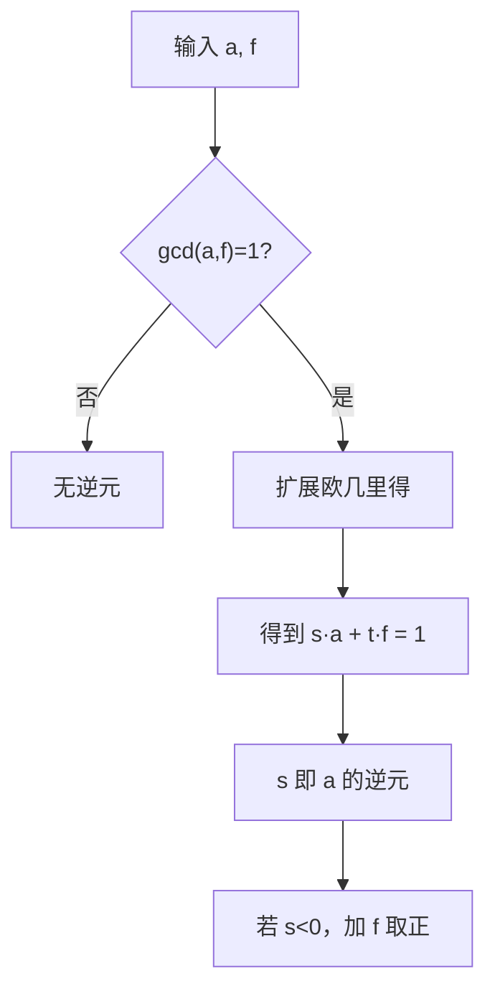

# 乘法逆元的概念与求解

## 乘法逆元

### 它是什么

在实数运算中，$a$ 的倒数 $a^{-1}$ 满足 $a \times a^{-1} = 1$。模运算里也有类似的概念：对整数 $x$，若存在 $y$ 使得

$$
x \times y \equiv 1 \pmod{n}
$$

则称 $y$ 为 $x$ 关于模 $n$ 的==乘法逆元==（也称模乘逆元），记作 $x^{-1} \bmod n$。

例如 $3 \times 3 = 9 \equiv 1 \pmod{8}$，所以 $3$ 关于模 $8$ 的逆元就是 $3$ 本身。

> [!IMPORTANT]
> 核心结论：$x$ 关于模 $n$ 的乘法逆元存在，==当且仅当 $\gcd(x, n) = 1$==。若 $n$ 为素数，则 $1$ 到 $n-1$ 的每个数都有逆元；若 $n$ 为合数，只有与 $n$ 互素的数才有逆元。

### 为什么需要

乘法逆元在密码学中频繁出现：RSA 中私钥 $d$ 就是公钥 $e$ 关于模 $\varphi(n)$ 的逆元；求解一次同余式 $ax \equiv b \pmod{m}$ 时，两边同乘 $a^{-1}$ 即可得到 $x \equiv b \cdot a^{-1} \pmod{m}$。没有逆元，就无法做“模意义下的除法”。

### 怎么求：扩展欧几里得算法

欧几里得算法告诉我们 $\gcd(a, b) = \gcd(b, a \bmod b)$，反复取模直至余数为 $0$。扩展欧几里得算法在这个基础上==回代==求出 Bézout 系数：若 $\gcd(a, f) = 1$，则存在整数 $s, t$ 使得

$$
s \cdot a + t \cdot f = 1
$$

两边对 $f$ 取模可得 $s \cdot a \equiv 1 \pmod{f}$，所以 $s$ 就是 $a$ 的逆元。

### 表格计算法（课件风格）

用课件中的三列迭代格式，每一行记录 $(X_1, X_2, X_3)$ 和 $(Y_1, Y_2, Y_3)$，其中 $X_3 = X_1 \cdot f + X_2 \cdot d$。当 $Y_3 = 1$ 时停止，$Y_2$ 即为 $d$ 的逆元。

**例：求 $7^{-1} \bmod 96$**

| $X_1$ | $X_2$ | $X_3$ | $Y_1$ | $Y_2$ | $Y_3$ | $Q$ |
|:---:|:---:|:---:|:---:|:---:|:---:|:---:|
| 1 | 0 | 96 | 0 | 1 | 7 | 13 |
| 0 | 1 | 7 | 1 | $-13$ | 5 | 1 |
| 1 | $-13$ | 5 | $-1$ | 14 | 2 | 2 |
| $-1$ | 14 | 2 | 3 | $-41$ | **1** | 2 |

$Y_3 = 1$，停止。$Y_2 = -41$ 为负值，转换为正数：

$$
-41 \bmod 96 = 96 - 41 = 55
$$

验证：$7 \times 55 = 385 = 4 \times 96 + 1 \equiv 1 \pmod{96}$。✓

> [!TIP]
> 记忆口诀：**“三列迭代，看 $Y_3$；得负取正，加模即可”**。表格中 $Q = \lfloor X_3 / Y_3 \rfloor$，下一行 $X$ 取上一行 $Y$，下一行 $Y = X - Q \cdot Y$。

### 常见坑

- **不互素就没有逆元**：$\gcd(x, n) \neq 1$ 时，$x \cdot y \equiv 1 \pmod{n}$ 无解。例如 $2$ 关于模 $8$ 没有逆元，因为 $2y$ 永远是偶数，不可能 $\equiv 1$。
- **逆元不唯一，只在模意义下唯一**：$3$ 关于模 $8$ 的逆元可以是 $3, 11, 19, \ldots$，但==在 $0$ 到 $n-1$ 范围内唯一==。
- **负数逆元要转正**：算法给出的结果往往是负数，需要 $\bmod n$ 转为正数。
- **素数模的特殊性**：模 $p$ 为素数时，$1$ 到 $p-1$ 每个数都有逆元，且可以成对出现（如模 $13$ 下 $5^{-1}=8$，$8^{-1}=5$），也可以自逆（$1^{-1}=1$，$12^{-1}=12$）。

> [!WARNING]
> 易错点：求逆元时务必先检查 $\gcd(x, n) = 1$。直接套扩展欧几里得算法而不检查互素条件，会在不互素时算出错误结果或陷入混乱。

### 与“倒数”的区别

实数中的倒数满足 $a \cdot a^{-1} = 1$（精确相等），模逆元满足 $x \cdot y \equiv 1 \pmod{n}$，即 $x \cdot y = 1 + kn$，乘积比 $1$ 多出 $n$ 的整数倍。模逆元只在同余意义下成立，不是一个精确的分数。
