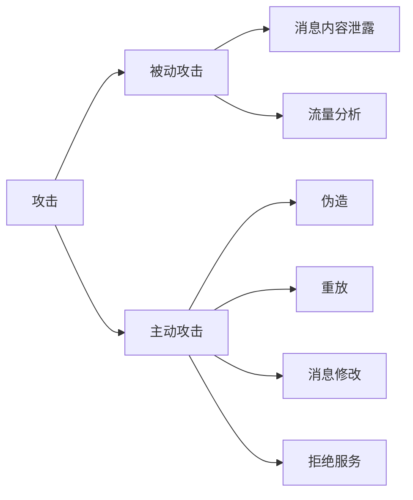

# 信息安全的目标、安全攻击的主要形式和分类（被动攻击与主动攻击）

## 为什么要有这些目标

想象你在网上给同学发一条“银行卡密码是 123456”。如果这条消息被别人偷偷看到了、改掉了、或者对方事后说“根本没发过”，你会怎么办？

信息安全的目标，就是回答：**我们到底要防什么**。南京邮电大学《密码学》第 1 章给出的基本要求（也是填空高频题）是：

- **可用性**
- **保密性**
- **完整性**
- **不可否认性**
- **可控性**
- **真实性**

其中，保密性主要由加密算法实现；不可否认性常由数字签名算法实现（注意题目里写“抗依赖性”是笔误，应为 **不可否认性**）。

> [!IMPORTANT]
> 填空常考原文：加密算法实现 ==保密性==；数字签名实现 ==不可否认性==。

## 被动攻击 vs 主动攻击

攻击者搞破坏，主要分两类。先看一张图：

**被动攻击**：攻击者只在信道上“偷听、截取”，不改动信息。例如只截取信道上传送的信息，就是被动攻击。它分两种：

- **消息内容的泄露**：看到了明文内容；
- **流量分析**：没看到内容，但知道谁在和谁通信、通信量多大。

**主动攻击**：攻击者不仅看，还动手改通信过程。包括：

- **伪造**：冒充别人发消息；
- **重放**：把以前截到的消息再发一遍；
- **消息修改**：篡改内容；
- **拒绝服务（DoS）**：让你用不了服务。

> [!TIP]
> 记忆口诀：==被动=只截不改；主动=又改又搞==。

## 相近概念的区别

| 比较项 | 被动攻击 | 主动攻击 |
|---|---|---|
| 是否修改数据 | 否 | 是 |
| 典型形式 | 泄露、流量分析 | 伪造、重放、修改、DoS |
| 对应防护业务 | 保密业务 | 认证、完整性、可用性等 |
| 检测难度 | 难检测 | 相对易发现 |

保密业务正是用来保护数据、防御被动攻击的。

## 常见坑与一个考过的例子

判断题里常把两者说反：

> 在一个密码系统中，只截取信道上传送信息的攻击方式被称为主动攻击。（×）

订正：这是 **被动攻击**。因为“只截取”说明没有修改、没有伪造、没有拒绝服务。

> [!WARNING]
> 最核心易错点：==“只截取/只偷听”=被动攻击，不是主动==。主动必须“动手”。

再比如：判断说 DES 是 14 轮，也让改——它是分组密码，迭代 **16 轮**，不过这是后续章节的坑，先记住第 1 章只考攻击分类与目标。

> [!NOTE]
> 信息安全目标不是单靠一种算法完成：保密靠加密，完整/真实靠哈希与消息认证，不可否认靠签名，可用/抗 DoS 靠系统与协议设计。
