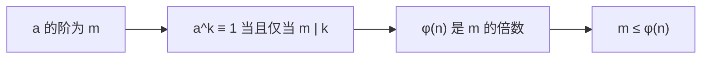

# 元素的阶与本原根的概念

## 元素的阶与本原根

在模 $n$ 的运算中，我们常常关心“一个数要乘多少次自己才会回到 $1$”。这就引出了**阶**的概念。

**定义**：设 $\gcd(a,n)=1$，称使得

$$
a^m \equiv 1 \pmod n
$$

成立的最小正整数 $m$ 为 $a$ 模 $n$ 的**阶**，记作 $\operatorname{ord}_n(a)$。

> [!NOTE]
> 为什么要求 $\gcd(a,n)=1$？如果 $a$ 与 $n$ 不互素，那么 $a^k$ 永远不可能与 $n$ 互素，自然也不可能同余于 $1$。阶只对**与模数互素**的元素有定义。

### 阶的核心性质

第一个关键问题是：$a$ 的哪些幂次会等于 $1$？是不是只有 $m$ 这一个？显然不是——比如 $a^m \equiv 1$，那 $a^{2m} = (a^m)^2 \equiv 1$ 也成立。反过来，如果 $a^k \equiv 1$，$k$ 和 $m$ 是什么关系？

> [!IMPORTANT]
> **定理（阶的判定）**：设 $a$ 的阶为 $m$，则
> $$a^k \equiv 1 \pmod n \iff m \mid k.$$
> 也就是说，==所有使 $a^k \equiv 1$ 的指数 $k$ 恰好是阶 $m$ 的倍数==。

**推论**：$a$ 的阶 $m$ 一定整除 $\varphi(n)$。

这个推论来自欧拉定理：$a^{\varphi(n)} \equiv 1 \pmod n$，而由上面的定理，$\varphi(n)$ 必须是 $m$ 的倍数。

### 本原根：阶“拉满”的元素

阶最大能是多少？由推论，阶最多是 $\varphi(n)$。当阶恰好达到这个上限时，就有了一个特殊的名字：

> [!IMPORTANT]
> **本原根**：若 $a$ 的阶等于 $\varphi(n)$，则称 $a$ 为模 $n$ 的**本原根**（primitive root）。

为什么本原根重要？因为如果 $a$ 是 $n$ 的本原根，那么

$$
a,\ a^2,\ a^3,\ \cdots,\ a^{\varphi(n)}
$$

在模 $n$ 下**两两不同余**，且都与 $n$ 互素。这实际上就是模 $n$ 的既约剩余系的一个“生成元”——所有与 $n$ 互素的数都可以写成 $a$ 的某个幂次。

> [!TIP]
> 形象地说：阶是“回到 $1$ 最少要乘几次”，本原根就是“要乘满 $\varphi(n)$ 次才回到 $1$”的元素。它生成的循环恰好覆盖全部与 $n$ 互素的剩余类。

当 $n$ 为素数 $p$ 时，$\varphi(p)=p-1$，所以：

> [!IMPORTANT]
> 若 $a$ 是素数 $p$ 的本原根，则
> $$a,\ a^2,\ \cdots,\ a^{p-1}$$
> 在模 $p$ 下互不相同，恰好就是 $1,2,\cdots,p-1$ 的一个排列。

### 和相近概念的区别

| 概念 | 含义 | 判断依据 |
|---|---|---|
| 阶 $\operatorname{ord}_n(a)$ | $a^m \equiv 1$ 的**最小正**指数 | 计算最小的 $m$ |
| 欧拉定理 | $a^{\varphi(n)} \equiv 1$ 恒成立 | 不需要最小性 |
| 本原根 | 阶恰好等于 $\varphi(n)$ | 验证 $\operatorname{ord}_n(a)=\varphi(n)$ |

>[!WARNING]
> **不是每个 $n$ 都有本原根**。例如 $n=8$：与 $8$ 互素的数有 $1,3,5,7$，$\varphi(8)=4$，但可以验证每个数的阶都不超过 $2$（如 $3^2 \equiv 1,\ 5^2 \equiv 1,\ 7^2 \equiv 1$），所以模 $8$ **没有**本原根。一般地，模 $n$ 有本原根当且仅当 $n=2,4,p^k,2p^k$（$p$ 为奇素数）。

### 算一个例子

**例**：求 $2$ 是否为模 $7$ 的本原根。

先算 $\varphi(7)=6$。看 $2$ 的各次幂：

$$
\begin{aligned}
2^1 &\equiv 2, \\
2^2 &\equiv 4, \\
2^3 &\equiv 8 \equiv 1 \pmod 7.
\end{aligned}
$$

所以 $\operatorname{ord}_7(2)=3$，而 $\varphi(7)=6$，$3 \neq 6$。因此 ==$2$ 不是模 $7$ 的本原根==。

再试 $3$：

$$
\begin{aligned}
3^1 &\equiv 3, \\
3^2 &\equiv 9 \equiv 2, \\
3^3 &\equiv 6, \\
3^4 &\equiv 18 \equiv 4, \\
3^5 &\equiv 12 \equiv 5, \\
3^6 &\equiv 15 \equiv 1 \pmod 7.
\end{aligned}
$$

直到指数 $6$ 才第一次得到 $1$，所以 $\operatorname{ord}_7(3)=6=\varphi(7)$。因此 ==$3$ 是模 $7$ 的本原根==，且 $3,3^2,\cdots,3^6$ 模 $7$ 恰好是 $3,2,6,4,5,1$，就是 $1$ 到 $6$ 的一个排列。

### 常见的坑

> [!CAUTION]
> **忘记先检查互素**：如果 $\gcd(a,n)\neq 1$，阶根本不存在，更不要谈本原根。做题第一步先验证 $\gcd(a,n)=1$。

> [!CAUTION]
> **误以为阶就是 $\varphi(n)$ 的某个因数就行**：阶当然整除 $\varphi(n)$，但给定一个具体的 $a$，阶是那个**最小的**正指数 $m$，需要用试算确定，不能直接猜 $\varphi(n)$ 的某个因数。
