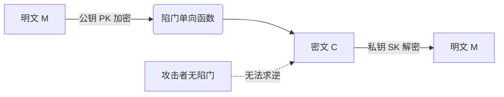

# 公钥密码学的提出背景、思想、陷门单向函数、应用（保密通信与认证）及优缺点

传统对称密码中，加密和解密用同一把密钥。如果 Alice 和 Bob 从未见过面，他们怎么安全地把这把密钥交给对方？一旦密钥在传输中被截获，整个系统就崩溃了。这就是困扰密码学界多年的“密钥分发”难题。

1976 年，Diffie 和 Hellman 发表了《密码学的新方向》，==提出公钥密码体制的思想==：将加密密钥与解密密钥分开，从而开创了公钥密码学的新纪元。

## 核心思想与陷门单向函数

在公钥密码体制中，加密密钥（公钥）可以公开传播而不会危及密码体制的安全性，而解密密钥（私钥）必须严格保密。

要把这种不对称概念变成可实行的密码系统，必须找到一个合适的数学函数——==陷门单向函数==。

- **单向性**：已知 $x$，计算 $y = f(x)$ 很容易；但已知 $y$，求 $x = f^{-1}(y)$ 在计算上不可行。
- **陷门**：如果掌握了一个秘密信息（即私钥作为“陷门”），就能轻易求出逆函数。

公钥密码算法是建立在数学函数基础上的，而不是像分组密码那样建立在字符或位方式的操作上。例如 RSA 的理论基础是数论的欧拉定理，其安全性依赖于大整数素因子分解的困难性。

## 两大应用场景

公钥密码主要解决两个问题：保密通信与认证。

### 保密通信

Bob 想给 Alice 发机密消息，只需查找 Alice 公开的公钥 $PK_A$ 进行加密：$C = E_{PK_A}(M)$。只有持有私钥 $SK_A$ 的 Alice 才能解密：$M = D_{SK_A}(C)$。

### 认证业务

用于保证通信的真实性，包括实体认证和消息源认证。Alice 用自己的私钥对消息签名，接收方用 Alice 的公钥验证，从而确认消息确实来自 Alice 且未被篡改。数字签名技术不仅提供完整性、认证性，还能实现不可否认性。

> [!NOTE]
> 实际应用中常采用混合密码系统：公钥密码算法用作身份认证和加密会话密钥，对称密码算法用于加密消息本身。

## 优缺点辨析

| 对比维度 | 对称密码体制 | 公钥密码体制 |
| :--- | :--- | :--- |
| **密钥数量** | 双方共享同一密钥 | 公钥与私钥成对出现 |
| **处理效率** | 高（基于位操作） | 低（基于复杂数学运算） |
| **密钥管理** | 困难（需安全信道分发） | 容易（公钥可直接公开） |
| **典型算法** | AES、DES | RSA、ECC、ElGamal |

> [!CAUTION]
> 常见误区：认为公钥密码比对称密码更安全。错！两者在同等密钥长度下提供的安全级别相当，对称密码的优势在于==效率更高==，而非安全性更高。

> [!IMPORTANT]
> 整个密码系统的安全性并不取决于对密码算法的保密，而是由密钥的保密性决定的。公钥密码解决的核心问题是密钥管理问题。

## 经典考题演练

**题目**：判断正误——跟公钥密码体制相比，对称密码体制具有安全性更高的特点。

**解析**：错误（×）。对称密码体制的优势在于加解密速度快、效率高。公钥密码体制通过非对称密钥解决了密钥分发难题，两者的安全性均依赖于密钥长度与底层数学难题的难度，不能简单说谁的安全性更高。订正应为：对称密码体制具有==效率更高==的特点。
