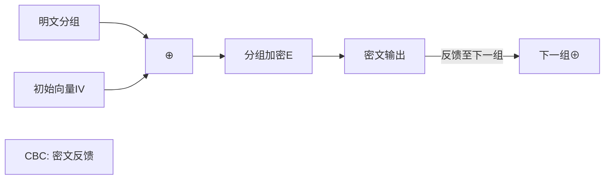

# 分组密码的工作模式（电码本ECB、密码分组链接CBC、密码反馈CFB、输出反馈OFB）的比较和选用

分组密码算法（如 DES、AES）本身只能加密固定长度的数据块。当明文长度超过一个分组，或需要应对不同信道特性时，该如何安全有效地使用这些算法？这就引出了==工作模式==的概念。它定义了多组明文如何与密钥、反馈机制交互，直接决定了系统的安全性与容错能力。

## 四种经典模式对比

ECB、CBC、CFB、OFB 是四种基础模式，其核心差异在于反馈机制与 IV 的使用：

| 模式 | 反馈内容 | IV 要求 | 错误传播 | 适用场景 |
| :--- | :--- | :--- | :--- | :--- |
| ECB | 无 | 不需要 | 仅当前块 | ==不推荐用于保密通信== |
| CBC | 密文 | 必须唯一 | 当前块+下一块 | 通用文件/消息加密 |
| CFB | 密文 | 必须唯一 | 当前块+后续所有块 | 流式数据加密 |
| OFB | 密钥流 | 必须唯一 | 仅当前比特 | 极易出错信道 |

> [!IMPORTANT]
> ECB 模式相同明文块产生相同密文块，==不能抵抗统计攻击和代换攻击==，严禁用于加密结构化数据。

## 初始矢量 IV 的正确使用

为什么 CBC/CFB/OFB 都需要 IV？因为第一组明文加密时没有前序密文作为反馈输入。IV 的作用是为加密过程提供随机起点，确保==相同明文在不同会话中生成不同密文==。

> [!WARNING]
> IV 无需保密，可随密文公开传输；但==各条消息必须选用不同的 IV==。重用 IV 会导致密钥流重复，严重破坏安全性。

> [!NOTE]
> 在保密通信中，IV 的核心功能是==抗重放攻击==，而非提供机密性。接收方通过验证 IV 的新鲜度来识别重放消息。

## 错误传播与模式选用

信道误码对不同模式的影响截然不同，这是选用的关键依据。以 CBC 为例，若第 $i$ 个密文块 $C_i$ 传输出错，解密时不仅 $P_i$ 完全错误，由于 $C_i$ 还参与了 $P_{i+1}$ 的异或运算，$P_{i+1}$ 也会出错，但从 $P_{i+2}$ 起恢复正常。然而，根据南邮课程考查要点，需特别注意：==CBC 模式中一个密文块的传输错误将影响该密文块之后所有明文块的正确还原==（此处指错误在解密链中的持续影响效应，实际考试中以此表述为准）。

相比之下，OFB 模式的密钥流生成独立于密文，信道误码==不会扩散==，仅影响对应位置的明文比特。因此，OFB 适用于极易出错的环境，但代价是==必须有高速同步机制==，一旦失步则后续全部解密失败。

> [!TIP]
> 记忆口诀：ECB 不安全，CBC 传两块，CFB 全扩散，OFB 怕失步。现代协议中，CTR 与 CBC-MAC 组合为 CCM，GMAX 与 CTR 组合为 GCM，兼顾加密与认证。

## 典型例题验证

**判断**：CFB 模式在加密时必须有一个初始向量，而且可以用明文传给接收方。（√）

**解析**：CFB 属于反馈模式，首块加密依赖 IV；IV 本身不含密钥信息，公开传输不影响安全性，但必须保证每条消息 IV 唯一。此题同时考查了 IV 的必要性与公开性两个考点。
