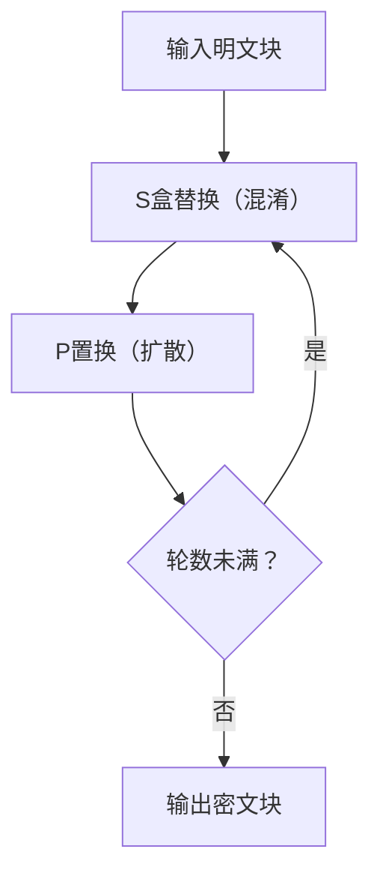

# 分组密码的设计要求与设计思想（扩散和混淆）

## 扩散与混淆

在对称密码设计中，我们最担心的是攻击者通过分析大量密文来找出明文或密钥的统计规律。Shannon 在其经典论文中提出，一个安全的密码系统必须能抵抗这种**统计分析**，为此他给出了两个基本设计方法：==扩散== 和 ==混淆==。

### 为什么需要扩散与混淆？

试想一个简单的替换密码：明文中字母“A”总是被加密成“Q”。攻击者只需统计密文中各字母的频率，对照自然语言的字母频率分布，就能轻松破解。这说明，如果密文保留了明文的统计特征，密码就是不安全的。

要解决这个问题，需要做到两点：
1. 让明文的统计结构在密文中“消失”——这靠**扩散**。
2. 让密钥与密文的关系复杂到无法推测——这靠**混淆**。

### 扩散原则

> [!IMPORTANT]
> 扩散是指将明文和密钥的每一位的影响，尽可能迅速地散布到较多个密文比特中去，使输出不呈现任何输入时的统计特性。

通俗地说，就是让明文哪怕只改动一个比特，密文也要有大约一半的比特发生变化。这种效果也被形象地称为==雪崩效应==。

扩散隐藏的是**明文与密文之间**的关系。例如，古典密码中的 Hill 密码，其矩阵乘法使得每个密文字母都由多个明文字母共同决定，这就是扩散思想的早期体现。在现代分组密码中，**P 置换（Permutation）** 是实现扩散的核心部件。

### 混淆原则

> [!IMPORTANT]
> 混淆是指使密文与密钥之间的依赖关系变得尽可能复杂，让攻击者即使获得大量密文，也无法推导出密钥的任何信息。

混淆隐藏的是**密钥与密文之间**的关系。它要确保密钥的任何细微变化，都会让密文发生不可预测的剧烈变化。在现代分组密码中，**S 盒（Substitution）** 是实现混淆的核心部件。

### 两者如何协同工作：SPN 结构

单独使用替换（混淆）或置换（扩散）都不安全。现代分组密码普遍采用==交替使用==替换和置换的组合结构，即 **SPN 结构**（Substitution-Permutation Network）。

以 AES 的轮函数为例，它精确地组合了混淆与扩散：
- **字节代换（SubBytes）**：使用 S 盒进行非线性替换，起到==混淆==作用。
- **行移位（ShiftRows）** 与 **列混淆（MixColumns）**：将每个字节的影响混合到多列中，起到==扩散==作用。
- **轮密钥加（AddRoundKey）**：将密钥以异或方式混入状态。

>[!NOTE]
> SPN 结构与另一种经典设计——Feistel 结构相比，扩散速度更快，但加解密过程通常不对称，需要为解密专门实现逆 S 盒与逆 P 置换。

### 常见的坑与辨析

>[!WARNING]
> **混淆 ≠ 加密密钥本身**：混淆强调的是“依赖关系的复杂度”，而不是密钥的保密性。即便攻击者知道算法全部细节，混淆也要让他无法分析出密钥。
> 
> **扩散 ≠ 单纯的复制**：扩散不是把明文的某一位简单复制到多个密文位置，而是要让它与密文的多个比特形成高度非线性的关联。

>[!TIP]
> 记忆口诀：**“S 混 P 扩”——S 盒负责混淆，P 置换负责扩散。** 填空常考 SP 思想中谁实现混淆、谁实现扩散。

### 一个理解扩散的简单例子

假设我们用一个极度简化的 S 盒将一个 4 比特输入 $M = 0110$ 替换为 $S(M) = 1011$。此时只有 4 比特受到影响。

接着，我们用一个 P 置换（如简单的矩阵转置）将这 4 比特散布到一个 16 比特块的多个位置：第 3、8、12、15 位。

下一轮时，这些位置又分别输入到不同的 S 盒中，影响各自的 4 比特输出。经过几轮交替后，最初仅在第 3 位的那个“1”，其影响就会扩散到整个密文块的几乎所有比特——这就是扩散的雪崩效应。

AES、Whirlpool 等算法正是基于**宽轨迹策略**来设计扩散层，确保扩散的效率能在最低轮数下抵挡差分与线性密码分析。
