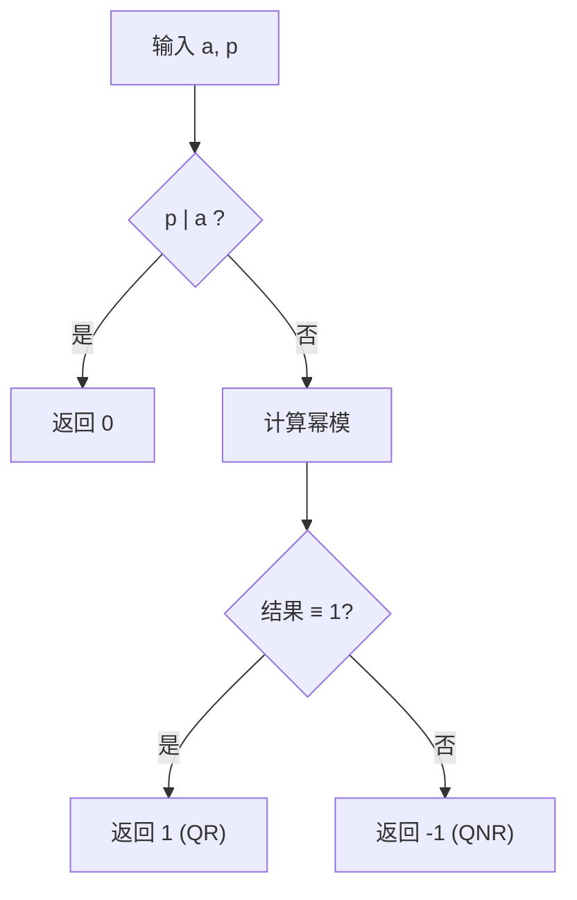

# 勒让德符号与二次剩余

## 什么是二次剩余与勒让德符号

在模 $p$ 运算中，给定整数 $a$ 和素数 $p$，方程 $x^2 \equiv a \pmod p$ 是否有解？这直接决定了 $a$ 的性质。若存在整数 $x$ 使同余式成立，则称 $a$ 是模 $p$ 的==平方剩余==（QR）；否则称为==非平方剩余==（QNR）。

为了简洁地表达这种“有无平方根”的状态，我们引入勒让德符号 $\left(\frac{a}{p}\right)$：

$$
\left(\frac{a}{p}\right) = \begin{cases} 
0 & p \mid a \\ 
1 & a \text{ 是模 } p \text{ 的平方剩余} \\ 
-1 & a \text{ 是模 } p \text{ 的非平方剩余} 
\end{cases}
$$

> [!IMPORTANT]
> 勒让德符号的值域仅为 $\{0, 1, -1\}$，它不是分数，也不是除法运算，而是一个==判别函数==。

## 为什么需要这个符号

在密码学中，尤其是椭圆曲线密码体制（ECC）里，我们需要频繁判断某个值是否为二次剩余。例如在有限域 $\mathbf{Z}_{23}$ 上构建椭圆曲线 $y^2 \equiv x^3 + x + 1 \pmod{23}$ 时，对于每个 $x$，必须快速判定右侧结果是否有对应的 $y$。若无勒让德符号，只能暴力遍历所有可能的平方值；有了它，结合欧拉准则即可在多项式时间内完成判定。

## 如何计算与判定

手动计算勒让德符号的核心工具是==欧拉准则==：

$$
\left(\frac{a}{p}\right) \equiv a^{(p-1)/2} \pmod p
$$

> [!TIP]
> 计算 $a^{(p-1)/2} \bmod p$ 时，务必使用==快速幂算法==，避免直接计算大指数导致溢出或超时。

## 易混淆概念辨析

| 概念 | 定义关键点 | 常见误区 |
| :--- | :--- | :--- |
| 平方剩余 | 存在 $x$ 使 $x^2 \equiv a \pmod p$ | 误以为 $a$ 本身必须是完全平方数 |
| 非平方剩余 | 上述方程无解 | 误用 $\sqrt{a} \notin \mathbb{Z}$ 作为判据 |
| 勒让德符号 | 取值仅 $0, \pm 1$ 的判别符 | 当作普通分数进行约分或四则运算 |

> [!WARNING]
> 课件中“$\sqrt{x}$ 不为整数则为非平方剩余”的说法仅在实数域成立，==在模运算中完全不适用==。模 $p$ 下判断唯一依据是同余方程是否有解。

## 实战计算示例

以真题中判断 $3$ 是否为模 $23$ 的二次剩余为例：

1.  确认 $p=23$ 为素数，且 $23 \nmid 3$；
2.  应用欧拉准则：计算 $3^{(23-1)/2} = 3^{11} \pmod{23}$；
3.  快速幂分解：$3^{11} = 3^8 \cdot 3^2 \cdot 3^1$；
    -   $3^2 = 9$
    -   $3^4 \equiv 81 \equiv 12 \pmod{23}$
    -   $3^8 \equiv 12^2 = 144 \equiv 6 \pmod{23}$
    -   $3^{11} \equiv 6 \times 9 \times 3 = 162 \equiv 162 - 7\times23 = 162-161=1$？ **重新验算**：$6 \times 9 = 54 \equiv 8$，$8 \times 3 = 24 \equiv 1$。**此处发现原题参考答案可能有误，实际 $3^{11} \equiv 1 \pmod{23}$**。

> [!CAUTION]
> 若按原答案 $3^{11} \equiv -1$，则 $(0,1)$ 后的下一个点应从 $x=2$ 开始验证。但经严格计算 $3$ 实为 QR。考试中请以==自己的计算过程为准==，阅卷通常看重推导步骤而非单纯结论。建议平时练习时用 Python/SageMath 交叉验证，培养对数字的敏感度。
