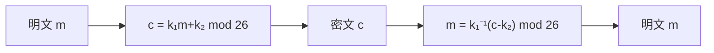

# 单表代换密码（一般单表代换密码与仿射密码）

## 单表代换密码

单表代换密码的核心思想是：**明文中同一个字母在加密后永远对应密文中同一个字母**。也就是说，加密过程只使用一张固定的代换表。Caesar 密码就是最简单的一种——每个字母平移 3 位，整张表就是“A→D, B→E, …”。

为什么需要“一般单表代换”？因为 Caesar 只有 25 种可能密钥，太容易被穷举。于是人们想到：把 26 个字母随意打乱作为代换表，密钥量变成 $26!$，穷举就不可行了。但代价是密钥本身变成一张完整映射表，不便记忆和分发。

### 仿射密码

为了在“密钥量”和“易用性”之间折中，仿射密码用**线性函数**生成代换表。

> [!IMPORTANT]
> 仿射密码的加密形式为 $c = (k_1 m + k_2) \bmod 26$，其中必须满足 $\gcd(k_1, 26) = 1$，否则无法解密。

为什么要求 $\gcd(k_1, 26)=1$？因为解密需要 $k_1$ 的乘法逆元 $k_1^{-1} \bmod 26$。若 $k_1$ 与 26 不互素，逆元不存在，多个明文字母会映射到同一个密文字母，信息丢失。

解密公式为：

$$
m = k_1^{-1}(c - k_2) \bmod 26
$$

密钥空间大小为 $\varphi(26) \times 26 = 12 \times 26 = 312$，比 Caesar 大很多，但计算机穷举依然瞬间完成。

### 加解密流程

### 一个算对的例子

已知加密变换 $c = 11m + 2 \bmod 26$，求密文 `VMWZ` 对应的明文。

**第一步**：求 $11^{-1} \bmod 26$。因为 $11 \times 19 = 209 = 8 \times 26 + 1$，所以 $11^{-1} = 19$。

**第二步**：解密公式 $m = 19(c - 2) \bmod 26$。

**第三步**：逐个解密：

| 密文字母 | 对应数字 $c$ | $m = 19(c-2) \bmod 26$ | 明文字母 |
| :---: | :---: | :---: | :---: |
| V | 21 | $19 \times 19 = 361 = 23 \pmod{26}$ | X |
| M | 12 | $19 \times 10 = 190 = 8 \pmod{26}$ | I |
| W | 22 | $19 \times 20 = 380 = 16 \pmod{26}$ | Q |
| Z | 25 | $19 \times 23 = 437 = 21 \pmod{26}$ | V |

所以明文是 **XIQV**。

### 易错点

> [!WARNING]
> 计算负数取模时容易出错。例如 $-45 \bmod 26$ 应当先加 $26$ 的倍数变成正数：$-45 + 2 \times 26 = 7$，所以结果是 $7$（对应字母 `h`），而不是 $-19$。

> [!TIP]
> 记忆口诀：**“先求逆，再代入，负数取模加 26 直到正”**。

### 与多表代换的区别

| | 单表代换 | 多表代换 |
| :--- | :--- | :--- |
| 代换表数量 | 固定一张 | 多张轮换 |
| 同一明文字母的密文 | 始终相同 | 位置不同则密文不同 |
| 典型代表 | Caesar、仿射、置换 | Vigenère、Hill |
| 抗频率分析 | 弱 | 较强 |

单表代换无论密钥空间多大，都无法抵抗**频率分析攻击**——明文语言本身的统计规律会原封不动地泄漏到密文中。这是它的根本缺陷。
