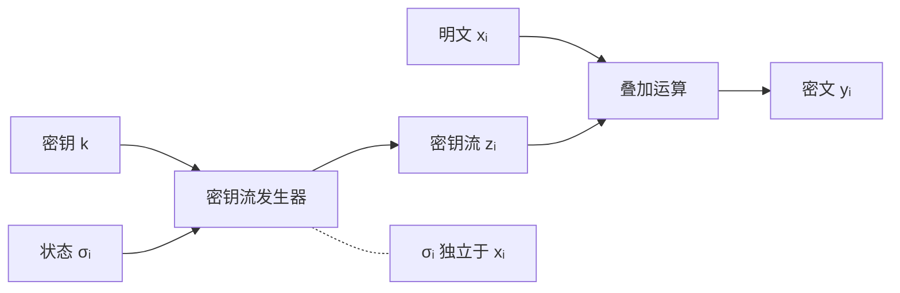

# 同步流密码的工作原理及密码设计者的愿望

## 同步流密码的核心机制

如果密钥流的生成完全不受明文内容干扰，加密过程会呈现什么特征？这正是理解同步流密码的切入点。在序列密码中，若加密器内部记忆元件的状态 $\sigma_i$ ==独立于输入的明文字符==，仅由密钥 $k$ 和自身前一状态决定，则称其为同步流密码。

其加密模型可表示为：

$$
z_i = f(k, \sigma_i), \quad y_i = E_{z_i}(x_i)
$$

这意味着密钥流 $z$ 是预先确定或自主生成的，与明文 $x$ 无关。收发双方必须严格保持状态同步，一旦传输中丢失或插入一个密文比特，后续所有解密都将错位失效，需重新同步。

> [!IMPORTANT]
> 同步流密码的本质判据：==状态 $\sigma_i$ 不依赖明文==。这是名词解释题的标准得分点，切勿与自同步流密码混淆。

## 与自同步流密码的区别

为何要区分“同步”与“自同步”？关键在于状态更新是否受明文反馈影响。两者对比如表所示：

| 特性 | 同步流密码 | 自同步流密码 |
| :--- | :--- | :--- |
| 状态 $\sigma_i$ 依赖 | 仅密钥与前一状态 | 密钥 + 前若干密文/明文 |
| 错误传播 | 无（仅丢失位出错） | 有限（影响后续几位） |
| 同步要求 | 需外部同步机制 | 自动恢复同步 |
| 典型代表 | m序列、A5/1 | 早期机械密码机 |

> [!WARNING]
> 填空题常考“叠加”而非“异或”。虽然实践中多用异或，但标准表述应为“用一个密钥序列与明文序列进行==叠加==来产生密文”，避免术语失分。

## 密码设计者的愿望

既然密钥流决定了安全性，设计者追求什么目标？一个理想的滚动密钥生成器应使输出序列满足四大性质：

-   **极大的周期**：避免密钥流过早重复；
-   **良好的统计特性**：接近真随机序列的0/1分布；
-   **抗线性分析**：防止被线性反馈移位寄存器逼近；
-   **抗统计分析**：抵御基于频率或相关性的攻击。

> [!TIP]
> 记忆口诀：“周统线统”——周期大、统计好、抗线性、抗统计。这四点常作为简答题采分点。

## 计算示例与验证

设某同步流密码当前状态 $\sigma_3 = (1,0,1)$，密钥 $k$ 固定，密钥流生成函数为 $z_i = \sigma_i^{(1)} \oplus \sigma_i^{(3)}$。若明文 $x_3 = 1$，求密文 $y_3$。

解：$z_3 = 1 \oplus 1 = 0$，故 $y_3 = x_3 \oplus z_3 = 1 \oplus 0 = 1$。注意整个过程未使用 $x_3$ 来计算 $z_3$，符合同步定义。

> [!CAUTION]
> 切勿将密钥流生成与加密运算混为一谈。$z_i$ 的计算绝不能包含 $x_i$，否则即变为自同步或非线性反馈结构，违背同步流密码基本前提。
