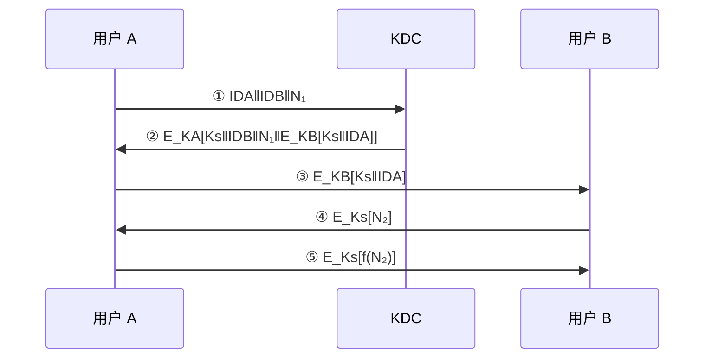

# 在线密钥分发、基于KDC的密钥分配中心模式（KDC生成会话密钥）及Kerberos协议

## 在线密钥分发与基于 KDC 的密钥分配

两个用户想要进行保密通信，首先需要共享一个会话密钥。如果用户数量很少，可以人工面对面交换密钥；但在网络环境中，用户数量多、分布广，靠人工分发显然不现实。于是自然想到：能不能找一个**大家都信任的第三方**来负责密钥的分发？这就是密钥分配中心（Key Distribution Center, KDC）的核心思想。

> [!IMPORTANT]
> ==KDC 模式的前提==：每个用户与 KDC 之间预先共享一个**主密钥**（master key），会话密钥由 KDC 生成并经主密钥加密后分发。主密钥长期使用，会话密钥一次性使用。

### 基本流程：密钥分配中心如何产生会话密钥

假定用户 A、B 分别与 KDC 共享主密钥 $K_A$、$K_B$，A 希望与 B 建立一次保密会话。整个过程可以用以下时序图表示：

**逐步解释：**

- **第①步**：A 向 KDC 发出请求，包含自己的身份 $ID_A$、对方身份 $ID_B$ 和一个一次性随机数 $N_1$。$N_1$ 的作用是**防重放**——确保应答是新鲜的。
- **第②步**：KDC 生成一次性会话密钥 $K_s$，然后用 $K_A$ 加密应答。应答中包含：$K_s$、$ID_B$、$N_1$（让 A 确认这是对自己刚才请求的响应），以及一个**票据** $E_{K_B}[K_s \| ID_A]$（A 无法解密，只能转发给 B）。
- **第③步**：A 解密得到 $K_s$，将票据原样转发给 B。B 用自己的主密钥 $K_B$ 解密票据，得知 $K_s$ 和通信对方的身份 $ID_A$。
- **第④⑤步**：B 生成随机数 $N_2$，用 $K_s$ 加密发给 A；A 解密后对 $N_2$ 做变换得到 $f(N_2)$（通常取 $f(N_2)=N_2-1$），再用 $K_s$ 加密发回。这一步称为**挑战—应答**，目的是让 B 确认 A 确实持有 $K_s$，即完成双向身份认证。

该协议即 **Needham–Schroeder 协议**。

### 常见的坑：重放攻击与第③步的弱点

> [!WARNING]
> Needham–Schroeder 协议的经典弱点在第③步：B 收到票据后**无法判断票据是否新鲜**。如果攻击者此前截获了一个旧的 $E_{K_B}[K_s \| ID_A]$，而该 $K_s$ 已经泄露，攻击者可以直接重放旧票据冒充 A，B 无法察觉。也就是说，==B 看不到任何能证明"票据是新生成的"信息==。

Kerberos 协议对这个弱点做了改进：在票据中加入**时间戳**和**有效期**，B 收到票据后检查时间是否在允许范围内，从而抵抗重放攻击。

### 与公钥分配方式的区别

| 比较项 | 基于 KDC 的密钥分配 | 基于公钥证书的分配 |
|---|---|---|
| 信任基础 | 所有用户信任 KDC | 信任证书颁发机构 CA |
| 主密钥类型 | 对称密钥 | 公钥/私钥对 |
| 在线要求 | 每次会话需 KDC 在线 | 证书可离线验证 |
| 单点故障 | KDC 瘫痪则全部瘫痪 | CA 仅签发证书，不参与会话 |
| 适用规模 | 中小型封闭系统 | 大规模开放网络 |

### 一个算对了的例子

设 A 与 KDC 共享主密钥 $K_A$，B 与 KDC 共享 $K_B$。某次协议执行中：

1. A 选择 $N_1 = 20240512$，发出请求 $\text{IDA} \| \text{IDB} \| N_1$。
2. KDC 生成会话密钥 $K_s = k_1k_2\cdots k_{128}$（128 位），应答为：
$$ E_{K_A}\left[ K_s \| \text{IDB} \| 20240512 \| E_{K_B}[K_s \| \text{IDA}] \right] $$
3. A 用 $K_A$ 解密，核对 $N_1 = 20240512$ 与请求一致，于是保存 $K_s$，转发 $E_{K_B}[K_s \| \text{IDA}]$ 给 B。
4. B 用 $K_B$ 解密得到 $K_s$ 和 $\text{IDA}$，选择 $N_2 = 7749$，发送 $E_{K_s}[7749]$。
5. A 解密得到 $7749$，计算 $f(7749) = 7748$，发送 $E_{K_s}[7748]$。B 解密后验证 $f(N_2)$ 正确，确认对方就是 A。

> [!TIP]
> 记忆五步可以用口诀：**“请求带随机，应答双加密，转发那张票，挑战再应答。”** 第②步是“两层加密”——外层给 A 看，内层票据给 B 看；第③步 A 只是“搬运工”。
