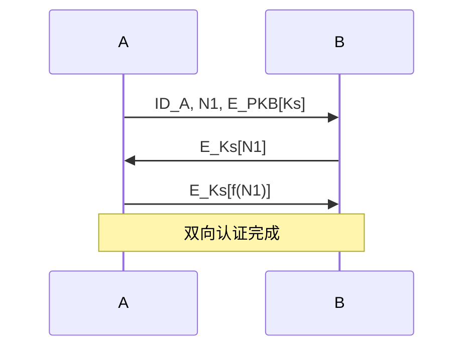
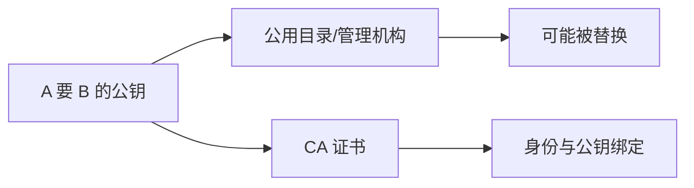

# 基于公钥管理机构与公钥密码体制的会话密钥分配、证书用途及提供的主要服务

## 它是什么

先想一个问题：如果 A、B 从没见过面，也没有共享任何秘密，怎么用对称密码安全地聊天？答案是——用**公钥密码体制先把一个临时的会话密钥 $K_s$ 安全送过去**，后面真正的数据再用对称密码加密。

在课件里，这叫**基于公钥管理机构与公钥密码体制的会话密钥分配**。它解决的是：把“长期密钥（公私钥）”和“短期会话密钥”分开管理。

> [!IMPORTANT]
> 把公钥密码用于密钥分配，==解决了重要的密钥管理问题==，这正是判断题“把公钥密码用于密钥分配解决了重要的密钥管理问题（√）”的出处。

## 为什么需要

直接用公钥加密全部数据太慢；但每次都人工约定共享密钥又不现实。所以做法是：

1. 用对方的**公开钥 $PK$** 加密一次性会话密钥 $K_s$；
2. 双方得到同一个 $K_s$ 后，再用对称算法高速加密通信。

这对应课件里“基于公钥密钥分配（会话密钥）”，前提条件是：**通信双方在 CA 中拥有自己的证书**。

## 怎么做（三步走）

前提：A、B 都有 CA 签发的证书，从而拿到对方真实公钥。

三步含义：

1. A 发请求：包含 $ID_A$、一次性随机数 $N_1$，以及用 B 公钥加密的会话密钥 $E_{PK_B}[K_s]$；
2. B 解开得到 $K_s$，再回 $E_{K_s}[N_1]$，证明“我真的能用 $K_s$ 解密”；
3. A 再回 $E_{K_s}[f(N_1)]$，B 核对通过，双方确认彼此存活且密钥一致。

其中 $N_1$ 防止重放，$f(N_1)$ 是简单变换（如 $N_1+1$），用于第三步认证。

## 证书用途与主要服务

证书就是把“身份 + 公钥”绑定起来，防止中间人替换公钥。

| 证书类型 | 主要服务 | 私钥处理 |
|---|---|---|
| 签名证书 | ==不可否认性==（对用户消息签名） | 不备份 |
| 加密证书 | ==保密性==（加密传送信息的密钥） | 需备份 |

还有两个撤销/状态查询机制：

- **CRL**：证书撤销列表；
- **OCSP**：在线证书状态协议，用证书序列号、CA 名、公钥散列值即时查状态。

## 相近概念区别

- **公钥管理机构**：动态维护公钥目录，但仍有单点压力与中间人风险；
- **数字证书 / CA**：用签名把公钥和身份绑定，解决“这个公钥真是 B 的吗”。

## 常见坑

> [!WARNING]
> 若没有证书或身份绑定，攻击者 C 可把目录中 B 的公钥换成自己的，从而实施**中间人攻击**：A 以为拿到 $PK_B$，其实拿到 $PK_C$。

所以==证书的核心服务就是公钥真实性==，后面 SSL 也是靠它建立安全管道。
