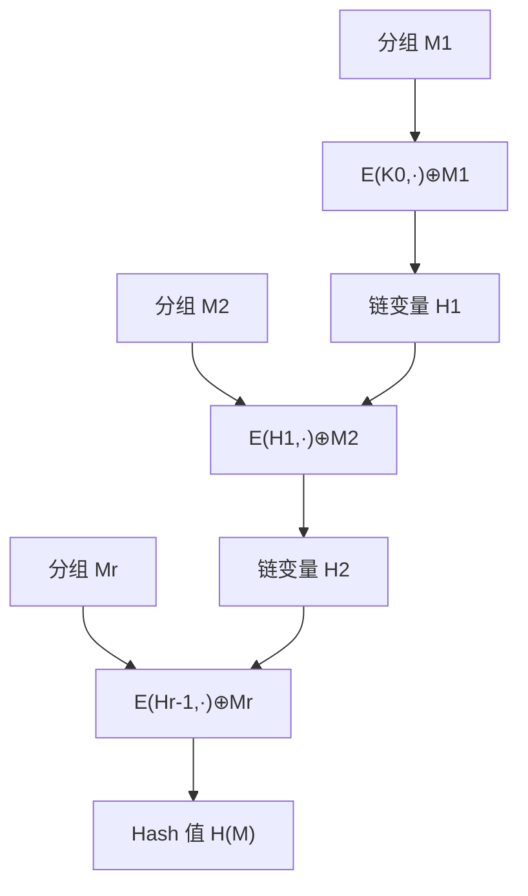

# 基于对称分组密码算法设计散列函数的方法

## 是什么：为什么分组密码能造 Hash

Hash 函数要的是==单向性、抗碰撞==，本身不需要密钥。但分组密码（如 DES、AES）结构成熟、雪崩效应好，于是密码学家想到：**把分组密码当“压缩引擎”，用某种迭代结构把任意长消息压成定长散列值**。

核心思路一句话：把消息分组后，逐组喂进分组密码，==上一组的输出作为下一组的“链变量”==，最后一段输出就是 Hash 值。

## 怎么做：三种经典构造

设分组密码为 $E(K, \cdot)$，分组长度 $n$，消息 $M$ 分成 $r$ 个分组 $M_1, M_2, \dots, M_r$，初始向量 $IV$（或初始密钥 $K_0$）。

三种构造的区别在于**密钥从哪来、和谁异或**：

| 方案 | 第 $i$ 轮密钥 $K_i$ | 输出 $H_i$ | 特点 |
|---|---|---|---|
| Rabin 方案 | $H_{i-1}$ | $E(H_{i-1}, M_i) \oplus M_i$ | 密钥=上一链变量 |
| Davies–Meyer | $M_i$ | $E(M_i, H_{i-1}) \oplus H_{i-1}$ | 密钥=消息分组，抗碰撞性可证 |
| Matyas–Meyer–Oseas | $H_{i-1}$ | $E(H_{i-1}, M_i) \oplus M_i$ | 密钥=链变量，加预处理 |

> [!IMPORTANT]
> 考试常考 Davies–Meyer：==消息分组 $M_i$ 当密钥，链变量 $H_{i-1}$ 当明文，输出再与 $H_{i-1}$ 异或==，即
> $$H_i = E_{M_i}(H_{i-1}) \oplus H_{i-1}$$

## 一个算对了的例子

用 Davies–Meyer，分组密码 $E$ 为 4 位理想密码，$IV = 0000$，消息两个分组 $M_1 = 0001,\ M_2 = 0010$。设查表得 $E_{0001}(0000)=0110$，$E_{0010}(0110)=1011$。

- 第一轮：$H_1 = E_{M_1}(IV) \oplus IV = 0110 \oplus 0000 = 0110$
- 第二轮：$H_2 = E_{M_2}(H_1) \oplus H_1 = 1011 \oplus 0110 = 1101$

故 $H(M) = 1101$。注意==最后还要和 $H_1$ 异或==，别只写 $E$ 的输出。

## 和相近概念的区别

| | 分组密码 | 基于分组密码的 Hash |
|---|---|---|
| 密钥 | 必需，保密 | 无密钥，公开 |
| 输入 | 定长分组 | 任意长消息 |
| 目标 | 可逆加密 | 单向、抗碰撞 |
| 输出 | 密文，可解密还原 | 散列值，不可逆 |

## 常见的坑

> [!WARNING]
> - **忘了末尾异或**：Davies–Meyer 的输出是 $E_{M_i}(H_{i-1}) \oplus H_{i-1}$，漏掉 $\oplus H_{i-1}$ 就退化成普通加密链，失去抗碰撞保护。
> - **密钥与明文角色互换**：DM 方案里 $M_i$ 是密钥、$H_{i-1}$ 是明文；Rabin/MMO 则相反，做题先看清题目给的是哪种构造。
> - **忽视长度填充**：实际构造（如 MD 强化）要先对消息做 padding 并附加长度，否则易受长度扩展攻击。

> [!TIP]
> 记忆口诀：==“消息当钥匙，链值当明文，输出再异或”==——Davies–Meyer 三步走。
