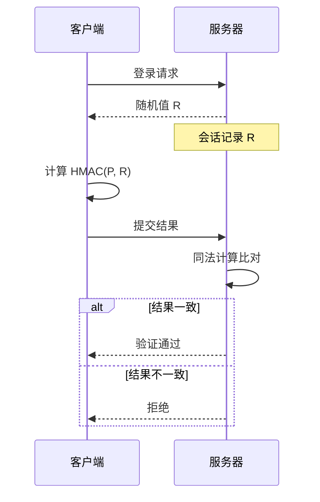

# 基于口令的身份鉴别方案及其改进（引入Hash机制、加Salt机制、OTP一次性口令）

## 基于口令的身份鉴别方案及其改进

### 为什么需要改进

最朴素的口令鉴别是**明文传输**：客户端把口令直接发给服务器比对。这样一旦信道被监听，口令立刻泄露；服务器数据库若被拖库，所有用户口令也全部暴露。围绕"==如何让口令既可用于鉴别，又不以可逆形式出现=="这一核心问题，逐步演化出 Hash 机制、加 Salt 机制与 OTP 三大改进。

### 基础方案：Hash 机制

客户端不传输口令本身，而是传输口令的 Hash 值：

$$h = H(P)$$

服务器端同样只存储 $H(P)$。由于 Hash 函数具有**单向性**，攻击者拿到 $h$ 也无法反推出口令 $P$。

> [!WARNING]
> 单纯 Hash 仍有两个致命弱点：
> - 同一口令必然得到同一 Hash，攻击者可用**预计算字典表**（彩虹表）批量反查；
> - 每次鉴别用的是同一个 $h$，==重放攻击==依然有效：截获一次 $h$ 即可冒充用户。

### 改进一：加 Salt 机制

在 Hash 之前为每个用户引入一个**随机串 Salt**，服务器存储 $(\text{Salt}, H(P \parallel \text{Salt}))$：

$$h = H(P \parallel \text{Salt})$$

| 对比项 | 无 Salt | 加 Salt |
|---|---|---|
| 相同口令的 Hash | 完全相同 | 各不相同 |
| 彩虹表攻击 | 直接有效 | ==完全失效== |
| 服务器存储 | $H(P)$ | $(\text{Salt}, h)$ |

> [!TIP]
> Salt 不需要保密，它的唯一作用是**破坏预计算**——攻击者必须为每个 Salt 单独建表，代价从"一次破解全部"变成"逐个破解"。

### 改进二：OTP 一次性口令

Salt 解决了存储问题，但**重放攻击**仍在：只要 $h$ 不变，截获后重放即可。OTP 的思路是==每次鉴别使用不同的口令==，常见实现有：

- **时间同步型**：$OTP = H(P \parallel T)$，$T$ 为当前时间片；
- **挑战-应答型**：服务器发随机数 $R$，客户端计算 $OTP = H(P \parallel R)$，每次 $R$ 不同，OTP 只用一次。

### 典型应用：HMAC 挑战-应答鉴别

HMAC 是带密钥的 Hash，公式为：

$$HMAC(K, M) = H(K \oplus opad \parallel H(K \oplus ipad \parallel M))$$

其中 $K$ 为认证密钥（口令），$M$ 为消息，$opad$、$ipad$ 为固定填充串。

**算例**：设 $P = \text{njupt123}$，服务器生成 $R = \text{a8f3}$。客户端计算 $HMAC(\text{njupt123}, \text{a8f3})$ 并提交；服务器用数据库中同一口令与 $R$ 做相同运算，若两次结果一致则鉴别通过。

> [!IMPORTANT]
> 攻击者即使截获了 $R$ 和 $HMAC$ 结果，也无法反推出 $P$（Hash 单向性），更无法用截获值重放（每次 $R$ 不同）。==随机值使 HMAC 仅在当前会话有效==，这是 OTP 思想的直接体现。

### 三种改进的关系

| 机制 | 解决的问题 | 未解决的问题 |
|---|---|---|
| Hash | 口令明文存储/传输 | 彩虹表、重放 |
| + Salt | 彩虹表攻击 | 重放 |
| OTP / HMAC | 重放攻击 | —— |

三者层层递进：==Hash 保单向性，Salt 破预计算，OTP 防重放==，共同构成实用的口令鉴别体系。
