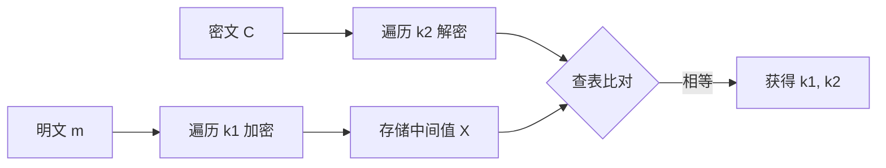

# 二重DES与三重DES(3DES)的原理与安全性

---
requires: [密码学/DES算法]
---

如果直接使用 DES 加密，56 位密钥在 $2^{56}$（约 72057594037927936）个可能值中虽已庞大，但随着算力提升，穷举攻击已成为现实威胁。如何在不推翻现有体系的前提下提升安全性？最直观的想法是：==多加密几次，多用几个密钥==。

## 二重 DES 与中途相遇攻击

二重 DES 使用两个独立的 56 位密钥 $k_1$ 和 $k_2$，对明文 $m$ 连续加密两次：

$$C = \text{DES}_{k_2}(\text{DES}_{k_1}(m))$$

直觉上，两个 56 位密钥组合似乎让有效密钥长度翻倍到了 112 位，穷举需要 $2^{112}$ 次运算。但事实真的如此吗？

攻击者若已知一对明密文 $(m, C)$，由加密过程可知 $\text{DES}_{k_1}(m) = \text{DES}_{k_2}^{-1}(C)$。利用这个等式，可以发动**中途相遇攻击**：

> [!CAUTION]
> 二重 DES 并不能将密钥长度提高到 112 比特！通过中途相遇攻击，只需分别进行 $2^{56}$ 次加密和 $2^{56}$ 次解密并查表匹配，其安全强度仅相当于 ==57 比特==，无法抵抗该攻击。

## 三重 DES (3DES) 的原理

既然双重加密被“中间截胡”，那就再加一层。3DES 采用三个 56 位密钥（$k_1, k_2, k_3$），执行“加密—解密—加密”（EDE）流程：

$$C = \text{DES}_{k_3}(\text{DES}_{k_2}^{-1}(\text{DES}_{k_1}(m)))$$

为什么中间一步要用**解密**而不是加密？这是为了向下兼容：当令 $k_1 = k_2 = k_3$ 时，前两步互相抵消，3DES 就退化成了单重 DES，极大降低了旧系统升级的成本。

> [!IMPORTANT]
> 3DES 的有效密钥长度为 $56 \times 3 = 168$ 位（或双密钥模式下为 112 位）。它克服了单重 DES 面临的穷举攻击，同时增强了抗差分分析和线性分析的能力。

## 核心对比与常见陷阱

| 比较维度 | 单重 DES | 二重 DES | 三重 DES (3DES) |
| :--- | :--- | :--- | :--- |
| **密钥数量** | 1 个 | 2 个独立密钥 | 3 个（或 2 个） |
| **标称密钥长** | 56 位 | 112 位 | 168 位 |
| **实际安全强度** | 56 位 | 约 57 位 | 112 位或 168 位 |
| **处理速度** | 快 | 较慢 | 慢 |
| **分组长度** | 64 位 | 64 位 | 64 位 |

> [!WARNING]
> 3DES 虽然密钥变长了，但==明文分组长度没变==（依然是 64 位），与密钥长度的增长不匹配，且处理速度较慢。

### 考试真题演练

**判断题**：三重 DES 的有效密钥长度为 128 位。（ ）

**解析**：错误。每个 DES 密钥有效长度为 56 位，3DES 使用三个密钥，因此有效密钥长度为 $56 \times 3 = 168$ 位。切勿与现代分组密码（如 AES）常用的 128 位密钥长度相混淆。

**填空题**：尽管双重 DES 不等价于使用一个 56 位密钥的单重 DES，但有一种被称为____的破译方法会对它构成威胁。

**答案**：中途相遇攻击。该方法通过成倍减少要解密的加密文本搜索空间，使二重 DES 的安全性大打折扣。
