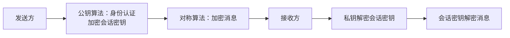

# 根据密钥特性对密码体制的分类（对称密码与非对称密码）

## 是什么：按密钥特性分类

密码体制按==密钥特性==可分为两类：

- **对称密码**：加密密钥 $K_e$ 与解密密钥 $K_d$ 相同（或已知一个可推出另一个），即 $K_e = K_d = K$。典型代表：DES、AES（分组密码），RC4（序列/流密码）。
- **非对称密码（公钥密码）**：加密密钥与解密密钥不同，且由加密密钥无法推出解密密钥。加密密钥可公开（公钥 $PK$），解密密钥保密（私钥 $SK$）。典型代表：RSA、椭圆曲线密码。

> [!IMPORTANT]
> 对称密码其实就**一个密钥**，因此该密钥的==秘密性、真实性、完整性都必须保护==；公钥密码中，公钥的公开不危及安全性。

## 为什么需要：对称密码的缺陷

对称密码计算快、适合加密大量数据，但存在三大问题：

| 缺陷 | 问题描述 |
|------|---------|
| 密钥分配 | 通信双方如何安全地事先共享同一密钥？ |
| 密钥管理 | $n$ 个用户两两通信需 $\frac{n(n-1)}{2}$ 个密钥，管理困难 |
| 数字签名 | 无法提供不可否认性（双方共享同一密钥，无法证明消息来源） |

公钥密码正是为解决这些问题而提出：公钥可公开传播，无需安全信道分配；签名用私钥、验证用公钥，实现不可否认性。

## 怎么做：混合密码系统

实际应用通常结合两者优势：

- 公钥密码：身份认证 + 加密会话密钥（解决密钥分配）
- 对称密码：高效加密消息（提供机密性）

## 与相近概念的区别

| 维度 | 对称密码 | 非对称密码 |
|------|---------|-----------|
| 密钥 | 一个密钥，双方共享 | 公钥公开，私钥保密 |
| 速度 | 快 | 慢 |
| 密钥分配 | 困难 | 公钥可公开传播 |
| 数字签名 | 无法提供 | 可提供 |
| 典型算法 | 分组密码、序列密码 | RSA、椭圆曲线密码 |

> [!NOTE]
> 数字签名属于非对称密码体制，消息认证码（MAC）属于对称密码体制。MAC 处理速度比数字签名快得多，但无法实现不可否认性。

## 常见的坑

> [!WARNING]
> - **流密码 ≠ 非对称**：流密码（序列密码）和分组密码都属于对称密码算法；公钥密码算法和数字签名算法才属于非对称密码算法。
> - **椭圆曲线密码**：利用有限域 $GF(2^n)$ 上椭圆曲线点集构成的群上的离散对数问题，构造的是==公钥/非对称密码体制==。
> - **Caesar 密码**：属于单表代换密码（字母平移），是对称密码的古典形式，不要误判为公钥密码。

## 算例：混合加密中的密钥使用

设 Alice 要向 Bob 发送机密消息 $m$：

1. **会话密钥协商**：Alice 随机生成对称密钥 $K$（如 AES 密钥）。
2. **公钥加密会话密钥**：用 Bob 的公钥 $PK_{Bob}$ 加密 $K$，得 $C_K = E_{PK_{Bob}}(K)$。
3. **对称加密消息**：用 $K$ 加密消息，得 $C_m = E_K(m)$。
4. **发送**：将 $(C_K, C_m)$ 发给 Bob。
5. **Bob 解密**：先用私钥 $SK_{Bob}$ 恢复 $K = D_{SK_{Bob}}(C_K)$，再用 $K$ 恢复 $m = D_K(C_m)$。

> [!TIP]
> 记忆口诀：**"公钥管钥匙，对称管数据"**——公钥密码解决密钥分配与认证，对称密码高效保证机密性。
