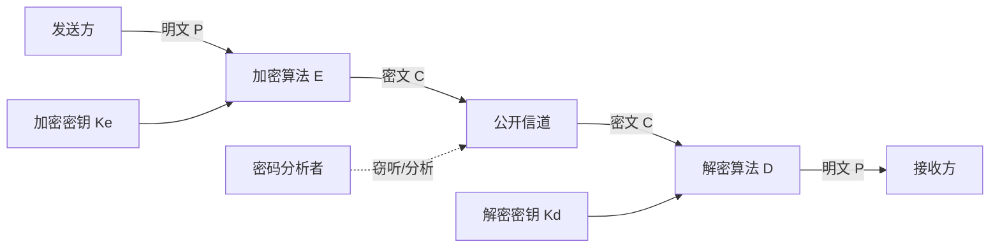

# 加密系统模型与密码体制的要素（明文空间、密文空间、密钥空间等）

## 加密系统模型

我们先从一个问题开始：如果要把一条消息安全地送给对方，你至少需要约定什么？

至少需要两点：一个**变换规则**，以及控制这个变换的**秘密参数**。这就自然引出了加密系统的核心模型。

这个模型刻画了一个基本事实：==加密和解密都是在密钥控制下进行的==。算法可以公开，安全性完全依赖于密钥的保密。

## 密码体制的五个要素

一个密码体制 $\mathcal{C}$ 的完整定义如下：

### 五元组 $(\mathcal{P}, \mathcal{C}, \mathcal{K}, \mathcal{E}, \mathcal{D})$

| 要素 | 记号 | 含义 | 举例（凯撒密码） |
| :--- | :--- | :--- | :--- |
| **明文空间** | $\mathcal{P}$ | 所有可能明文的有限集 | 26 个大写字母 |
| **密文空间** | $\mathcal{C}$ | 所有可能密文的有限集 | 26 个大写字母 |
| **密钥空间** | $\mathcal{K}$ | 所有可能密钥的有限集 | 1 到 25 的整数 |
| **加密算法** | $\mathcal{E}$ | $E_k(P) = C$ 的映射族 | 字母向后移动 $k$ 位 |
| **解密算法** | $\mathcal{D}$ | $D_k(C) = P$ 的映射族 | 字母向前移动 $k$ 位 |

> [!IMPORTANT]
> 对任意密钥 $k \in \mathcal{K}$，必须满足 **$D_k(E_k(P)) = P$**。这是解密正确性的基本要求。

### 密码学的两个方向

- **密码编码学**：设计安全的加密算法，保护信息。
- **密码分析学**：在不知道密钥的情况下，从密文推断明文或密钥。

两者相互对抗又相互促进。

## 一个必须警惕的概念：对合密码

有些资料会提到“对合密码”，指满足 $f(f(x, k), k) = x$ 的加密函数，即加密函数自身就是解密函数。

> [!WARNING]
> **对合密码并不是对所有密钥都成立。** 正确结论是：==对合密码要求“对每个密钥取值”都有该性质==，否则不能称为对合密码。例如 DES 就不是对合密码，因为用同一密钥加密两次并不恢复明文。

这个考点频繁以判断题出现，务必记住这一点。

## 常见误区辨析

| 误区 | 纠正 |
| :--- | :--- |
| “加密和解密都是在计算机控制下进行的” | 是在 **密钥** 控制下，而非计算机 |
| “Feistel 网络加密比解密复杂” | ==加密与解密过程算法复杂度一样高==，只是子密钥使用顺序相反 |
| “三重 DES 密钥长度 64 位” | 有效密钥为 $56 \times 3 = 168$ 位，64 位包含了奇偶校验位 |

## 一个算对了的例子

假设我们设计一个简单的仿射密码：加密函数 $E_{a,b}(x) = (a \cdot x + b) \bmod 26$。

- $\mathcal{P} = \mathcal{C} = \{0, 1, \dots, 25\}$
- $\mathcal{K} = \{(a,b) \mid \gcd(a,26) = 1, 0 \le b \le 25\}$

给定密钥 $k = (5, 8)$，明文 $P = 2$（对应字母 C）：
$$
C = E_{(5,8)}(2) = (5 \times 2 + 8) \bmod 26 = 18 \quad \text{（对应字母 S）}
$$

解密时，先求 $a$ 在模 26 下的乘法逆元。由于 $5 \times 21 = 105 \equiv 1 \pmod{26}$，逆元 $a^{-1} = 21$：
$$
P = D_{(5,8)}(18) = 21 \times (18 - 8) \bmod 26 = 210 \bmod 26 = 2 \quad \checkmark
$$

密钥空间大小：$\varphi(26) \times 26 = 12 \times 26 = 312$ 种可能的密钥组合。这个空间很小，不能抵抗穷举攻击——这也说明了为什么现代密码要求密钥空间足够大。
