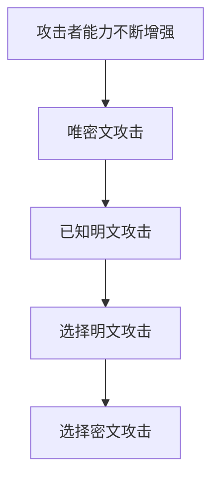

# 密码分析学概念及密码攻击类型（唯密文攻击、已知明文攻击、选择明文攻击、选择密文攻击）

## 密码分析学与基本攻击类型

密码分析学是密码学的另一面——如果说密码编码学负责“造锁”，密码分析学则研究如何在**没有密钥**的情况下“开锁”。

> [!IMPORTANT]
> 密码分析学的核心任务：在不知道解密密钥和算法的条件下，分析密文或密码系统，试图恢复明文或密钥。

### 攻击者能力模型

密码分析中，我们根据攻击者掌握信息的多少，定义了四种基本的攻击类型。这些类型构成了一个**由弱到强**的层次：攻击者掌握的信息越多，攻击越容易成功。

| 攻击类型 | 攻击者已知信息 | 攻击难度 |
| :--- | :--- | :--- |
| 唯密文攻击 | 仅拥有密文 $C$ | 最难 |
| 已知明文攻击 | 若干明文-密文对 $(P, C)$ | 中等 |
| 选择明文攻击 | 可任意选明文 $P$，获得对应密文 $C$ | 较易 |
| 选择密文攻击 | 可任意选密文 $C$，获得对应明文 $P$ | 最易 |

### 四种攻击类型详解

**唯密文攻击**
攻击者手里只有截获的密文，没有任何其他信息。这是最朴素、也最困难的攻击场景。比如通过统计密文中字符的频率来推测明文（针对古典密码）。

**已知明文攻击**
攻击者掌握了一些明文和它们对应的密文组合。这类信息可能来自已知的消息格式（如邮件开头的`FROM:`）、被泄露的文件等。课上提到的“中途相遇攻击”正是利用已知明文对双重 DES 进行破译，能将需要解密的文本量==成倍减少==。

**选择明文攻击**
攻击者获得了可以**主动选择任意明文**并得到其密文的能力。这在听起来离谱，但在现实中完全可能：比如攻击者往受害者要加密的邮件系统里发一封全网可见的公开信，他就同时拥有了该信的明文和密文。
- **一个要记住的结论**：==公钥密码算法对选择明文攻击是天生脆弱的==，因为公钥是公开的，攻击者可以随时用公钥加密任意明文来产生“明文-密文对”。

**选择密文攻击**
这是能力最强的攻击类型。攻击者不仅能选择明文加密，还能**选择密文解密**（但不知道密钥）。条件最为苛刻，但也最有威胁。比如攻击者获得临时访问一台解密机的机会，他可以输入大量伪造的密文，并记录其解密结果。

> [!WARNING]
> 选择密文攻击不是独立的，可以理解为“选择明文攻击”与反向解密能力的**组合**。它对许多高级密码方案构成根本性威胁。

### 攻击者的目标

除了“恢复密钥”这个终极目标，密码分析学还关注一个更现实的目标——**区分性**。
给定一个密文，攻击者只需要以高于 $50\%$ 的概率判断出它是某明文加密的结果，还是随机噪声，就算成功攻破了该算法的不可区分性。这比直接恢复密钥更容易，但同样是严重的安全漏洞。

### 常见误区辨析

- **“密码分析学就是破解密文”**：不准确。它的范围更广，还包括分析密码协议、发现系统弱点、进行伪造等。伪造破坏的是信息的**真实性**，而非可控性。
- **“选择明文攻击不切实际”**：恰恰相反，在很多系统中它很容易实现，是评估密码强度的基本指标之一。一个安全的现代密码必须能抵抗选择明文攻击。
